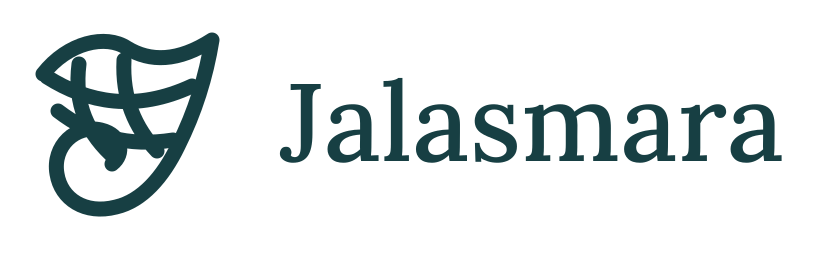

<p align="center"></p>

# Jalasmara · Menjaring Ingatan

Petualangan 2D pixel art di Kota Apung Bandar Hujung dan Palung Smara. Nala berenang, menjelajahi reruntuhan, menemukan pengetahuan, dan membantu warga melalui Kedai Waras. Pembelajaran hadir dari lingkungan, penemuan, dan tantangan kontekstual.

Dibangun dengan **Godot 4.7.2** untuk permainan, **React + Vite** untuk akun dan panel admin, **Fastify** untuk API, **MongoDB** untuk progres, dan **Redis** untuk sesi. Ekspor browser memakai renderer Compatibility dan single thread.

- Staging: https://staging-jalasmara.ardianryan.com
- Sumber dan CI: [GitLab](https://gitlab.com/ardianryan/jalasmara-the-game)
- Mirror sumber dan laporan: [GitHub](https://github.com/ardianryan/Jalasmara-The-Game)
- [Laporan CI GitLab yang dikirim ke GitHub](https://github.com/ardianryan/Jalasmara-The-Game/tree/ci-reports)

Lihat [status pengembangan dan bukti pengujian](docs/development-status.md). Versi ini masih prototipe; pemolesan visual, uji bermain manusia, dan pengujian HP fisik belum selesai.

## Menjalankan lokal

Prasyarat: Node.js 22.12+, npm, Docker Compose v2, Godot 4.7.2 dan template ekspor Web single-threaded. MongoDB harus berjalan sebagai replica set agar transaksi dan audit konsisten.

```sh
npm ci
cp .env.example .env
docker compose -f compose.dev.yml up -d
npm run seed
npm run owner
npm run build:game
npm run dev
```

Buka `http://localhost:5173`. Perintah `owner` meminta email, nama, dan password melalui terminal; tidak ada kredensial bawaan. Akun pemain diaktifkan melalui undangan owner.

```sh
npm run typecheck
npm test
npm run build
```

Jika Godot tidak ada di PATH, isi `GODOT_BIN` dengan path executable. Hasil ekspor di `apps/web/public/game/` diabaikan Git dan dibuat kembali saat build. Untuk pengujian integrasi, gunakan database lokal khusus melalui `TEST_MONGO_URL` dan `TEST_REDIS_URL`; jangan arahkan tes ke database produksi.

## Isi proyek

| Bagian | Fungsi |
| --- | --- |
| `client-godot/` | Dunia permainan, karakter, gerakan, eksplorasi, dan HUD |
| `apps/web/` | Akun, undangan, pengaturan, serta panel admin |
| `apps/api/` | Validasi permainan, autentikasi, ekonomi, dan audit |
| `packages/shared/` | Kontrak data, konten awal, dan definisi wilayah |
| `assets/brand/` | Kit identitas Jala Muara |
| `ci/` | Build Godot, CodeQL, dan pengiriman laporan |

## Akun dan pengelolaan

Login lokal adalah jalur utama. Owner dapat mengundang pemain, menerbitkan reset password, dan menetapkan admin. Admin dapat mengelola konten serta mengubah koin, fragmen, kemampuan, dan progres dengan alasan yang tercatat. Perubahan pemain membatalkan sesi permainan lama agar hasil sebelumnya tidak menimpa perubahan.

OIDC opsional melalui ZITADEL. Pemain menautkan identitas eksternal dari akun lokal setelah autentikasi ulang. Identitas yang belum ditautkan tidak membuat akun baru; kesamaan email tidak menggabungkan akun otomatis.

## Dokumentasi

- [Referensi teknis dan status integrasi](docs/reference-integrations.md): Polyfork, Strata, Procedural Pixel Creatures, img2threejs, SpriteCook, Ark Pixel Font, dan Pixelbolt.
- [Operasi dan deployment](docs/operations.md), termasuk upstream reverse proxy **10.1.0.8:3000**.
- [Kontrak API](docs/api.md).
- [Identitas merek](docs/brand/identity.md) dan [arah budaya](docs/brand/cultural-direction.md).
- [Asal aset](docs/assets/provenance.md), [kontribusi](CONTRIBUTING.md), dan [pelaporan keamanan](SECURITY.md).

CI dijalankan di GitLab; GitHub Actions dinonaktifkan. JUnit, audit dependensi, dan CodeQL SARIF diterbitkan sebagai artefak GitLab dan disalin ke branch `ci-reports` GitHub. Pengiriman memakai deploy key khusus repository, bukan token pribadi pengguna.

Referensi Dave the Diver digunakan sebagai moodboard privat, bukan aset distribusi. Direktori `moodboard/` dan `references/private/` diabaikan Git. Aset permainan dan materi budaya harus mengikuti provenance dan peninjauan budaya. Belum ada lisensi sumber terbuka yang ditetapkan pemilik; publikasi repository tidak memberikan izin penggunaan ulang otomatis.
