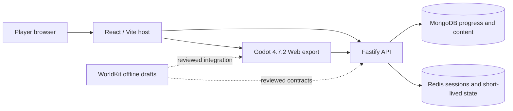

# Architecture at a glance

Jalasmara is a browser-hosted Godot game with an authoritative API. The Web host handles accounts and administration; it does not replace the Godot runtime. Offline authoring tools produce review candidates rather than live world changes.

## Boundaries

- **Game rendering and interaction:** Godot Compatibility renders real 3D land terrain from a left-to-right three-quarter camera, layered water, characters, HUD, and input. Pixel upscale uses nearest-neighbor sampling. Browser exports are single-threaded.
- **Authoritative state:** Fastify validates progress, inventory, economy, time, and admin operations. MongoDB persists long-lived state; Redis coordinates sessions and short-lived activity. The server-owned calendar advances one game day per 36 minutes of active real time.
- **Web host:** React/Vite provides login, account, loading, settings, and admin surfaces. Host-to-game events do not grant rewards or override API decisions.
- **Authoring:** WorldKit, Pixel Snapper, and Image-to-Pixel operate offline. Draft geometry and art previews need visual, collision, save-migration, licensing, and test review before promotion.

## Build and release

GitHub Actions verifies source and creates a hashed delivery bundle. A separate operator step backs up and tests MongoDB restore, verifies bundle and image bytes, activates only the application service, and runs public browser smoke with an isolated fixture. The previous image remains tagged for rollback. Gitea and GitLab mirror Git history without running project CI. See [operations](operations.md), [GitHub workflow](operations-github.md), and the [latest release report](reviews/hud-short-landscape-2026-11-12.md).

## Evidence levels

CPU unit tests, headless Godot, native rendering, browser WebGL, touch emulation, and physical-device measurements answer different questions. Do not use a passing build or still screenshot as proof of natural gait, final art quality, or Samsung/Windows performance. The [PRD](PRD.md) defines acceptance and the [active handoff](agent-handoff.md) records unresolved gates.
