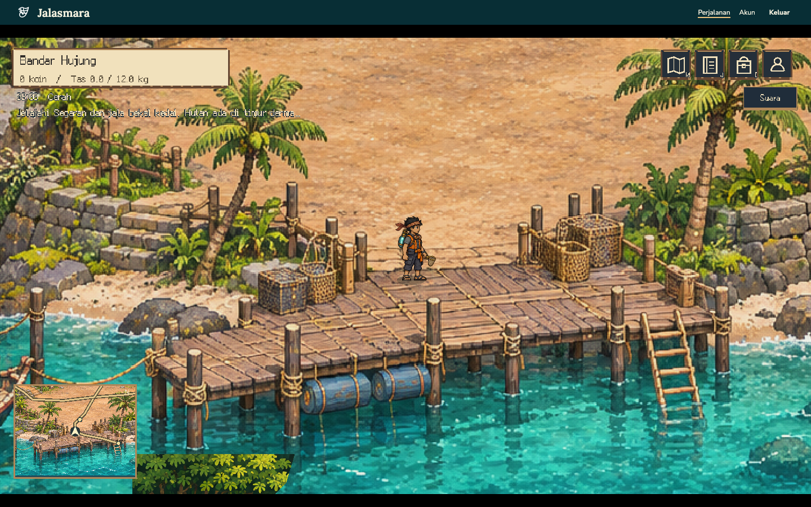
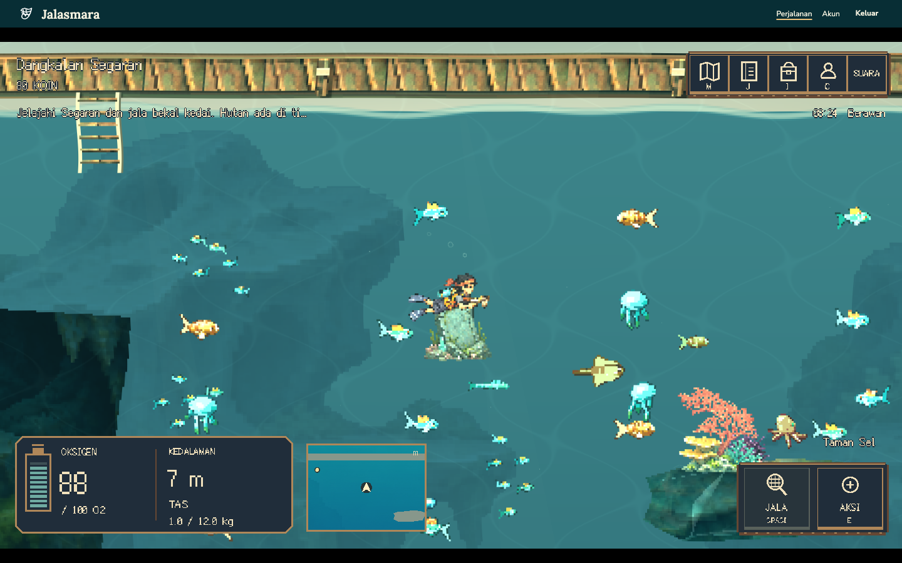
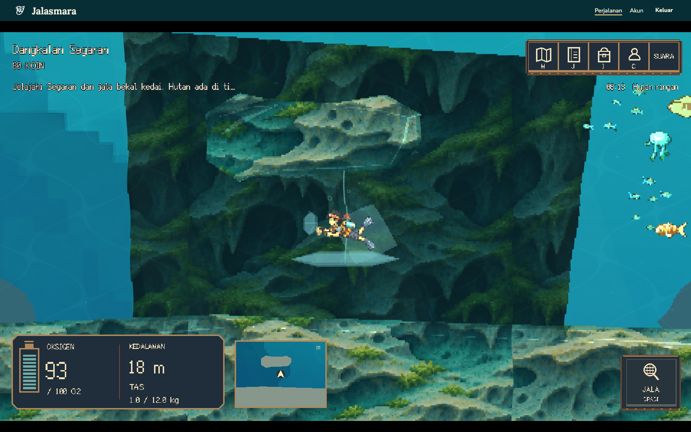
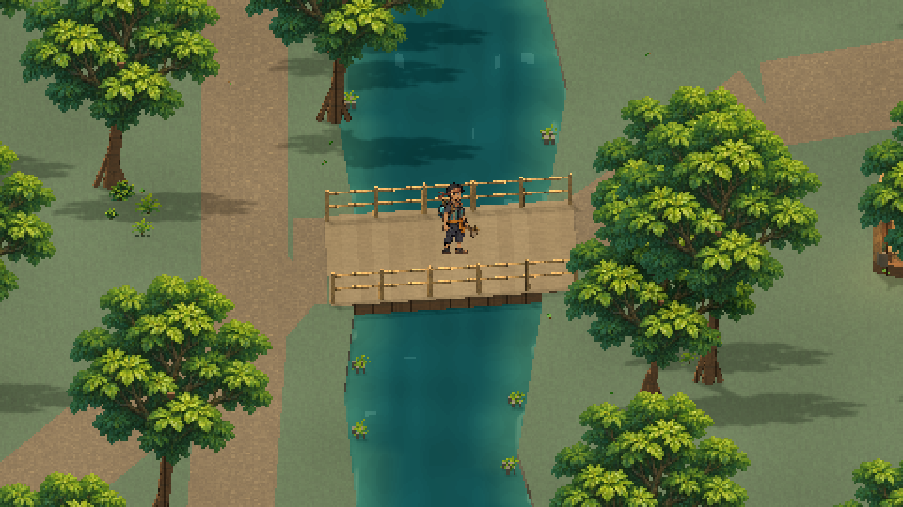
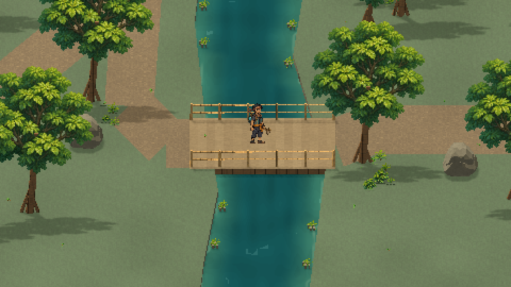
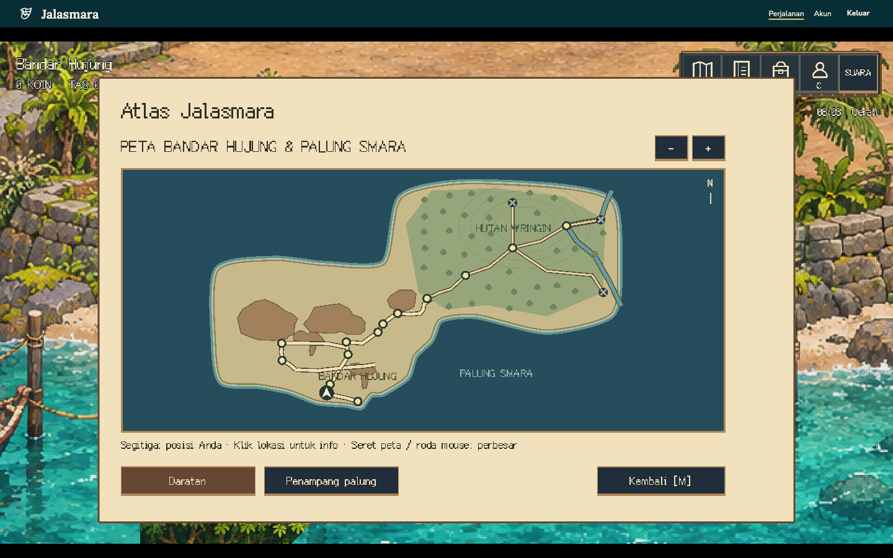
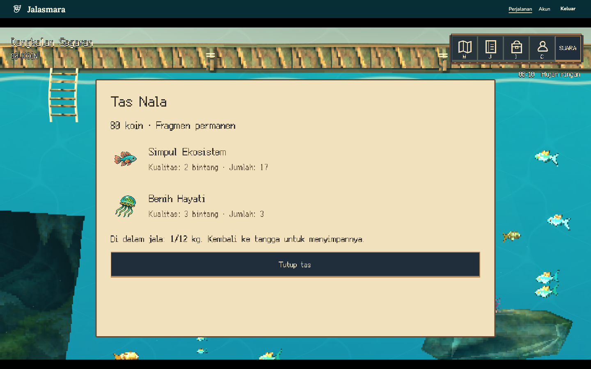

# Status pengembangan

Versi ini adalah prototipe petualangan Godot Fase 1 yang dapat dimainkan melalui browser. Kualitas animasi, peta, dialog, dan kedai masih perlu pemolesan berdasarkan moodboard yang dikerjakan terpisah. Durasi 30–45 menit adalah sasaran desain dan belum divalidasi dengan sesi bermain manusia dari awal sampai tamat.

## Yang sudah berjalan

Pembaruan desa menambahkan enam warga dengan dialog kontekstual dan rute pendek yang diperiksa terhadap lantai serta penghalang; Saras muncul mulai siklus kedua. Pos Raka memakai bangunan kontainer terpisah. Empat identitas pemain memiliki kaus harian, pakaian eksplorasi, dan wetsuit; tabung, jala, serta tas lapangan berupa perlengkapan 3D terpisah. Bilik dermaga mengganti pakaian menurut posisi tanpa mengubah statistik akun. Rincian cakupan dan fitur rumah/kebun yang masih direncanakan ada pada [ekosistem desa](world/village-ecosystem.md).

Grading warna hangat diterapkan hanya pada dunia, sehingga HUD tetap terbaca. Laut mendapat sepuluh penopang batu di bidang belakang yang tersambung ke lapisan bawah atau dasar, tanpa menutup celah renang. HUD memberi peringatan pada oksigen 35% dan 15%; dialog dan soal memakai Nunito, sedangkan judul mempertahankan Ark Pixel. Kuis mempunyai empat pilihan dalam dua kolom dengan shortcut 1–4. Buku interaktif lengkap, emote dialog, dan seluruh mekanik UI pada referensi belum diterapkan.

Pemeriksaan pembaruan ini: 58 pengujian API, typecheck, 17 pemeriksaan dunia Godot, generator 10 spesies/722 bingkai, serta build game/web berhasil. Pemeriksaan native mencakup pakaian, posisi warga, grading siang/malam, indikator oksigen, dan layout kuis. Regresi kuis pada 844×390 dan 667×375 memeriksa teks minimal 16 piksel fisik, tombol jawaban minimal 56 piksel, shortcut 1–4, Tab/Enter, scroll mengikuti fokus, dan jeda gerak pemain. Chromium lokal juga lulus alur dermaga–hutan–kedua jembatan–menyelam–menjala–penemuan–peta, beserta pemeriksaan hybrid dan parallax latar, tanpa error browser. Ini belum menjadi pengukuran FPS pada HP fisik.

Nala berjalan pada peta darat tiga perempat di Bandar Hujung dan hutan pesisir, memilih salah satu dari empat tampilan yang tersimpan di akun, berbicara dengan NPC, berenang dalam dunia 6144 × 3584 dengan tabrakan dan jalur bercabang, menjala biota biasa tanpa kuis, mengamati pengetahuan, memulihkan instalasi, dan membawa fragmen ke Kedai Waras. Tiga siklus membuka kedalaman berikutnya; peningkatan tabung dan jala mempersiapkan pemulihan Gajah Mina. Atlas darat memakai satu garis pantai kontinu, jalur dan footprint bangunan dari koordinat game, sungai, serta kontur bukit; bukan tempelan dua gambar peta persegi. Atlas menampilkan seluruh daerah dan wilayah rencana yang terkunci secara fisik dan melalui server. Jurnal menyimpan penemuan. Karakter dan NPC memakai skala yang diselaraskan dengan peta; HUD memakai palet kayu, krem, tembaga, dan hijau lamun. Jam kosmetik 24 jam visual berputar selama 36 menit nyata; cuaca, angin kanopi, pembiasan air, caustic, percikan, gelembung, dan jejak basah berasal dari engine; dampak cuaca pada hadiah atau ekonomi belum diaktifkan.

Akun lokal, undangan, reset oleh owner, kontrol pemain, editor konten versi, audit transaksi, dan penolakan hasil sesi lama tersedia. OIDC tambahan diuji terhadap issuer lokal tiruan; layanan ZITADEL eksternal belum diaktifkan.

Bandar Hujung dan Wringin sekarang dibangun dari komponen 3D (hub layout 6, hutan layout 5) pada koordinat 2400 × 1600: floor/elevasi, tangga, rumah berfootprint miring, pohon, kebun, batu dan dock dibaca dari manifest yang sama oleh renderer, physics dan API. Kamera ortografis berada pada elevasi pandang 35°. Hub mempunyai coast organik sebagai dasar visual, pelataran luas, 19 pohon fisik dan rumput tepi dekoratif. Hutan menyediakan dua daratan luas, sungai, dua jembatan berpagar bambu serta 43 pohon; pemain dapat berjalan di luar jalur tanah selama masih pada lantai sah. Air dan celah tebing tetap terlarang. Spawn (1120, 1230), titik menyelam (1485, 1330), pintu hutan (2295, 125), dan POI warga dipertahankan. Dua dek dibangun dengan ketebalan, balok bawah dan pagar bambu ber-collider; overlay tanah tidak menutup kayu. Sungai mendapat arus terarah, tepian berlekuk dan vegetasi kecil; bayangan dipendekkan. Pemolesan isi dermaga, tepi jalur dan variasi siluet pohon masih diperlukan agar mendekati suasana nyaman pada referensi.

Sepuluh spesies fauna dihasilkan offline melalui Core Procedural Pixel Creatures pada seed tetap: 722 bingkai animasi dengan metadata arah dan pivot. Godot membaca PNG serta JSON melalui CreatureAnimator; runtime C# tidak disertakan ke web. Gerombolan ikan memakai empat school dengan cohesion/separation, lima perilaku, serta klip idle/locomotion generator; prey menghindari penyelam/predator, predator mengejar secara visual, dan semuanya menghindari kontur batu. Ular dan kura-kura pesisir menghuni hutan. Dua render pakis/bambu dari model Polyfork dipakai sebagai dekorasi kecil. Ark Pixel 12px proportional Latin menjadi font tema game, HUD, dan peta, dengan antialias dan subpixel dinonaktifkan. Kredit MIT, CC BY 4.0, dan OFL disertakan bersama sumber aset.

Pilot laut kini memakai geometri 3D dengan kamera ortografis miring, Sprite3D untuk penyelam dan biota, serta senter yang menghasilkan bayangan pada batu. Kontur bergerigi yang sama dipakai oleh mesh, collider klien, peta, dan validasi posisi server. Daratan memakai renderer modular terpisah; billboard karakter mempertahankan koordinat gerak dua sumbu. Rincian cakupan ada pada [pilot hybrid](world/hybrid-terrain.md).

Traversal teras membaca empat konektor dari metadata yang sejajar dengan peta: satu ramp kayu dan tiga tangga batu. Progres, elevasi teras, serta indeks langkah mengikuti posisi badan; laju naik/turun dan bob kaki kecil memberi petunjuk gerakan tanpa memindahkan badan secara vertikal. Bob berhenti saat diam atau pengurangan gerak aktif. Elevasi traversal menggerakkan kaki/billboard di atas teras 3D tanpa mengubah koordinat otoritatif menjadi gerak bebas ke arah kamera. Rincian dan bukti terukur ada pada [pelapisan darat](world/land-layering.md).

HUD memakai satu instrumen oksigen bersegmen dengan angka besar, kedalaman dan tas. Pada desktop instrumen berada di bawah kiri; pada mode sentuh di atas kiri agar tidak bertabrakan dengan D-pad. Tombol jala dan aksi disatukan, dengan indikator tahan/lepas. Peringatan udara tipis muncul pada 20% atau kurang. Baris tas memisahkan ikon, nama, kualitas, dan jumlah dengan lebar teks yang mengikuti panel. Peta, jurnal, tas, tampilan, dan suara berada dalam satu strip.

## Bukti pemeriksaan

- Pembaruan dunia hidup lulus tiga belas pemeriksaan Godot headless: geometri peta, animasi, fauna, air/occlusion, foley, relief terrain, atmosfer latar, pelapisan darat, air permukaan, traversal teras, validasi jalur, renderer komponen dan jam. Simulasi fauna mencakup 43.500 sampel selama 60 detik dan 7.200 posisi target; terrain memeriksa 15 kontur, 521 teras, dan 4.650 vertex proyeksi. Verifikasi generator mencakup 10 spesies/722 bingkai.
- Uji traversal mencakup 168 sampel naik/turun, elevasi, indeks langkah, diam dan pengurangan gerak. Rebuild modular juga menguji lantai/footprint bersama, rute dengan radius konservatif 13 piksel, prop tambahan, sungai/jembatan dan basis breadcrumb. Perubahan versi biasa mempertahankan posisi sah serta timestamp; audit admin tetap membatalkan posisi lama. Native lokal mengukur proyeksi kaki, komponen rumah, bayangan dan lampu tanah. Harness Chromium memeriksa dua penyeberangan dengan input keyboard, dorongan ke pagar, batas dermaga, dinding rumah, kebun, tangga dan kecocokan posisi server. Lima tangkapan kamera juga diperiksa pikselnya agar metadata renderer tidak dapat menyembunyikan fallback datar. Pemeriksaan lama pada bitmap/per-rock viewport disimpan sebagai arsip terpisah.
- Latar bawah air memakai atlas orisinal enam bentuk pada tiga jarak dengan parallax X/Y, pengurangan saturasi/kontras, dan tint menurut kedalaman/cuaca. Enam pemeriksaan browser latar lulus bersama alur utama; pergerakan kamera sekitar 790 × 276 piksel menghasilkan pergeseran berbeda pada setiap bidang. Ini berlaku pada renderer hybrid laut; hutan dan fallback 2D mempertahankan implementasi masing-masing.
- Pada Chromium, 29 dari 29 makhluk berpindah posisi dalam dua pengamatan berjarak 2,4 detik; empat kawanan dan perilaku idle/feed/swim/flee/hunt aktif. Pemeriksaan browser juga memastikan arus berubah, berkas cahaya terpotong kontur, serta langkah dan audio bawah air aktif. Bukti ini tidak mengukur kualitas suara melalui speaker atau FPS perangkat fisik.
- 54 pengujian backend lulus, termasuk autentikasi, izin, versi konten, hadiah idempoten, eksplorasi, tiga siklus, boss, batas dan migrasi layout hub, serta pengiriman berkas terkompresi melalui HTTP.
- Pilot hybrid diuji melalui browser: mesh dan sprite 3D aktif, kamera ortografis, serta berenang melalui celah gua dengan posisi yang diterima server. Pemeriksaan GPU native juga memeriksa sembilan titik proyeksi pada tiga tingkat zoom. Alur lengkap pilot lulus di Chromium lokal dan HTTPS; Firefox baru terverifikasi merender scene, dengan cold startup melewati 90 detik dan alur lanjut belum lulus. Ini belum merupakan pengukuran FPS perangkat fisik. F6 kini dibatasi pada build debug native karena jalur perbandingan 2D lama menimbulkan warning buffer WebGL; browser release mempertahankan renderer 3D.
- Sepuluh spritesheet procedural lulus pemeriksaan batas dan perubahan piksel; dua proses generasi terpisah menghasilkan PNG/JSON identik. Import Godot dan smoke test scene hutan lulus setelah pemasangan Ark Pixel; pengujian font memastikan cakupan huruf Latin, angka, tanda baca, diakritik, dan panah.
- Setelah perombakan, alur berjalan–menyelam–menjala–penemuan–peta lulus di Firefox; tujuh pemeriksaan peta geografis dan enam pemeriksaan audio lulus di Chromium. Empat tangkapan siang/malam hub dan hutan menunjukkan dunia meredup sementara HUD tetap terbaca, tanpa error browser, shader, atau API. Pengujian audio memeriksa status pemutar, gesture, mute dan reload; kualitas suara melalui speaker tetap memerlukan pendengaran manusia.
- Game diuji di Chromium dan Firefox desktop: berjalan, menyelam, berenang, menjala tanpa kuis, mengamati, dan membuka peta. Tidak ada error browser pada alur tersebut.
- Delapan pemeriksaan hutan lulus di Chromium: pilihan karakter awal, perjalanan melalui gerbang, gerak dua sumbu, penemuan dan hadiah server, jurnal, ganti tampilan, atlas, serta pemulihan posisi setelah refresh.
- Alur yang sama lulus pada HTTPS staging. Cookie produksi memakai prefiks `__Host-`, `Secure`, `HttpOnly`, dan `SameSite=Lax`.
- Emulasi Chromium lanskap menguji input sentuh D-pad, Aksi, dan Jala pada HUD baru, termasuk posisi tombol jala yang berubah sesuai konteks. Angka oksigen rendah, peringatan, dan suara detak juga diperiksa. Ini bukan pengujian perangkat Android/iOS fisik.
- Admin diuji pada Chromium, Firefox, dan WebKit, termasuk perubahan koin, audit, salinan/edit/publikasi konten, serta lebar 1440, 768, dan 390 piksel tanpa overflow dokumen.
- Build Godot Web, web, API, pemeriksaan dependensi, dan CodeQL dijalankan oleh GitLab CI. Status aktual dan laporan berada pada tautan pipeline repository; GitHub Actions nonaktif.

Bukti lokal disimpan di `artifacts/` yang diabaikan Git. Gambar di `docs/screenshots/` adalah tangkapan prototipe Jalasmara, bukan referensi Dave the Diver; beberapa masih berasal dari sebelum rebuild modular terbaru dan belum menjadi bukti tampilan final.

Senter kerucut mengikuti arah gerak penyelam. Lentera dermaga serta hutan mengikuti cahaya sekitar dan awan; dua lampu hutan menghasilkan bayangan sederhana. Rincian implementasi dan batas efek dijelaskan dalam [waktu, cuaca, dan efek lingkungan](world/environment.md).

## Yang memerlukan tindak lanjut

Pada instalasi baru, owner pertama dibuat lewat perintah interaktif pada [panduan operasi](operations.md); tidak ada password bawaan. Akun owner staging yang sudah dibuat dipertahankan saat deployment. Pengujian perangkat HP fisik, uji bermain manusia untuk durasi/keseimbangan, peninjauan budaya oleh manusia, dan pemolesan aset belum dilakukan. Fase 2 hanya pengantar, bukan zona permainan lengkap. SMTP, multiplayer, leaderboard kelas, dan analitik lanjutan belum termasuk.

Integrasi sumber lengkap dicatat pada [referensi dan integrasi](reference-integrations.md). Pembaruan dunia hidup menambah lapisan teras 3D, backing tablet dari jalur img2threejs offline, berkas cahaya yang terhalang kontur, motes/parallax, wake renang, percikan Pixelbolt kontekstual, serta foley langkah/breathing. `npm run check:world` memeriksa perilaku dan geometri melalui Godot, tidak hanya keberadaan aset.
