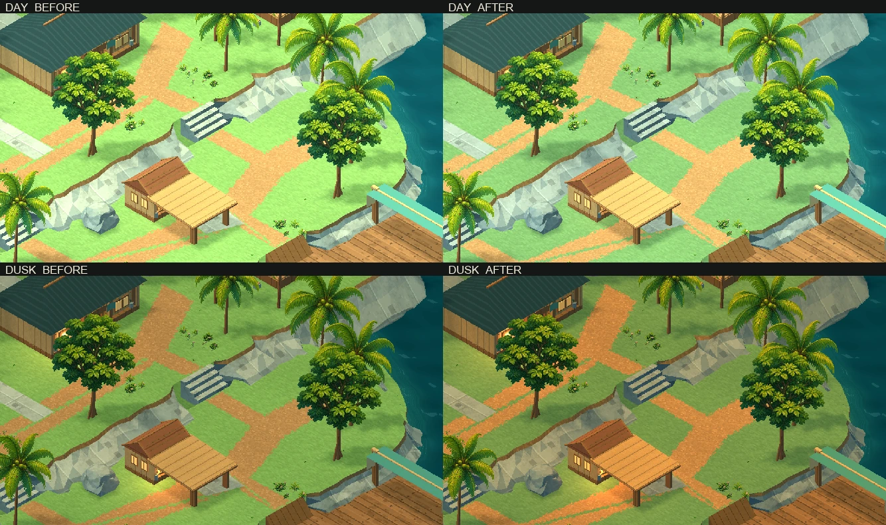

# Land palette at game scale — 15 November 2026

This candidate starts from `main` at `c3575c5` on `work/land-palette-quality`. It addresses two visible mismatches in the existing hub and forest: lime-looking grass and pale stone, while making the already-continuous 17:30 light read as a warm coast sunset. The changes are limited to the existing land material values and one dusk parameter in the existing single-pass land grade. They do not change the authoritative clock, weather, geometry, collision, texture resolution, camera, draw calls or asset inventory. This branch has not been merged, pushed, exported or activated on staging.

Grass changes from `#80A963` to `#709665`; stone from `#AFB9AC` to `#9AA7A2`. The land grade receives the existing smoothed `dusk` value from `LandWorld3D`. It warms lit midtones/highlights while leaving dark pixels mostly cool. The modulation rises and falls with the continuous sunset curve; it does not select a discrete phase or add a render pass. The water remains teal in the inspected frames. These are original project color choices; no reference/moodboard pixels or third-party art were incorporated. Existing project licensing is unchanged.

The contact sheet is a 391,232-byte WebP assembled from original Godot native frames, SHA-256 `b8a7c94facfb3c35dbc66403d78224ab733a829717d0893966e4dfe5614711b8`. Original PNGs and `results.json` remain under `artifacts/godot/land-palette-quality/{before,after}/`. The source PNG SHA-256 values are `6f960a01d92ded73a81f839dc201c67c046023b47bd82f53e03593a9526dc751` and `6bc43e2cb59f01d6cf2f2fb235cb16022b28e50e19e2b3161d48bd2ba47ade9a` for baseline day/dusk, `c3719157a30950e38e12a557e5b69214d64d2c506063fb3893894aa3fa079f89` and `e099bb8811dc358fb8a90e4df0ba03fca94b8395d627a1890fbad36e218a4851` for candidate day/dusk. The WebP is a compressed visual proof, not a replacement for exact PNG comparisons.

The repeatable renderer `scripts/tests/land-palette-quality-render.gd` captures the same hub and forest camera positions at 667×375 and 844×390 at 10:00 and 17:30. All eight baseline and eight candidate frames were inspected at their actual size. The candidate shows less lime grass, more readable gray-green rock, and warmer dusk paths/wood; no visible water clipping or broken silhouette was found. At 667×375, mean absolute RGB difference is 8.51/8.12 levels for hub day/dusk and 10.76/8.09 for forest day/dusk, out of 255. These numbers measure change, not quality or moodboard parity. The forest has no large stone surface, so the stone judgment rests mainly on hub views. The screenshot lacks the player and HUD; it does not prove in-game device color or moving frame pacing.

Godot 4.7.2 Compatibility native render and focused checks passed without `ERROR` or `SCRIPT ERROR`: `land-lighting-palette.gd`, `moodboard-daylight-continuity.gd` (max palette step `0.0017875`, tint step `0.0028067`, both below the existing `0.005` gate), and `moodboard-clock-jump-visual.gd` (shift, rewind, midnight and scene tint). Logs: `.runtime/land-palette-quality-{before,after}.log`, `.runtime/land-palette-{light,continuity,jump}-test.log`. `git diff --check` passed. Full `npm run check:world`, typecheck, test, build, browser GPU/Windows/S23 and integrated multi-lane review remain for the integrator after cherry-pick. One extra grade uniform and a few per-pixel arithmetic operations have not yet been benchmarked on devices; no new texture/sample/pass was added.

Next, compare this lane with the foliage/HUD candidates on the integrated source, run the full checks and actual-size game capture, then use exact CI assets for staging only if the combined result remains good. Do not call this full visual parity with the moodboard: character source detail, terrain edges and underwater art have separate acceptance work.
