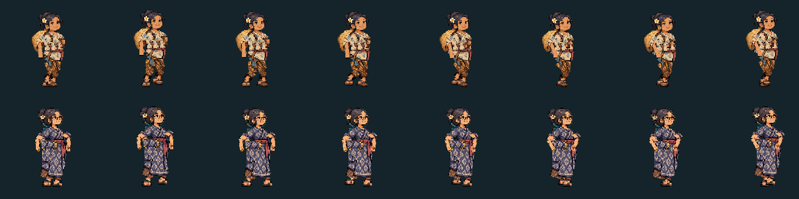
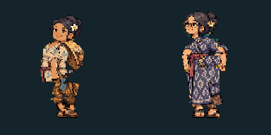

# Legacy resident foot-contact correction — 15 November 2026

## Scope and result

The owner asked whether every resident moves dynamically, avoids backward-looking travel and has intact legs, then requested a correction. This package fixes a concrete production defect in the **Bu Darmi** and **Yu Sari** cutout rigs: their previous knees were estimated from hip/ankle midpoints, each thigh/calf sprite was scaled to fit that estimate, and the whole rig could be mirrored for a side view. Their original source-art parts now use the same real-distance, world-ground foot-contact solver already proven for Mang Ujang. Stride is limited to 82% of each character's shortest measured leg reach. The two source-pixel bone lengths remain fixed, feet alternate on travel and stop on pause, and the body transform remains anatomically positive while turning. When travelling west, only the original head and torso pixels turn horizontally; the physical legs and shoes are not reflected. Ujang retains his previous stride and turn threshold.

This is **not** acceptance of every resident's direction art. Seven older portrait residents still use front three-quarter five-frame strips; their westward mirroring does not supply an authored back view. The director and five children likewise retain one authored upper-body view. A programmatic rear-head palette experiment was inspected as a contact sheet, looked like a rectangular/dithered patch and was discarded before integration. No new character art, generated image or third-party runtime dependency was shipped. Work on the seven alternate views must use reviewed pixel-authored side/rear frames and native playback, not a blind palette transform.

## Source and verification

Candidate branch: `work/npc-facing-foot-20261115`, forked from `main` at `9b062d5`. At the local candidate checkpoint it was not yet merged, pushed or on staging; the release status is recorded below. The change is in `client-godot/scripts/NpcBodyRig3D.gd`; the world runner now includes `scripts/tests/legacy-resident-contact.gd`. The route fixture covers both residents' real work↔home commutes in normal and reduced-motion settings. `village-routine06.gd` also exercises four flat-ground direction turns for all three cutout rigs. The native `npc-body-render.gd` saves eight actual-distance walking frames per pilot and checks contact reach and fixed lengths. The optional `npc-body-sequence.gd` now saves nine selected frames by default and supports `NPC_SEQUENCE_ONLY`/`NPC_SEQUENCE_FULL=1` so a review does not generate hundreds of redundant PNGs.

Verification on Godot 4.7.2 Compatibility (Apple M2) and the local pinned Node toolchain:

| Check | Result and limit |
| --- | --- |
| `npm run check:world` | **77/77 passed**, including 37,418 route steps for 13 residents, 4,172 actual-commute contact samples for Darmi/Sari and 1,242 Ujang regression steps. Logs contain no `SCRIPT ERROR` or `ERROR:`. This verifies geometry and scripted motion, not visual quality on every device. |
| `npm run typecheck` | Passed. |
| `npm test` | **123/123 passed** using isolated temporary MongoDB replica set at 127.0.0.1:27019 and Redis at 127.0.0.1:6381. Both services were stopped; their owned data directory was removed. No owner account or persistent database was used. |
| Native `npc-body-render.gd` | Passed for Ujang, Darmi and Sari. Darmi and Sari changed 1,485 and 1,583 body pixels between work poses; eight walking frames and a west-facing still per person were visually inspected. The Sari dress hides much of the knee/stride in this view. This is an isolated native rig render, not a browser or physical-device capture. |
| Sparse native `npc-body-sequence.gd` | Passed for Yu Sari with `NPC_SEQUENCE_ONLY='Yu Sari'`. This checks the new capture selector and script path; its camera framing is not accepted as a resident visual review. |
| `npm run build` | Passed after the final west-facing change. Local Web PCK SHA-256 `a5f35650ec7cac6e2c4169a3d728023606f466274a9fd47a4b2d6b962dc0c77c`, 72,730,500 bytes. This is a candidate export, not the GitHub CI delivery bundle. |

The original 1,536×384 contact sheet was assembled from the Godot native transparent-stage frame captures, with a documentation-only dark background. PNG SHA-256 `a4b0c2fdba62f1941d5b080f266131789919b56969efc96fb6e3bb0a678be18d`; the 384×192 west pair is `bf34f695d158993ded32fa68c844f53653c8758d5f560aefae61bfb5629bddf0`. Neither is a game texture. The input cutouts remain project-owned `npc-rigs/{darmi,sari}.png` derived from the existing `npc-atlas.png`; the generator and rig remain project code. Pillow was used only to assemble these documentation images. PixelHand, SpookyGhost, Konado and Sprite AI were not used for this package. Their earlier tool-review/license status is unchanged.

The first `check:world` attempt lacked `GODOT_BIN`; a second attempt timed out while the new worktree's Godot import cache was empty. A one-time editor import completed, then the full 77-check run passed. One new test initially used unsupported `Array.reversed()` and was corrected to `reverse()` before the passing run. The optional full-frame native sequence was stopped after an excessive 146 MiB of raw captures because its camera framed other actors on some routes; it is **not** counted as visual proof. A first sparse-sequence invocation used a `res://` path although the fixture is outside the Godot project; the corrected absolute-path invocation passed. The selected isolated contact sheet above is the valid render evidence.

## Delivery and remaining work

At the local candidate checkpoint, the source still required GitHub CI and the exact-manifest staging gate. The release below passed those gates. Physical Windows/Samsung S23 visual review remains open; no FPS or smoothness claim is made for those devices.

### Staging release, 15 November 2026

Commit `7c884a9095b1b498c2198420ed9a406defb615b7` was fast-forwarded to `main` and pushed without force to GitHub, Gitea and GitLab. [Branch CI 43673264761](https://github.com/ardianryan/Jalasmara-The-Game/actions/runs/43673264761) and [main CI 43673883198](https://github.com/ardianryan/Jalasmara-The-Game/actions/runs/43673883198) passed. The branch CI `verified-delivery` manifest declared that exact source and Web PCK SHA-256 `ab6fcffa91b3ee5baca1be0c652e514ceb524f7fa1668ebfadbd53eff197f4f2` (72,730,500 bytes); its context tar SHA-256 was `2aef95e4b4bc009d1b36c1042dbf459c4cf5b49be499bd23e40519b6b0b73744` (127,170,560 bytes). All 14 game assets matched the manifest after transfer to the VPS.

The normal VPS Docker build failed at `npm ci`: its DNS resolver could not reach `registry.npmjs.org` (`EAI_AGAIN`; local log `.runtime/npc-vps-build-failed.log`). The source diff from the previous live commit `85b3612c80b50eb5f16a066318c321d855606074` changes no host/API source, package manifests, lockfile or Dockerfile. For this Godot-only runtime update, a temporary offline Dockerfile therefore used the immutable prior image `sha256:ad8b8ce901ce8d50325b2cd4345163e8100d1f391acaebfbe4c4c51ecb6b0561` as base and copied the 14 verified game assets into `/app/apps/web/dist/game/`. This is an explicit build-method deviation, not a claim that the normal Dockerfile passed. The resulting image `sha256:f547723c020590e6747d2e3e2ade918316cc7f00849b2f45dcf1971c8d2aa36a` was checked inside a network-isolated container: all 14 file names, sizes and SHA-256 hashes matched the CI manifest. The base host/API remains byte-identical to the previously accepted image. Repair VPS outbound DNS before a future full-source image build.

Before the app-only swap, backup `/var/backups/jalasmara/jalasmara-20261115T035413Z.archive.gz` (SHA-256 `b78e686410ff7263731223352ae96289d1ae71e50570654a0999d89f43f36462`) restored all 48 live documents into a separate check database, then removed that database. The old image `ad8b8ce901ce` is tagged `jalasmara:rollback-20261115-before-npc`. The new app container `6af76bef945c` is healthy; MongoDB `7b13e58eb0e6`, Redis `a67512d71c0d` and `.env` SHA-256 `627555330e24f0159d84ca5df860fdebe2c28812cd62edec433635565dd0f68e` did not change. Public `/api/health` returned 200 and the public PCK manifest named the CI hash and size.

The traced Chromium/SwiftShader public smoke result at ignored local path `artifacts/browser/staging-plan06-03a368f4-1741-407c-9c32-7cf901185153/results.json` passed **6/6**: downloaded PCK, login/ready game, physical forest gate/canopy route, touch journal pause, reload with authoritative clock writer, and saved position without reward or story change. It recorded no console errors or failed asset transfers, and cleanup left zero fixture players, receipts, shifts and Redis keys. The [public ready-game screenshot](../visual/legacy-resident-staging-ready-20261115.png) has SHA-256 `a5581c94ca231151bdb483168b9f30b9053e7721993ffe977f6ca5d53d473093`; it proves startup and visible Nala, **not** Darmi/Sari walking in the browser. Native contact sheets remain the resident-motion visual evidence; owner Windows/Samsung S23 review is still required.

After smoke, the three owned VPS transfer/context/overlay directories were removed (127,173,300, 126,971,039 and 122,811,549 file bytes). The failed builder container and superseded `46ccaa9e6402` image were removed; builder prune reclaimed 0 B and image prune reported 95.97 kB. Only current `f547723c0205` and rollback `ad8b8ce901ce` remain tagged. VPS free space was 44,906,721,280 bytes before transfer and 44,989,952,000 bytes after cleanup; health and `.env` hash remained correct. The 127,170,560-byte local context tar was also removed after verification; its manifest and small logs remain in ignored `.runtime/`, with the CI artifact retained by GitHub. No source, database volume, `.env` or backup was deleted.

Next in order: (1) review the native Darmi/Sari gait in normal gameplay and at short landscape size; (2) author side and rear views for the seven portrait residents, preserving each silhouette/props and planting feet through turns; (3) review the director/five children's one-view rigs; (4) capture Darmi/Sari walking in the public browser and obtain physical Windows/S23 visual review. The seven-person direction-art task belongs to `NpcSimpleSteps.gd`, its source atlas/generator and `LandActors3D.gd`, with one owner for that shared renderer. Do not treat the current single-view strips as complete four- or eight-direction art.

The worktree's raw `artifacts/godot/npc-body-rig/` capture directory (149,444 KiB) was removed after curating the image above. Free disk grew from 15,334,296 to 15,500,368 KiB across that cleanup. The temporary isolated database directory used 6,588 KiB and was removed after verified service shutdown. Active staging, its rollback image, VPS data and `.env` were untouched.
