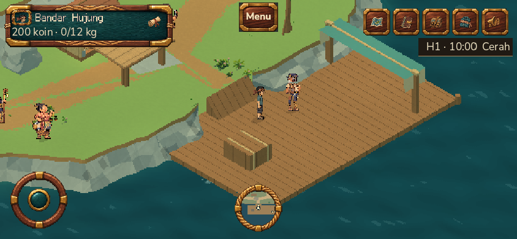

# Main staging release: compressed audio — 11 November 2026

The latest validated `main` build is active at [staging](https://staging-jalasmara.ardianryan.com). This release replaces the runtime audio with the owner's compressed versions while retaining the original masters in the source archive. The Godot Web PCK fell from 86,885,700 to 69,648,468 bytes, a reduction of 17,237,232 bytes (19.8%). No gameplay or world patch from the 20 held work branches was included.

| Identity | Verified value |
| --- | --- |
| Release source and all three remote `main` heads | `f600b62bdbcfdd3cb870ba47679e8fc53d611cee` |
| Declared Godot export source | `00c344c33d26bd745293b9d7a10b33d7e42ac894` (the following commit changes only the Foley test and documentation) |
| Gitea CI | [Run 19, attempt 2](https://git.ppti.me/ardianryan/Jalasmara-The-Game/actions/runs/19): **success** |
| Active image | `jalasmara:current`, `sha256:6679c096d317912a6867f26927f101303c1a0c7b8ed6d86e502e674da6685330` |
| Rollback image | `jalasmara:rollback-before-audio-20261111-f600`, `sha256:10bcbab5484c0943a970f8d83819609138c016b5445c57d704414f7358d44a79` |
| Active PCK | 69,648,468 bytes, SHA-256 `cdbfac713fd72506e8458a9cd4fdfc0983f48f2cd805acdd0c9d61fc4f52106a` |
| Release context | 74,352,640 bytes, SHA-256 `43a61799443384e03af7ea4f03bf8e548bbf9a9d27d20cb073607278ab48a78d` |
| Manifest | SHA-256 `e86fda645d6b9661a3625b687ac4462d930afdf392e2a141dc1a8fbe34bd771d`; retained at `.runtime/release-audio-20261111-f600/manifest.json` and on the VPS |
| Pre-activation backup | `/var/backups/jalasmara/jalasmara-20261111T002957Z.archive.gz`, SHA-256 `64aa8e59f52d291dda6af722edac59d8d13c00722c0feb1868d21e92a875c8a6` |

The manifest's 14 game assets matched the extracted context and built image. The two reused WASM files matched the prior active image byte for byte. Only the app container was recreated. The app became healthy, internal and public `/api/health` returned 200, and its PCK matched the pinned hash. MongoDB container `7b13e58e…`, Redis container `a67512d7…`, and `.env` SHA-256 `627555330e24f0159d84ca5df860fdebe2c28812cd62edec433635565dd0f68e` remained unchanged. Backup restore verification matched 42 documents across the fixture collections with zero failures and removed the check database.

## Verification and limits

Before release, FFmpeg 9.0.2 decoded the changed audio; Godot 4.7.2 export had no `SCRIPT ERROR` or `ERROR:`; `npm run check:world` passed 68/68, `npm test` passed 121/121 against disposable isolated MongoDB/Redis, and typecheck plus Web/API build passed. The [audio validation report](audio-compression-validation-2026-11-11.md) records the local evidence. Gitea run 18 failed after a 60-second runner timeout in `world-foley.gd`. Run 19 attempt 1 also timed out after 60 seconds, this time in `village-routine06.gd`. No script error was printed. The unchanged-source rerun of run 19 on another runner passed the complete CI and delivery workflow. These failures remain recorded; they were not concealed by increasing a timeout.

The public host smoke passed 6/6: HTTPS health and exact downloaded PCK, form login and game READY, clock writer on reload, saved position/story/coins, guest/player Admin chunk isolation, and HTTPS Admin chunk delivery with a mocked owner-role API. Evidence: `artifacts/browser/staging-plan06-cee9cbab-f34d-45b8-a6ef-d18109400b5d/results.json` (ignored local artifact). Two navigations fetched all 67 PCK parts and reached READY/HUD about 14 and 11 seconds after the first trace observation. These are observations on the operator's Chromium browser, not device FPS or a controlled causal benchmark.

The full public gameplay smoke passed **6/6**, with `defaultPublicAccepted: true`, no errors or failures: real login/game READY, physical gate and canopy, touch journal pause/resume, authoritative clock after reload, and position preservation without story or reward change. Its route took 302,630 ms. Evidence: `artifacts/browser/staging-plan06-ac5d299e-e470-4abc-8d6f-01b382707d26/results.json`. Both smokes cleaned up to zero temporary players, receipts, shifts, and Redis keys.

The curated screenshot is original gameplay from the released source/PCK, 844 × 390 Chromium on the operator's Mac, clear day, with a temporary test player. It is 202,978 bytes, SHA-256 `4dc62d67b809e4f05920b7440f7e7ae779c1e396551bf33ca4a30ea6f6dc1f5a`. It is development evidence, not a distributable game asset or third-party moodboard. Visual inspection confirms the dock player has a visible full body.

Listening quality, music rights clearance, natural gait, and physical Samsung S23/Windows performance remain unverified. Browser transfer time alone does not establish an FPS gain or prove that compression alone caused the shorter startup.

## Branch and storage cleanup

`main` is the sole active release branch. An audit with `git cherry main` found **20/20 `work/*` branches still have unique patches**; none was patch-equivalent to `main`. Five linked worktrees also have uncommitted files (`06-gateway-qa`, `06b-house-alignment`, `overnight-character`, `overnight-resident-art`, `overnight-village`). Per the owner's instruction, these unaccepted branches were reported and retained, not archived, merged, or deleted for cosmetic cleanup. Review them individually against the [prior branch inventory](branch-retirement-2026-11-10.md) before any later retirement.

After smoke acceptance, the superseded `b6c8…` image and its two tags, duplicate release tags, generated VPS context and transferred `context.tar` were removed. The manifest and Docker build log remain. Docker builder prune reclaimed 0 B and dangling-image prune reported 266.9 MB; no volume prune ran. VPS free space rose from 42,705,043,456 to 43,937,304,576 bytes (+1,232,261,120 bytes) between the pre/post-cleanup measurements. On the Mac, the verified local `context.tar` (74,352,640 bytes) was removed, and APFS available space rose by 72,612 KiB. The active image, one rollback image, data, `.env`, backup, and source remained intact. Post-cleanup app health, public health, PCK, backup and `.env` hashes were rechecked.

Tools actually used: Git and the project's three-remote push helper, Gitea `tea`/Actions, Godot 4.7.2, Python release packager and SHA-256 checks, Node/npm and Playwright Chromium, OpenSSH, Docker/Compose, FFmpeg 9.0.2 (prior validation), and the project backup/restore scripts. No new engine, image generator, generated art, or third-party asset was used in this release. Audio source and credit remain in [asset provenance](../assets/provenance.md). Next: listen to BGM and jingle transitions on the real build, verify distribution rights, run the owner-assisted S23/Windows device checks, and review held branches separately.
