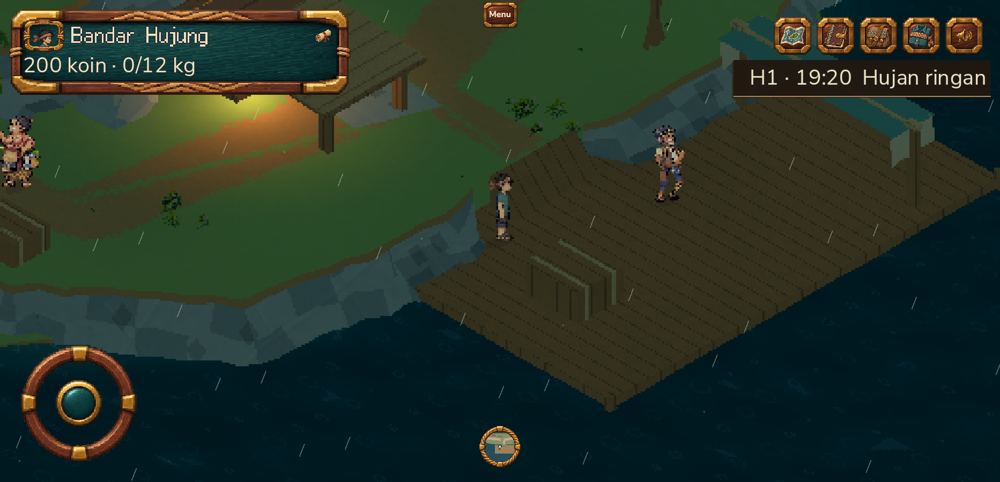

# Dock visibility and staging release — 10 November 2026

The player appeared as a head beside the Bandar Hujung dock crates immediately after loading a saved position. The player was present and moving; the crate's tall 3D mesh covered most of the sprite at that position. The obstacle manifest supplies both rendering and collision, so the fix moves `dock_crates` from `(920, 1190)` to `(940, 1260)` without changing its shape, height, or the character's depth behavior. A saved position at `(1000, 1200)` now shows the full body, while the crate stays on the deck and its recovery path remains connected.

## Release identity and evidence

| Item | Verified value |
| --- | --- |
| Source branch and commit | `main` at `4980d6b172e7524fad8dbef3ea02e3916c4ea3c3` on Gitea, GitHub, and GitLab |
| Gitea CI | [Run 16](https://git.ppti.me/ardianryan/Jalasmara-The-Game/actions/runs/16), success |
| Active image | `jalasmara:current`, `sha256:10bcbab5484c0943a970f8d83819609138c016b5445c57d704414f7358d44a79` |
| Rollback image | `jalasmara:rollback-before-4980d6b-20261110`, `sha256:b6c8eddfd8752ecd62a9c041ea3cd357dae56a8fc085af732f81cdc7bbe9f481` |
| Public game PCK | 86,885,700 bytes, SHA-256 `cb5bd527bca632c66f2d23f7dc1a87758d2e4d057249a28d5efc4a40e3516b27` |
| Release context | 4,270,080 bytes, SHA-256 `50e8d3ae3e5e2f77f69be03f9cd1b2b566d85c054471cc30bd3e07bb62423745`; manifest SHA-256 `7a112435455b49e3eef45bbf47927206698d45f115916dec542cd999e875d4bc` |
| Pre-release backup | `/var/backups/jalasmara/jalasmara-20261110T161448Z.archive.gz`, SHA-256 `2b0305d1834653aad2826c8720965b4cf48d9769c839202c9a5a42fb682cedfa`; restore check: 42 documents, zero failures |

The VPS image was built from the pinned release context and 14 exact-hash game assets reused from the preceding audio candidate. The source change only affects the shared map; the Godot export PCK is the same as the validated audio candidate. The deployed image reports crate coordinates `(940, 1260)` and layout version 11. Only the app service was recreated. MongoDB container `7b13e58e…`, Redis container `a67512d7…`, and `.env` SHA-256 `627555330e24f0159d84ca5df860fdebe2c28812cd62edec433635565dd0f68e` remained unchanged. The app became healthy and its internal and public `/api/health` returned HTTP 200.

This screenshot is original browser gameplay from the deployed source/PCK, Chromium on the operator's Mac at 1865 × 900 with touch emulation, saved fixture `(1000, 1200)`, day 1 around 19:20 and light rain. The curated file is 305,702 bytes, SHA-256 `d6514da09da9a8750b908f28508a76b95baf0524af46101ca907aafceb1934e3`. The local [native candidate image](../visual/dock-player-visible-candidate-20261110.png) is a separate Godot diagnostic, 153,110 bytes, SHA-256 `918101cf459c2a635f0244c612c9b2bd150b0d6c39faf51d6d378ad5383d3789`. Neither image is a distributable game asset or third-party moodboard.

## Validation and failed attempts

The first local move to `(900, 1280)` crossed Mang Ujang's route. His contact test entered repeated script errors; it was terminated, and its 281 MB diagnostic log was deleted. A subsequent move to `(875, 1190)` made Nala visible but left no connected save recovery path: local API testing was 120/121 and Gitea [run 15](https://git.ppti.me/ardianryan/Jalasmara-The-Game/actions/runs/15) failed. Neither candidate was deployed. The final `(940, 1260)` position passed the same recovery assertion and Ujang's 1,242-step legal route.

On the final source, `npm run typecheck`, `npm test` (121/121 using isolated disposable MongoDB and Redis), `npm run check:world` (68/68; ten species and 722 frames), `npm run build`, the geographic-map check, and focused land/village API tests (5/5 and 4/4) passed. Godot logs were checked for `SCRIPT ERROR` and `ERROR`. Gitea run 16 also passed. The isolated test services and SSH tunnel were stopped and removed; no owner account or production database was seeded.

The saved-position public browser smoke downloaded and hashed the full PCK, then passed six host checks: login and real game ready, reload with clock writer, saved position/story/coins, player and guest script isolation, and HTTPS admin chunk delivery with mocked owner-role API. Its proof is `artifacts/browser/staging-plan06-a24396ce-4071-446d-ac00-ed957159c5ca/results.json` (ignored local artifact). The full public gameplay smoke also **passed 6/6**, with `defaultPublicAccepted: true`: physical gate and forest canopy, touch journal pause/resume, authoritative clock after reload, and saved position without a story or reward change. Its route took 461,138 ms; evidence is in `artifacts/browser/staging-plan06-b4bdd284-66b8-43e8-bc69-d80b479a8b4b/`. Both runs recorded no errors or failures and verified cleanup of zero players, receipts, shifts, and Redis keys. These are browser automation results on the operator's Mac, not a physical-device FPS result.

## Storage cleanup and post-cleanup health

After confirming the release and rollback images, no build/import process owned the generated outputs. On the VPS, six generated context directories/tars for the superseded audio candidate, failed crate candidate, and active release were removed; their manifests and Docker build logs remain. Their allocated sizes before deletion were 137,976 + 89,456 + 137,976 + 4,172 + 137,972 + 4,172 KiB. The two unused candidate image tags and older export5 tags were removed; `docker image prune -f` reclaimed a reported 634.9 MB of dangling images. No volume prune ran. VPS free space rose from 41,323,814,912 to 43,968,442,368 bytes (+2,644,627,456 bytes). On the Mac, the three superseded release `context.tar` files were removed while manifests remained; APFS available space rose from 18,565,352 to 18,665,624 KiB (+100,272 KiB). The active image and exactly one verified rollback image remain tagged. After cleanup, the app was still healthy on the same image, public health returned `{"status":"ok"}`, `.env` and the verified backup hashes were unchanged, and MongoDB/Redis containers remained untouched.

## Branches, tool provenance, and remaining work

`main` is the sole active release branch. Twenty `work/*` candidate branches and their worktrees remain because they have unique patches and have **not** been accepted or merged. The user's instruction is to report branches that are not ready, not archive or work through them during this cleanup. No candidate was deleted as a shortcut to a one-branch appearance. See the [branch inventory](branch-retirement-2026-11-10.md) before reviewing them individually. The Claude gait experiment remains outside the release and its pilot remains off.

Tools actually used: Godot 4.7.2 headless/native rendering, Node/npm and TypeScript tests, Playwright Chromium browser smoke, Python release packager and hashing, Gitea `tea` CLI, Git, OpenSSH, Docker Compose, `curl`, MongoDB/Redis disposable test services, and project backup/restore scripts. This package adds no image generator, runtime engine, third-party asset, or dependency. The six new BGM/jingle assets in the released parent commit have [separate source and credit documentation](audio-context-integration-2026-11-10.md); no claim of physical-device audio or performance acceptance is made here.

Next: obtain a visual and performance pass on the owner's Samsung S23 and Windows device; measure the now larger PCK's first-load time, verify BGM listening and rights, and separately review the 20 candidate branches before any merge. Reproduce this specific issue with saved surface position `(1000, 1200)` in the hub at night; Nala must remain fully visible and able to leave the dock. Do not infer completion of natural gait, world art, or physical-device FPS from this screenshot.
