# Jalasmara visual evidence

## Source-pinned local Phase 1 browser replay, 18 November 2026

The [667×375 Gajah Mina intro](phase1-browser-current-20261118/boss-intro-667x375.png) and [ending card](phase1-browser-current-20261118/ending-card-667x375.png) come from local Chromium/SwiftShader replay of source `1249b90118672817f67820162e9086d9f2866d93`, PCK SHA-256 `4425ddabd7fc2da2aa0b3dafe3bbef094ae3fd146b73a2f2d498343f9cca3532` (81,698,736 bytes). The full 12-scene results are in `artifacts/browser/phase-one-journey-4b09ce88-08b6-4e27-8b35-3a0a3591e1b0/results.json`; [review and limits](../reviews/moodboard-parity-pass-2026-11-18.md). These are original project captures, not staging, physical-device or moodboard assets. Their source SHA precedes this documentation commit; runtime files are unchanged by the documentation.

## Local support-stage actor scale, 18 November 2026

The [five children at the capsule refusal](cutscene-support-stage-20261118/refusal-667x375.webp), [Ki Lurah at the Balai](cutscene-support-stage-20261118/balai-667x375.webp), and [Kedai supporting cast](cutscene-support-stage-20261118/feast-667x375.webp) are original 667×375 native Godot captures from the accepted local source; the [844×390 refusal frame](cutscene-support-stage-20261118/refusal-844x390.webp) checks the wider layout. The [support-stage review](../reviews/cutscene-support-stage-parity-2026-11-18.md) records source/test provenance. These are not staging or physical-device evidence. Rejected [reef face](../reviews/reef-rear-volume-diagnostic-2026-11-18.md), [reef foreground](../reviews/reef-foreground-geology-trial-2026-11-18.md), [joined path](../reviews/land-route-composition-trial-2026-11-18.md), and [path material](../reviews/land-route-material-diagnostic-2026-11-18.md) comparisons are retained for diagnosis only.

## Latest candidate: victory dock and valve plume, 18 November 2026

The [revised victory berth and sampan](cutscene-victory-dock-20261118/victory-dialogue-667x375.webp) and its [844×390 counterpart](cutscene-victory-dock-20261118/victory-dialogue-844x390.webp) are native Godot captures from the accepted local source. The [valve-plume baseline](pollution-valve-camera-20261118/baseline-844x390.png), [revised plume](pollution-valve-camera-20261118/candidate-844x390.png), and [cleared state](pollution-valve-camera-20261118/after-victory-667x375.png) are native fixture captures using the production valve atlas. The [landform trial](land-cliff-landform-20261118/after-667x375.png) was rejected; its geometry never entered the runtime. These are development proofs, not staging or physical-device acceptance. See the [parity review](../reviews/moodboard-parity-pass-2026-11-18.md) and individual reports for source, tests, provenance and limitations.

The later [capsule-pitch crowd before](cutscene-capsule-crowd-20261118/before-667x375.webp) and [after](cutscene-capsule-crowd-20261118/after-667x375.webp) show five adults spread apart at game size. The [coast before](shoreline-silhouette-20261118/coast-before-844x390.png) and [after](shoreline-silhouette-20261118/coast-after-844x390.png) show a more irregular upper rock edge; [stair comparison](shoreline-silhouette-20261118/stairs-after-667x375.png) documents that the opening remains visible. These are local native images, not a completed browser/device visual acceptance.

## Moodboard parity review, local candidate, 18 November 2026

| Ki Lurah's harbor lesson | Capsule crowd | Victory dock and ensemble | Griya roof before/after |
| --- | --- | --- | --- |
| 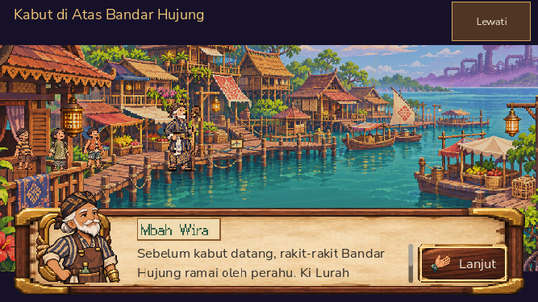 | 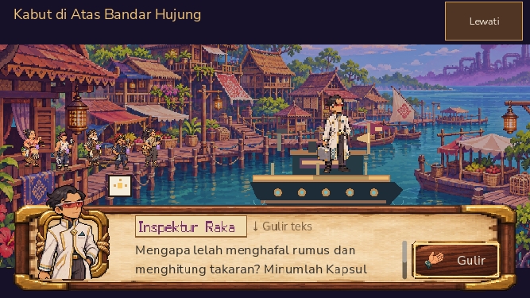 | 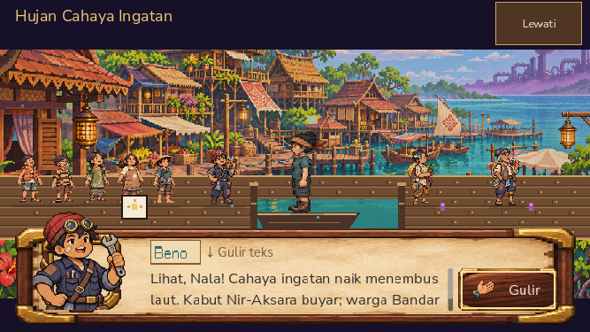 | [See the actual-size land A/B images](land-moodboard-parity-20261118/griya-after-667x375.png) |

These Godot 4.7.2 native frames are original project captures, not reference assets or staging screenshots. The [coastal cliff A/B pair](land-cliff-parity-20261118/coast-after-844x390.png), [subsequent cliff strata A/B](land-cliff-strata-20261118/after-844x390.png), [ocean reef](ocean-parity-2026-11-18/reef-844x390.png) and [open cave mouth](ocean-cave-2026-11-18/passage-open-844x390.png) document the world pass. The [larger Ki Lurah in the garden](cutscene-foreground-20261118/garden-lurah-667x375.png), [Balai council](cutscene-foreground-20261118/balai-council-667x375.png), and [Kedai witnesses](cutscene-feast-foreground-20261118/feast-settled-667x375.png) document the foreground cutscene corrections. The [parity report](../reviews/moodboard-parity-pass-2026-11-18.md) records source commits, hashes, tests and remaining gaps. The work is an incremental candidate; it does not establish full moodboard or physical-device acceptance.

The [larger children in the harbor lesson](cutscene-children-pass5-20261118/prologue-01-667x375.webp), [separated victory ensemble](cutscene-children-pass5-20261118/victory-03-667x375.webp), and [Bagas holding the map-room UV lamp](cutscene-children-pass5-20261118/epilogue-04-667x375.webp) are pass-5 native captures, with 844×390 counterparts in the [cutscene report](../reviews/cutscene-children-pass5-2026-11-18.md). They are source-candidate evidence, not staging or physical-device acceptance.

## Phase 1 close-up staging, 18 November 2026

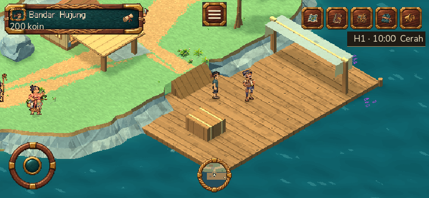

This public Chromium/SwiftShader frame uses source `e424af5`, CI image `588b77bd` and PCK `293d415a`; it came from the successful six-check smoke with zero fixture residue. The [release report](../reviews/phase-one-closeup-staging-2026-11-18.md) records the full hashes and limits. The native cutscene frames immediately below show the corrected supporting cast; this public hub frame alone does not prove their motion or owner acceptance on physical devices.

## Phase 1 supporting cast correction, local native candidate, 18 November 2026

| Nala lands on the dock | Pak Ranto as a framed Kedai cut-in | Laskar at the garden | Residents at the feast |
| --- | --- | --- | --- |
| 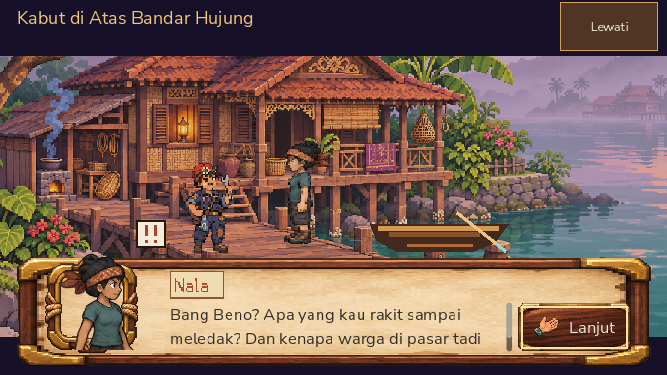 | 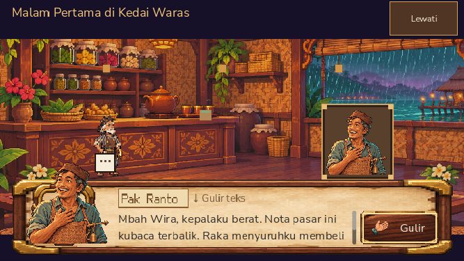 | 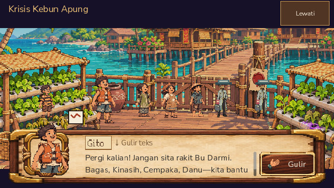 | 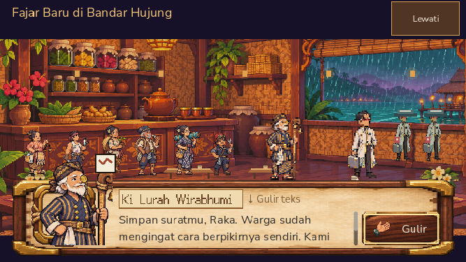 |

These source `76fb375` images are Godot 4.7.2 native captures at the actual 667×375 game viewport. The [correction report](../reviews/phase-one-character-closeup-2026-11-18.md) records the tests, hashes and limits. They are a local visual candidate, not staging, browser, or physical-device acceptance.

## Phase 1 focal staging, native game-size review, 16 November 2026

| Raka arrives | Gito defends the garden | Nala's first dive | Nala at the ending |
| --- | --- | --- | --- |
| 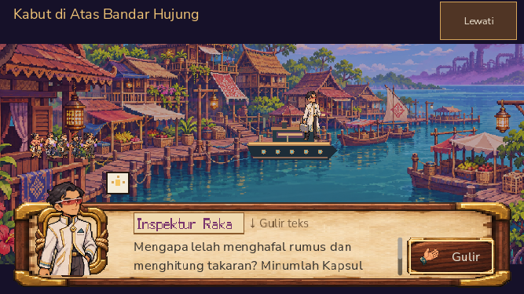 | 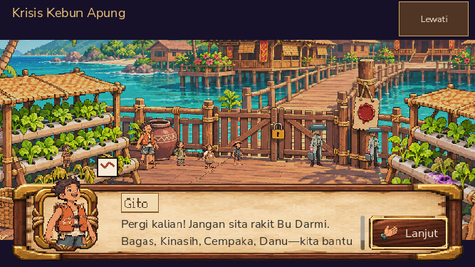 | 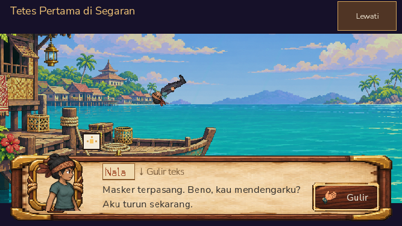 | 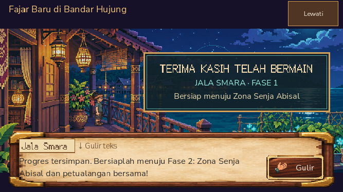 |

These `ecfa97b` screenshots document a **rejected visual scale pass**. Although the figures measured roughly 61–66 opaque pixels and the focused checks passed, the owner found the boat, garden, Balai and Griya residents too small at the actual 667×375 viewport. The dialogue portrait is readable but cannot substitute for acted foreground staging. The [hero-staging report](../reviews/phase-one-hero-staging-2026-11-16.md) retains exact hashes and technical results; a foreground close-up revision is in progress. These native screenshots are development documentation, not accepted art, distributed textures, browser playback or physical-device evidence.

## Phase 1 screenplay, native game-size review, 16 November 2026

| Griya arrival | First dive | Pak Ranto remembers |
| --- | --- | --- |
| 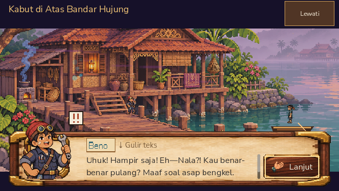 | 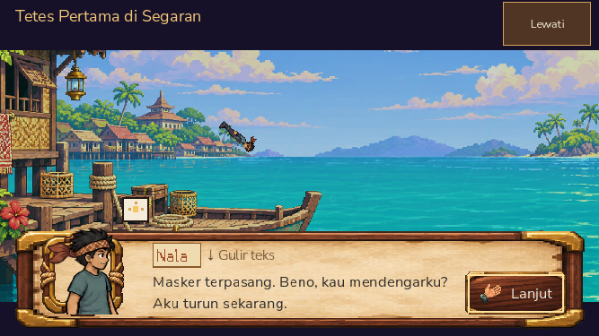 | 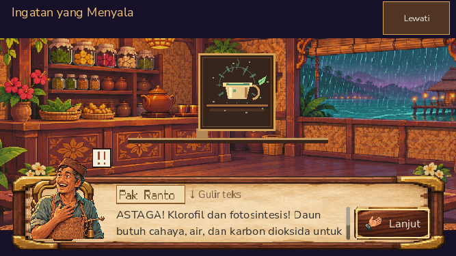 |

The same native Godot 4.7.2 capture includes the [garden confrontation](phase-one-screenplay-20261116/garden-lurah-667x375.png), [Gajah Mina introduction](phase-one-screenplay-20261116/gajah-mina-intro-844x390.png), [restored guardian](phase-one-screenplay-20261116/gajah-mina-restored-844x390.png), [Kedai feast](phase-one-screenplay-20261116/kedai-feast-844x390.png), and [moonlit ending](phase-one-screenplay-20261116/griya-ending-844x390.png). These eight original screenshots come from local game source `cccaffb` with uncommitted fixture-only corrections and cover selected frames of a 94-frame, 12-sequence, 16-scene native capture at 667×375 and 844×390. They are documentation, not distributed assets or evidence of browser/physical-device pacing. Individual hashes and acceptance limits are in the [integration report](../reviews/phase-one-screenplay-integration-2026-11-16.md).

## Coastal-life staging, 16 November 2026

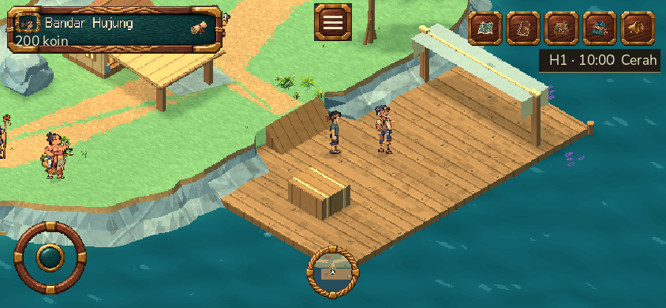

This original game screenshot came from the public Chromium/SwiftShader smoke of source `e17d539ebcbaa298e146badb71bb9f5bab02dc14`, CI PCK `8eed4a6502708d7037b2f683e15d3262315cdc1acc8fc91abedff320fcf16045`, and active image `sha256:e7ae1721cef0c51f9e5659af110ae3e950ec58c122a965f928b6a8302cff0b53`. PNG SHA-256: `a2e46086222cd79fbfb2a9769b3e31c15e89425e360c00b479d7b342bccb0192`. The [release report](../reviews/coastal-life-staging-2026-11-16.md) records the full public route and limits. This still proves game readiness, not coral movement or physical-device GPU quality; it is development documentation, not a runtime asset.

## Reef contacts at gameplay size, 16 November 2026

The accepted [667×375](coral-rock-integration-667x375-20261116.webp) and [844×390](coral-rock-integration-844x390-20261116.webp) native A/B sheets compare coral roots against the same reef shelves in shallow and deep water. The [coral report](../reviews/coral-rock-integration-2026-11-16.md) records 39 of 43 mounted clusters and four unverified edge placements. The [rear-rock composition trial](../reviews/ocean-depth-composition-trial-2026-11-16.md) was rejected after it widened the empty teal lane; its [baseline](ocean-depth-trial-baseline-844x390-20261116.png) and [candidate](ocean-depth-trial-repeat-844x390-20261116.png) remain development evidence only. These captures do not prove browser motion, physical-device performance, or full moodboard parity.

## Pollution rings and ocean depth audit, 16 November 2026

The [surface water](pollution-bubbles/surface-before-667x375.png), [grounded valve before purification](pollution-bubbles/underwater-before-667x375.png), and [same valve after purification](pollution-bubbles/underwater-after-667x375.png) are native 667×375 Godot frames from the accepted pipe-plus-pollution source. The [pollution report](../reviews/pollution-bubbles-2026-11-15.md) records state gates, budget, tests and screenshot hashes. The [844×390 reef baseline](ocean-parallax-audit-baseline-844x390-20261116.png) belongs to a [rejected depth-gradient audit](../reviews/ocean-parallax-coherence-audit-2026-11-16.md); the candidate shader was not committed. These are local development captures, not staging or mobile GPU acceptance.

## Grounded underwater pipe props, 15 November 2026

The [667×375](ocean-pipe-grounding-667x375-20261115.png) and [844×390](ocean-pipe-grounding-844x390-20261115.png) native A/B sheets compare the existing valve and leak sprites before/after placing their bases on reef shelves. The [grounding report](../reviews/ocean-pipe-grounding-2026-11-15.md) records the unchanged server interaction anchors, visual offsets, focused Godot check and PNG hashes. This accepted local source is not yet staging or browser evidence; the original project atlas remains the source art.

## Land wind and future prop authoring, 15 November 2026

The [hub](land-wind-hub-667x375-20261115.webp) and [forest](land-wind-forest-667x375-20261115.webp) side-by-side native captures show still/reduced-motion, eastward wind and westward wind at the actual 667×375 game size. [Coverage review](../reviews/land-wind-coverage-2026-11-15.md) records the Godot checks and the remaining browser/device limits. The [future prop contact sheet](future-world-props-v1-20261115.png) shows 13 original transparent sprites drawn with project code for future corporate power, Saras's field camp and the northern forest state. These props are **not placed in Phase 1**; [asset provenance](../assets/future-world-props-v1.md) distinguishes the source art from gameplay or staging evidence.

## Coastal detail and rooted coral source review, 15 November 2026

The native 667×375 [still](coral-current-still-667x375-20261115.png), [sway phase A](coral-current-sway-a-667x375-20261115.png), and [sway phase B](coral-current-sway-b-667x375-20261115.png) show the same original coral atlas anchored at its visible base. The [source report](../reviews/coral-current-motion-2026-11-15.md) records hashes, focused test, 844×390 captures and measured changed pixels. The [dock before](dock-joints-baseline-844x390-20261115.png) and [after](dock-joints-candidate-844x390-20261115.png) compare subtle staggered board ends in the original dock shader. Matched [forest](moodboard-foliage-forest-ab-20261115.png) and [hub](moodboard-foliage-hub-ab-20261115.png) contact sheets compare the original and alternate project-atlas tree crowns in day and dusk. All three changes are merged into local `main`; these files are development evidence, not staging or physical-device acceptance. The [rejected coastline trial](coastline-authored-landform-rejected-20261115.webp) was never merged into the runtime.

## Smooth daylight, land palette and compact HUD staging, 15 November 2026

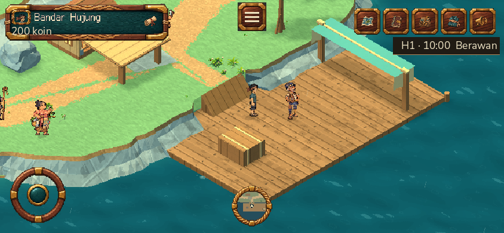

This original public Chromium/SwiftShader screenshot (SHA-256 `1435eb9874dfc59fddff697f3d6aaa066efe5a082714f798ac2e59b86c516949`) uses source `9392ec9`, CI PCK `6e7559d5bb69e6b21f533f6ca7ca0fafe49f6ba84b6290fb7b03e9e31080496b`, and active image `d21269477130`. The [release report](../reviews/moodboard-palette-hud-staging-2026-11-15.md) records 6/6 warmed public smoke. This single frame proves startup/current appearance, not a moving daylight transition or physical-device performance. The [reef A/B contact sheet](reef-pixel-trials-667x375-20261115.png) documents a rejected experiment; no trial coral entered the runtime. These are development documentation, not distributable game assets.

## Land palette and compact HUD candidate, 15 November 2026

The [667×375 land before/after](land-palette-quality-hub-667x375-20261115.webp) shows the same camera at day and dusk with calmer grass/stone and a warmer continuously driven sunset grade. The [667×375 HUD](moodboard-hud-badge-667x375-before-after-20261115.png) and [844×390 HUD](moodboard-hud-badge-844x390-before-after-20261115.png) compare the shorter identity badge and existing 32 px icons. These are native/component proofs from the [integration report](../reviews/moodboard-palette-hud-integration-2026-11-15.md), not staging or physical-device captures. Rejected [foliage sharpening](foliage-source-sharpen-rejected-20261115.png) and [leaf-mass trial](foliage-leaf-masses-rejected-20261115.png) are kept only as development evidence; neither entered the game.

## Continuous daylight staging release, 15 November 2026

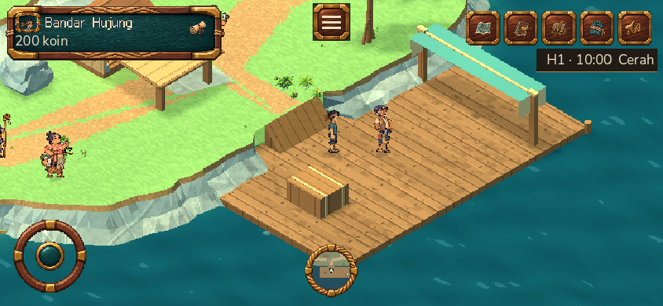

This original public Chromium/SwiftShader screenshot (SHA-256 `97a8f09ca29b698d8015b5e51685a740e93d6e62215dd813411eb9cce320477d`) uses source `d163bc2`, CI PCK `bd6d3364effbfa15901dd97e3e901f6fc2447bb324713a8dad205b27709003f1` and active image `95c66620addb`. The [release report](../reviews/moodboard-continuous-light-staging-2026-11-15.md) records public warmed route 6/6 and the failed cold first load. This single frame documents readiness, not a moving daylight transition or physical-device performance. It is documentation, not a game asset.

## Continuous light and underwater shaft source review, 15 November 2026

The [17:30](moodboard-daylight/land-dusk-1730-667x375.png), [18:30](moodboard-daylight/land-dusk-1830-667x375.png), and [settled night](moodboard-daylight/land-night-667x375.png) Godot 4.7.2 captures document the continuous land-lighting source candidate. The [reef before](ocean-shafts-baseline-667x375-20261115.png) and [reef after](ocean-shafts-candidate-667x375-20261115.png) show the water-plane shaft at actual landscape size. These are native captures from local source, not public staging or physical-device proof. See the [lighting report](../reviews/moodboard-land-shader-continuity-2026-11-15.md), [clock-correction report](../reviews/moodboard-clock-jump-visual-2026-11-15.md), and [ocean report](../reviews/moodboard-ocean-light-2026-11-15.md) for tests, provenance and limits.

## Current moodboard refinement on staging, 15 November 2026

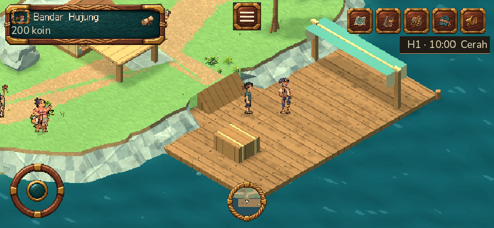

This original Chromium/SwiftShader screenshot (SHA-256 `95b40acbf1a63b771cb21c3c42b16dd3d8815b61eeffbb04cf6a87122ddacb2b`) uses source `0a94d985`, exact CI PCK `9e84afe2fd3a49a370240571416f45b16f354df6557db1885dcbbca2b8f01fb8` and active image `b3edddd8b82f`. The [release report](../reviews/moodboard-staging-2026-11-15.md) records the warmed public 6/6 route and failed cold startup. This screenshot proves hub readiness, not full moodboard parity, underwater quality, or Windows/S23 frame pacing. It is documentation, not a game asset.

## Ocean karst edge on staging, 15 November 2026


This original 1440×810 Godot 4.7.2 Apple M2/Compatibility frame has SHA-256 `fa7a22c0fd7bbab456b94146eaa12e7e2210d2b02be19cb97dde093e363e28b2`. The [release report](../reviews/ocean-backdrop-alpha-edge-2026-11-15.md) compares it with the previous reef capture. It is development evidence, not a distributed game asset, public-browser result or physical-device benchmark.


This Chromium/SwiftShader screenshot (SHA-256 `772cd64e8bdad93fe22a6dab894fe6f02c0a60a1ad3d8053fab72ac80e168e19`) uses source `9ea9fa65`, CI PCK `c7c40eab9ece` and active image `bc2b56d22e35`. It is a public hub ready-game capture after the 6/6 warm-path smoke, not a public underwater capture or Windows/S23 performance evidence. The new-SHA cold load timed out at 38%/120s. It is documentation, not a runtime asset.

## Underwater pixel refinement on staging, 15 November 2026

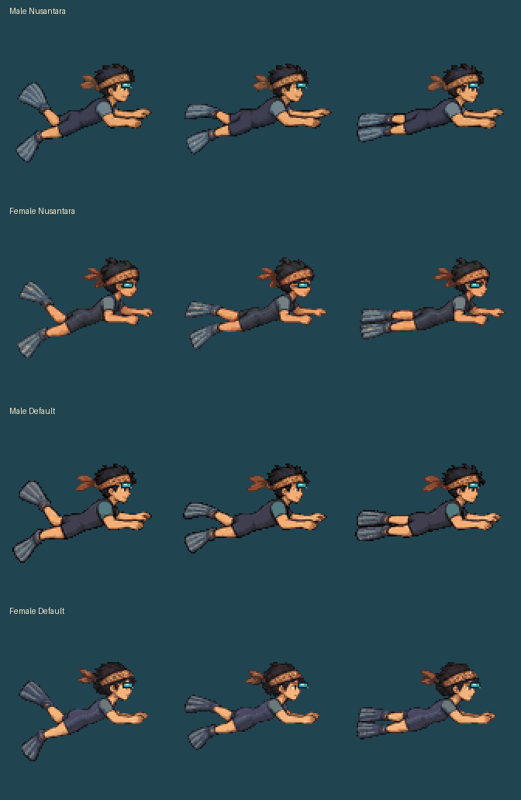

The source-derived 28-color strips have code-drawn visors and clean alpha. PNG SHA-256 `157d96c6caf407881b88f6aa6e3b7765e977c692fcce109d49bd4cff2d5766d1`. This 2× nearest-neighbor sheet is authoring evidence, not a gameplay capture or third-party asset.

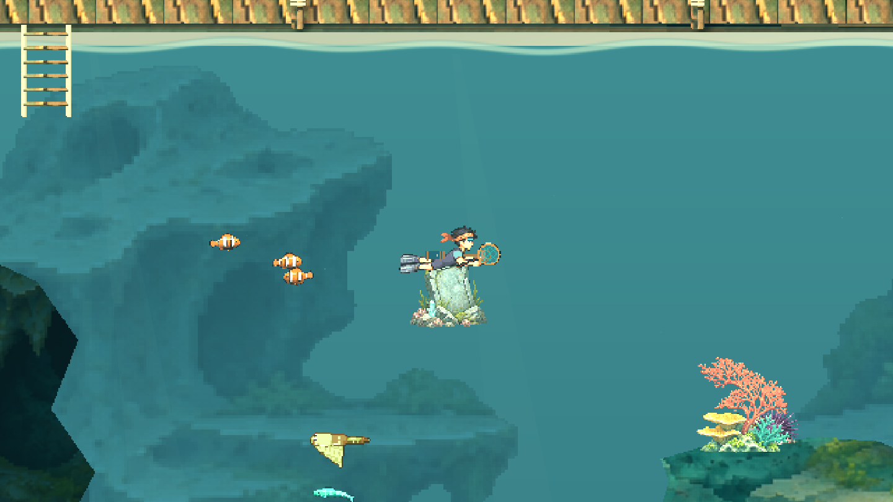

The 1440×810 Godot 4.7.2 Apple M2/OpenGL capture has SHA-256 `59daabe34591e4c49d70abb85bcc2476ec93a9ce464e4b6ea344e2be0d13eff4`. [Report](../reviews/pixel-visual-refinement-2026-11-15.md) records source, checks and the remaining moodboard/device limits. These images are project development documentation, not runtime assets.

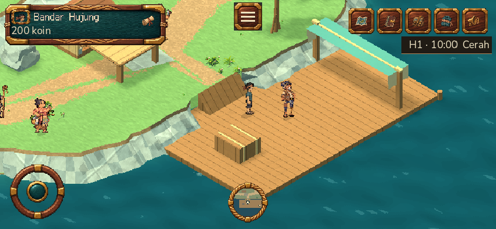

This Chromium/SwiftShader screenshot (SHA-256 `98e7609e3cb0c7b2f89c84fa7f542c5faddb8c9a6e19172c761e57785396b940`) uses source `0257864`, active CI PCK `e317a3bc9195` and image `c9914bda517e`. It proves game-ready visibility after the 6/6 public smoke, not the underwater frames or Windows/S23 performance. The two cold-start timeouts and subsequent hash-checked cache warm-up are detailed in the report.

## Nala underwater motion and staging, 15 November 2026

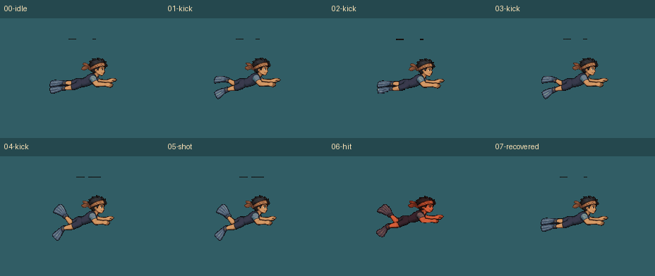

This Apple M2/OpenGL native Godot 4.7.2 sheet (SHA-256 `8a6c5684882a375d31aeba1685499cc1ae5f90967d0a81439aadfcaa27107570`) captures the actual runtime sprite; it is development documentation, not a distributed asset or Windows/S23 performance evidence. [Source strips](swim-v2-source-contact-20261115.png) and [full native reef scene](swim-v2-native-reef-20261115.png) show scale and environment. [Release report](../reviews/nala-swim-combat-reactions-2026-11-15.md) records source `abfe2d4`, CI PCK `e7b07bfe1d31`, provenance, tests and limitations.


This public Chromium/SwiftShader screenshot (SHA-256 `d68c35d2f28e4246b972f90704acb2af77708c3b51810351a7fc2938004fffe2`) uses the exact CI PCK and active staging image `a08ad10df7ed`. It proves ready-game visibility, not underwater animation or physical-device quality. It is development documentation, not a runtime asset.

## Gito gait correction on staging, 15 November 2026

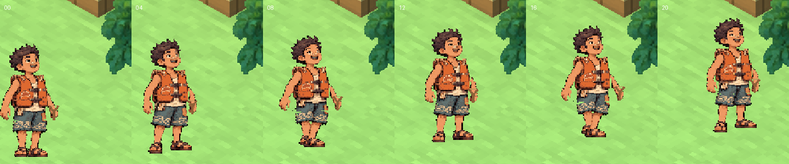

The 1,440×300 contact sheet uses original Godot 4.7.2 Apple M2 frames from source `3a18ee52d64a2d4e0a5aff2f3c4e0409b11d8b04`; PNG SHA-256 `6fd897b79cbda0b2b5c8fdfd12d3d64dfca1133f1850b964d2807795b547d893`. It is native visual evidence for the corrected knee bend, not browser or physical-device proof.


This Chromium/SwiftShader public screenshot uses CI PCK `9eefa0d0e8573043f14ad28ffab0c414e0c767ef402d020d27cc550fe7f18b55` and active image `fdd65aba4615`; PNG SHA-256 `361c4d59ce3d76b28e1aa17eea000bb1d14cb33f9464792543d2d750967c444c`. It proves ready-game visibility, not six-frame live motion. [Release report](../reviews/gito-gait-depth-bend-2026-11-15.md). Both images are development documentation, not game assets.

## Resident facing v2 staging, 15 November 2026


This public Chromium/SwiftShader still is from source `a26fd5f4af6d21fe87b8af34d4bebea64a3177ad`, CI PCK `6cd14511b96171f2d6c92f2533b0fe1d551a4d7e95225afbfaa32445a8178f6d`, image `ee3b1735bb2c`. PNG SHA-256 `fd5bca8ab242cec248281dfa175bc32ca667b1fe1abea928a28fa66418bef774`. It proves ready-game visibility, not gait or physical-device quality. The [release report](../reviews/resident-facing-v2-candidate-2026-11-15.md) records the 6/6 public smoke and native motion evidence. This screenshot is documentation, not a game asset.

## Resident source-matched turns candidate, 15 November 2026

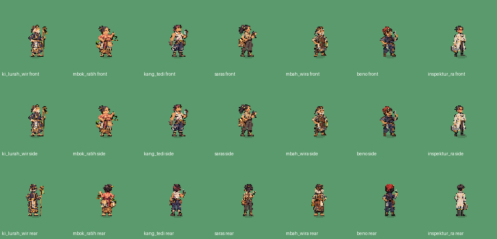

This curated 1,120×540 sheet is cropped from 105 native Godot 4.7.2 Compatibility frames at 480×270, then enlarged 2× with nearest pixels. PNG SHA-256 `9eae6b44e4b0679f6e4753bb0dcf3fedcba33798ef26b3bcd388bba8cc492649`. The [candidate report](../reviews/resident-facing-v2-candidate-2026-11-15.md) records source hashes, test results and limits. It is not a public staging screenshot or physical-device acceptance. These images are evidence, not game/kit assets.

## Seven resident front/profile/rear candidate, 15 November 2026

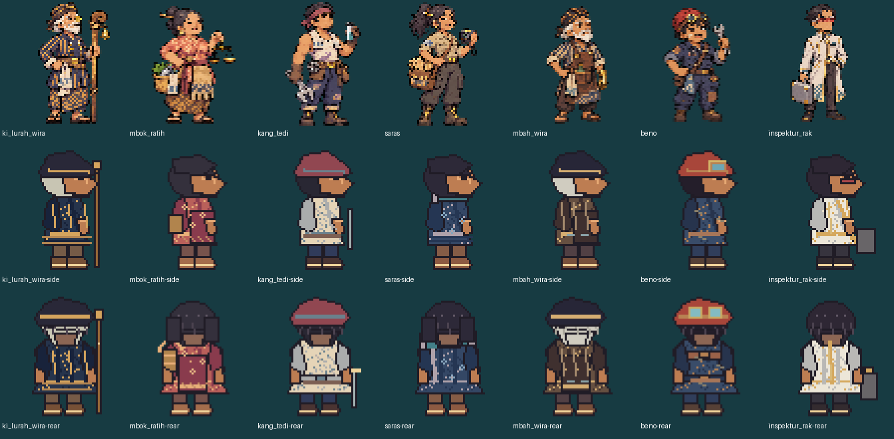

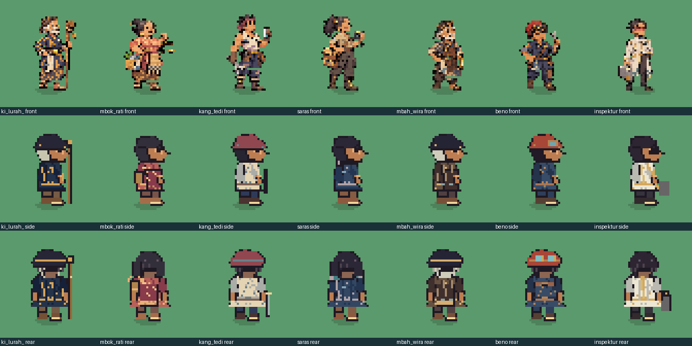

These are curated evidence from source `e762509`, now a **rejected visual candidate**. The first sheet contains generated 64 px pixels enlarged with nearest scaling; the second crops actual native Godot 4.7.2 Sprite3D frames from the 480×270 fixture. The uneven detail between front and alternate views caused a visible shape change when residents turned. They prove renderability only, not acceptance. [The rollback report](../reviews/resident-facing-staging-rollback-2026-11-15.md) records the public review. These screenshots are documentation, not runtime art.


This public Chromium/SwiftShader capture (SHA-256 `9a45c915df4f350defe895eeb8d1a0a6dd414a1e2176c2a8d1e7cce9570a0158`) documents the rejected staging attempt. It is not the current staging version or a physical-device acceptance image.

## Resident foot-contact staging startup, 15 November 2026


Original 844×390 Chromium/SwiftShader public screenshot from source `7c884a9095b1b498c2198420ed9a406defb615b7`, CI PCK `ab6fcffa91b3ee5baca1be0c652e514ceb524f7fa1668ebfadbd53eff197f4f2`, and active image `sha256:f547723c020590e6747d2e3e2ade918316cc7f00849b2f45dcf1971c8d2aa36a`. PNG SHA-256 `a5581c94ca231151bdb483168b9f30b9053e7721993ffe977f6ca5d53d473093`. The [release report](../reviews/legacy-resident-foot-contact-2026-11-15.md) records the 6/6 public smoke and its scope. This screenshot proves startup and visible Nala, not Bu Darmi/Yu Sari gait or physical-device performance. It is documentation, not a runtime asset.

## Legacy residents' planted walk, native candidate, 15 November 2026

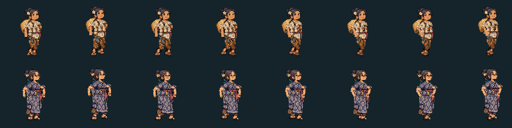

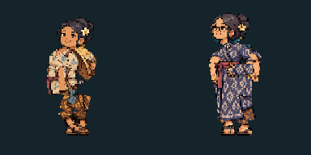

Original 1,536×384 isolated Godot 4.7.2 Compatibility contact sheet from candidate branch `work/npc-facing-foot-20261115`; PNG SHA-256 `a4b0c2fdba62f1941d5b080f266131789919b56969efc96fb6e3bb0a678be18d`. It shows eight actual-distance frames for each resident. The 384×192 west-facing pair is `bf34f695d158993ded32fa68c844f53653c8758d5f560aefae61bfb5629bddf0`. The [contact report](../reviews/legacy-resident-foot-contact-2026-11-15.md) contains the 4,172-sample route check, source/PCK, tool provenance and limits. These are development evidence, not game assets, public staging screenshots or physical-device results. Seven other portrait residents still lack reviewed rear/side art.

## Living action release on public staging, 14 November 2026


Original Chromium/SwiftShader public staging capture after source `85b3612`, CI PCK `ab1c964b01736980db7075859ff92096fc7d81cf5ba6f50f2b2a73bade8ba7b5`, image `ad8b8ce901ce`; SHA-256 `2a2be18cd26a210d9a81a8619117e2ac386f420f99b3bba2d65e89bed785c4af`. The associated full-route smoke passed 6/6; this still does not show cutscene timing or physical-device FPS. See the [release report](../reviews/living-cinematic-actions-2026-11-14.md). This screenshot is documentation, not a runtime asset.

## Living Phase 1 action layers, native candidate, 14 November 2026

| Nala arrives by sampan | Tamansari pipe fractures | Prasasti depth route |
| --- | --- | --- |
| 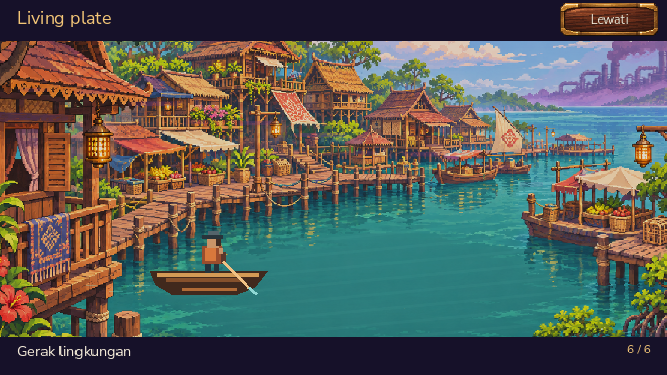 | 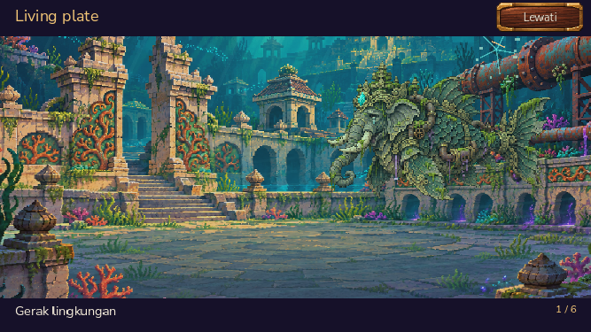 | 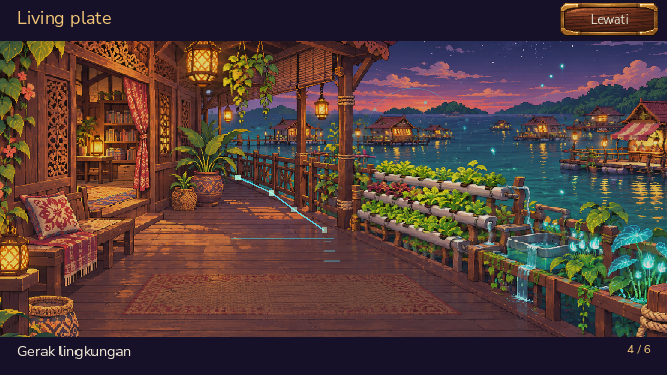 |

Godot 4.7.2 Apple M2 Compatibility captures at 667×375 from isolated source branch `work/living-gameplay-20261114`, not a public staging build. They show composition; temporal motion is exercised by the native before/after fixture, and physical Windows/S23 performance remains untested. Source painting hashes, screenshot hashes, tool/provenance and test limits are in the [candidate report](../reviews/living-cinematic-actions-2026-11-14.md). These PNGs document development and are not runtime assets.

## Phase 1 cinematic motion candidate, 14 November 2026

| Bandar Hujung | Tamansari | Griya Sasmita |
| --- | --- | --- |
| 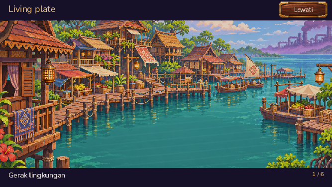 | 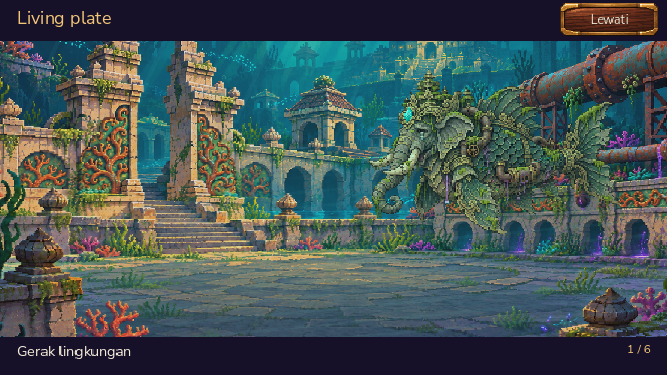 |  |

Original 667×375 Godot 4.7.2 Apple M2 Compatibility captures from candidate source `58a4b75`. Image hashes, before/after pixel-change measurements, provenance, and acceptance limits are in the [motion report](../reviews/phase-one-cinematic-motion-2026-11-14.md). These stills show composition, not proof of animation by themselves or of public staging playback. The six raw temporal frames stay in ignored local artifacts; no screenshot is a runtime asset.


## Neutralizer combat HUD and staging startup, 14 November 2026

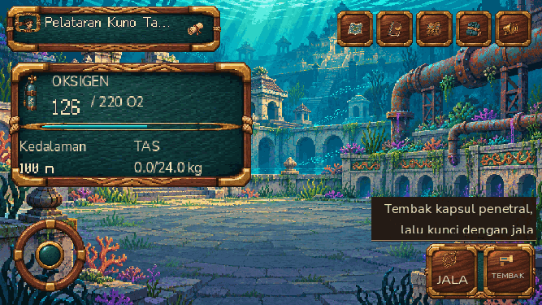


The first image is an original Godot 4.7.2 Apple M2 Compatibility component capture over project-owned Tamansari art, SHA-256 `ce93fb9f3116acff0374de1e19cbcfa7cd1769e752d10a8ba79b7063cc067b59`. It verifies compact HUD layout, not live boss interaction. The second is an original Chromium/SwiftShader public staging screenshot from source `f3f0ab4`, image `9dfde26231b5`, CI PCK `b73dbf7d82ce79e821d74e04643465a87a7f4ef9a3160743f764703fa573ce0c`, SHA-256 `4c8f0b15981652079fd9b1ebd9df338e000a560df5aa27ee335d4e7bb7028b23`. It proves startup and visible Nala only; the six-resonance duel still needs public and physical-device review. See the [release report](../reviews/neutralizer-combat-2026-11-14.md). These documentation images are separate from runtime assets.

## Phase 1 cinematic art on public staging, 14 November 2026


Original public Chromium/SwiftShader screenshot from source `a5b1bdac0c20d03833d7fa270b2c856c0d7cc3ca`, active image `cf523a7d4186`, and CI PCK `e872b7ba9bbc4e4753fac80fedda8216c0b3e12800b96ddfb3228968bef5647e`. PNG SHA-256 `6b1846602fc1e8ea6020f0310cc1336d3d7187b6859f308d1c30fd90df826926`. This confirms public startup, not actual cinematic playback: the smoke fixture completed the tutorial. The native cutscene captures below show the art composition. See the [release report](../reviews/phase-one-cinematic-art-2026-11-14.md).

## Phase 1 cinematic art native captures, 14 November 2026

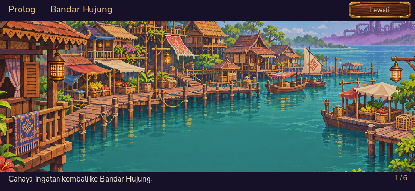

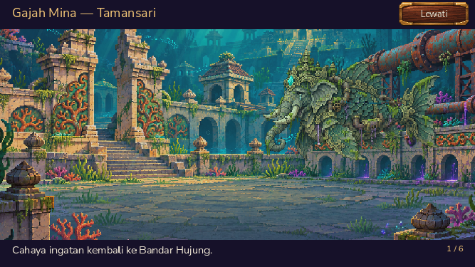

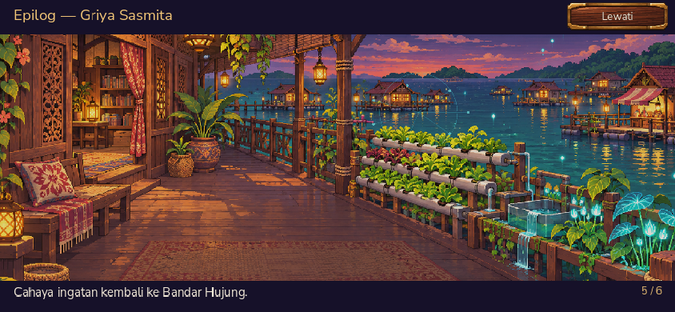

Original Godot 4.7.2 Apple M2 Compatibility component captures from source `a5b1bda`, taken before release; the same source is now active on staging. The PNG SHA-256 values and source asset provenance are in the [release report](../reviews/phase-one-cinematic-art-2026-11-14.md). These prove native shot composition at the stated sizes; they do not prove public-browser progression, physical-device performance, or a completed screenplay animation. Documentation images are separate from the runtime artwork and its terms.

## Phase 1 cinematic release startup on public staging, 14 November 2026


Original public Chromium/SwiftShader screenshot from source `2b5bd8edf6c21828502df4b9a9c22dd39137736a`, active image `f60edf88490a`, and CI PCK `72a92e317d3aa91b6c37b3aca74a160413b04a12b612ff7aa0745512d519b325`. PNG SHA-256 `216a22d3c6deb7c00be4c6984a46a9d336084ca0f0d78b72af5be4e3beac8f6e`. This proves a ready game and visible Nala after the release; the tutorial-complete fixture did not trigger a cinematic. See the [release report](../reviews/phase-one-cutscenes-2026-11-14.md). The image is documentation, not a game texture or physical-device benchmark.

## Compact HUD and three-line Menu on public staging, 14 November 2026


Original public Chromium/SwiftShader screenshot from source `70b2d4bb843e413ff2ef558f098246702b53a6cf`, active image `ce3bacae0f06` and CI PCK `3876454393e86b34e909b60c77e4af6f7a51d20f2065611bffa9d44dca67641f`. PNG SHA-256 `1f5942895b954129cca70079a34ad2c771d56781ada638cec1e69d15dc66695c`. The [release report](../reviews/hud-phase1-story-staging-2026-11-14.md) records public 6/6 smoke and limits. This is development evidence, not a game texture or physical-device FPS proof.

## Compact Phase 1 HUD source fixture, 14 November 2026

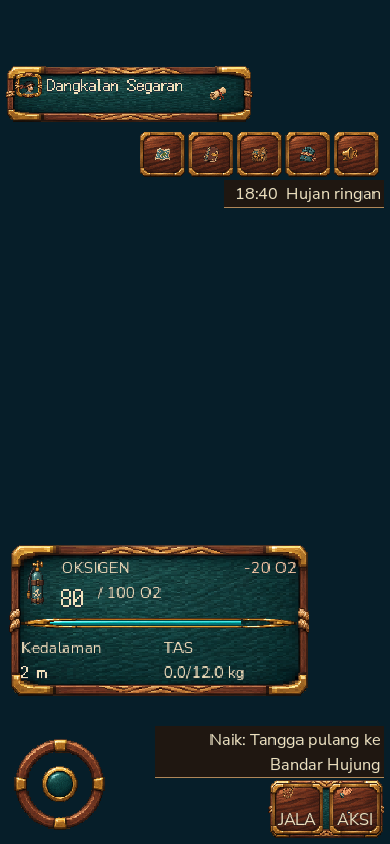

Original Godot 4.7.2 Apple M2 Compatibility component capture from `work/hud-story-phase1-20261114`, before staging. PNG SHA-256 `a1a861f60566d29d7af5896da24d8efc45ea66c59b12017297bd917bdef6357e`; local PCK `b9d1eb89b4a534e8ca725c49ac2bc1cae5ce98ed5417e7b6a490aff390286323`. The blank background is the fixture canvas. This is UI layout evidence, not a live-world screenshot, host Menu proof or physical-phone benchmark. See the [source review](../reviews/hud-phase1-story-2026-11-14.md).

## Graphics clarity on public staging, 14 November 2026


Original public Chromium/SwiftShader screenshot from source `98b4d29`, active image `15ed8a134cdd` and CI PCK `2c3066cec4bd4c21c5127348133aa7b3740f79b1cd01bad3251f5c5aea9929fc`. PNG SHA-256 `36f30cce357aab7c3bf47111376db3536fccd6f4c2fd1a2799e6b926dcbeba22`. Compare the [previous staging view](coast-pixora-staging-20261114.png). The [release report](../reviews/graphics-clarity-staging-2026-11-14.md) records the public 6/6 route smoke and its limits. This is development evidence, not a game texture or physical-device benchmark.

## Graphics clarity native source frames, 14 November 2026

| Sharp forest bridge | Sharp dock shore |
| --- | --- |
| 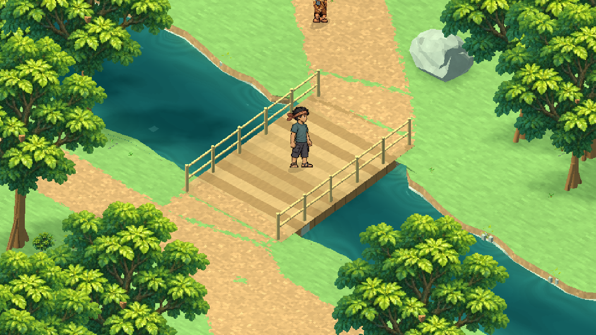 | 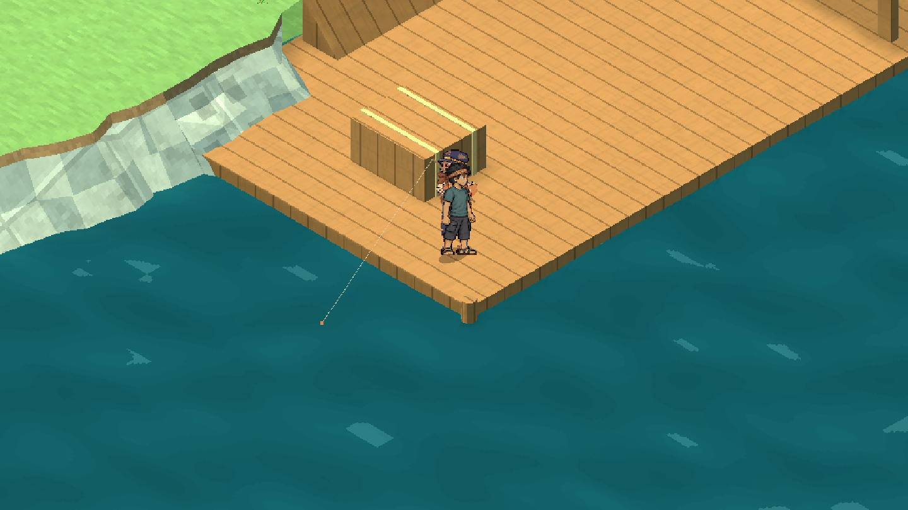 |

Original Godot 4.7.2 Apple M2 Compatibility captures from `work/graphics-clarity-20261114`, before staging. PNG SHA-256 values are `8ec2804c05284a980388454d2b28199e5c81814fe0465fc14247928e80de643b` and `40eb26dc93890b126bcca4d6b2f971f5b81e6edd1e4f77087a2665b2af4ff7c3`. See the [source review](../reviews/graphics-clarity-source-2026-11-14.md). These are documentation, not game textures or device FPS proof.

## Coast and Pixora Menu on public staging, 14 November 2026

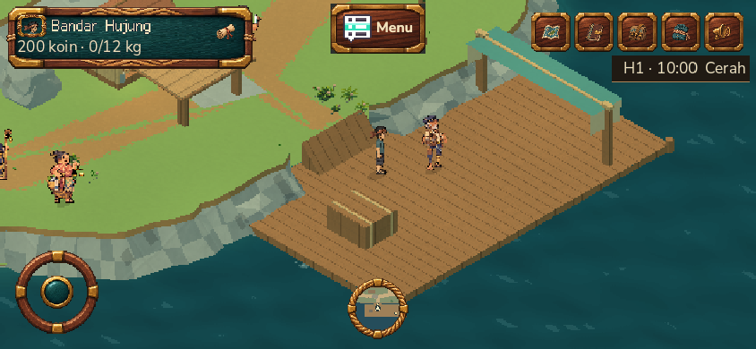

Original public Chromium/SwiftShader screenshot from source `c9cd608`, active image `065d49941457` and CI PCK `bffff79d266beb359641a51392a0431f05692034a5371bd585354758f699ccef`. PNG SHA-256 `8bf62966f7e3e4de0b58a425c16ebd1a8125a46a546ce6b7919e1d202187de3f`. See the [release report](../reviews/coast-pixel-pixora-staging-2026-11-14.md) for the 6/6 public smoke, attribution and limits. This is original development evidence, not a distributed game texture or physical-device FPS proof.

## Coastal contour candidate, 13 November 2026

| Forest bridge shoreline | Bandar Hujung dock shore |
| --- | --- |
| 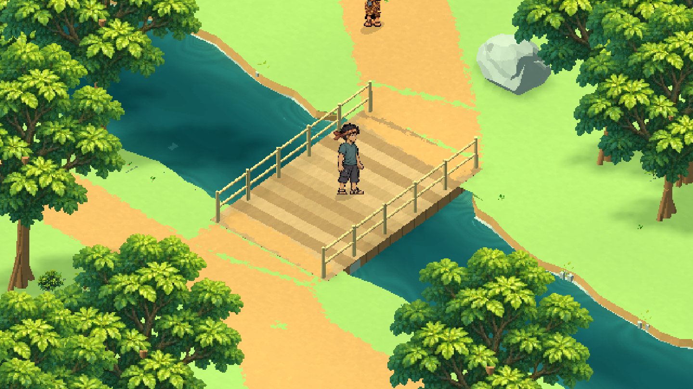 | 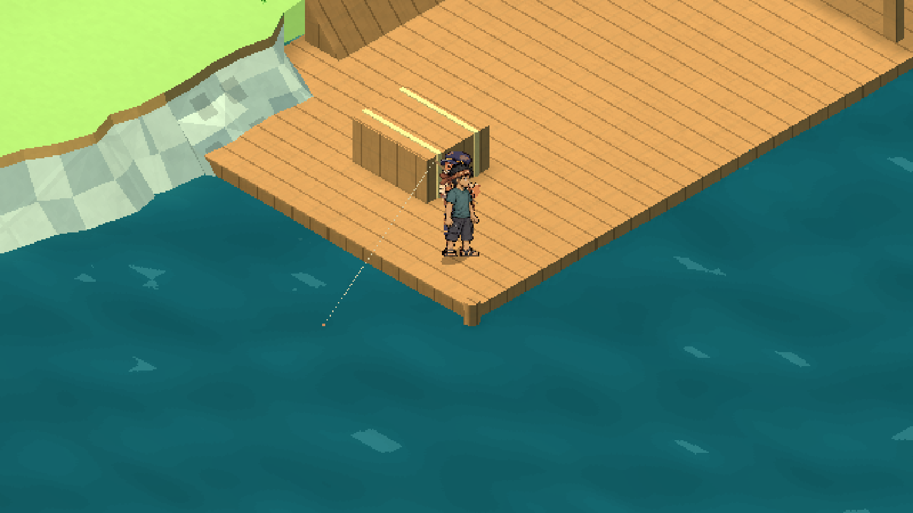 |

Original Godot 4.7.2 Compatibility frames from `work/coast-pixel-20261113` on Apple M2, before main merge and staging. PNG SHA-256: `27e0b8f241e99b567ab2bd19fb3fc6291a9e8892a32ab0c958cca1781c53902f` and `12b9e8c2eb0d0135f5b5df566565135b06f2a33bd465d5f359f7fa796223761d`. The [candidate review](../reviews/coast-pixel-foliage-menu-2026-11-13.md) records tests and limits. These screenshots are documentation, not game textures or physical device benchmarks.

## Gajah Mina swim revision, 13 November 2026

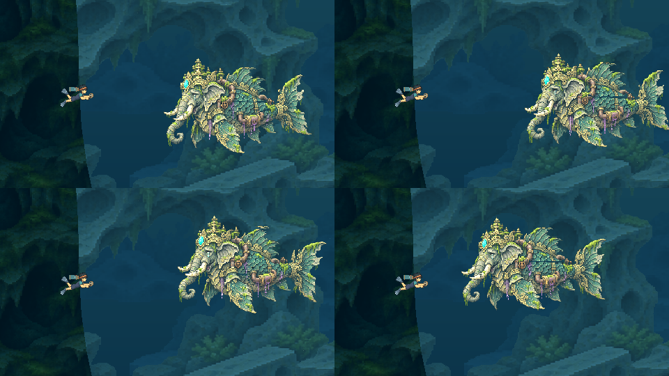

Original Godot 4.7.2 native Compatibility capture from source `a63f803`, active on staging as image `82fa4c42b2e1` and PCK `da99dcb4a2f4b5e11739dd216e9e1ccd7030d87d909af6198582bf6a2aec5770`. Four frames from the production HybridOcean actor were reduced by nearest-neighbor sampling to a 960×540 contact sheet; PNG SHA-256 `6f7f9fb45c0a8a185bf406c2e4574710b0554bbbc89f22949a854195cf7826a6`. See [the release report](../reviews/gajah-mina-natural-motion-staging-2026-11-13.md). This is development evidence, not a staging screenshot, device benchmark, or separately licensed game asset.

## HUD release on public staging, 13 November 2026


Original public Chromium/SwiftShader capture from source `df97df7`, active image `5e90232c9a04`, PCK `7f5baf3d020315aefb572f920de42b3723ea1d970da2e2303a735d626b531756`; PNG SHA-256 `df28e4099ba5e3ea449b54e12642d87f1f7074d6d115661e66778e2b172aaed3`. The [release report](../reviews/hud-visibility-staging-2026-11-13.md) records the 6/6 smoke and limits. This is original development evidence, not a distributed asset or physical-device FPS proof.

## Short-landscape HUD layout, 13 November 2026

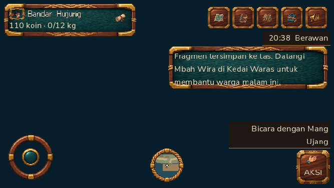

Original Godot 4.7.2 native component capture on `work/hud-visibility-20261113`, SHA-256 `59331b3e756f998cca4f93083c020ae128e4e27bec7eeea915f6fca1de802d6d`. [The review](../reviews/hud-visibility-2026-11-13.md) records measurements and tests. The blank backdrop is a fixture, not a gameplay or device screenshot; the source art remains governed by its separate provenance/license.

## Post-gait full-day regression, 13 November 2026

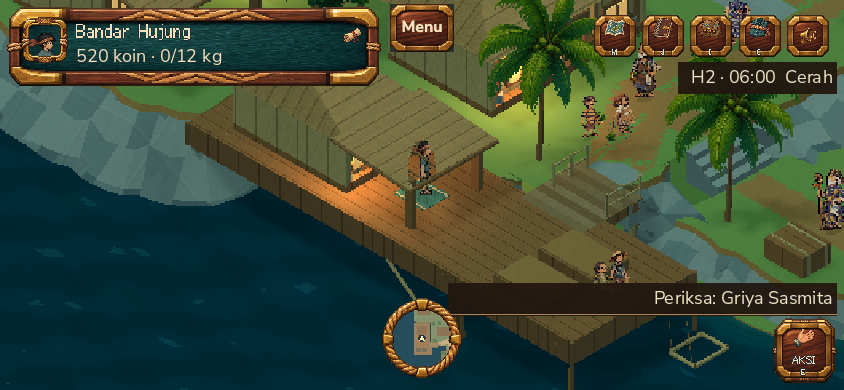

Original local Chromium/SwiftShader screenshot from current source `44203ab` and macOS-export PCK `1943b967938081c92283138fd37ef37aff0e3a24296eb4411e1bb0045ed7b15d` (69,982,364 bytes); PNG SHA-256 `d90bfe3ffe2e3e45f07348f5e999b593f88ec20463048ec93ee97b37e06a0130`. [The 9/9 regression report](../reviews/full-day-gait-regression-2026-11-13.md) records its scope and cleanup. This is original documentation evidence, not a distributed game asset, a public staging PCK capture or a device FPS measurement.

## Nala land-cadence staging release, 12 November 2026

| Public dock | Public forest |
| --- | --- |
|  |  |

Original public Chromium/SwiftShader captures from source `7f8d0cd07667f5714a9b3c1207b44ee808368369`, image `sha256:50aa0520fe7b07395d133bd416623c0008d64a82fee341460e279c42deaa4375`, PCK `eaa90ae68a8af30a7bf530a6b33f0053d092b742197eb72be24776e1846663aa`. Copied byte-identically from the isolated 6/6 smoke; PNG SHA-256 values `717980b4066639f962a81e089a737fc06f1599e2e231e601307e11fc85b17098` and `390be84e88b13753f5bc4fb83154723da9b49a1aff603269be5a61d0d307fbe8`. See the [release report](../reviews/nala-gait-staging-2026-11-12.md). This is screenshot evidence, not a moving gait or Windows/S23 FPS proof, and not a game/WorldKit asset.

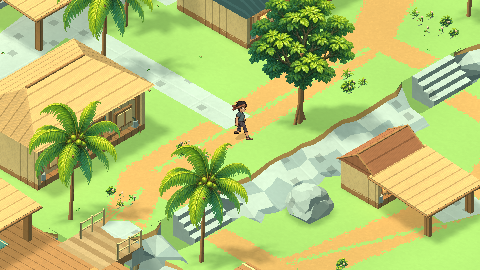

Original Godot 4.7.2 Apple M2 Compatibility diagnostic, source `7f8d0cd`, copied byte-identically from the eight-direction run; SHA-256 `28ed0301901d88527d7cc6117b5389c196fa7626aa4ccfc0d11a4335afba543c`. The diagnostic passed 776 geometry samples but the physical pilot remains OFF in release. See the [release report](../reviews/nala-gait-staging-2026-11-12.md) for its visual limits.

## Nala gait source candidate, 12 November 2026

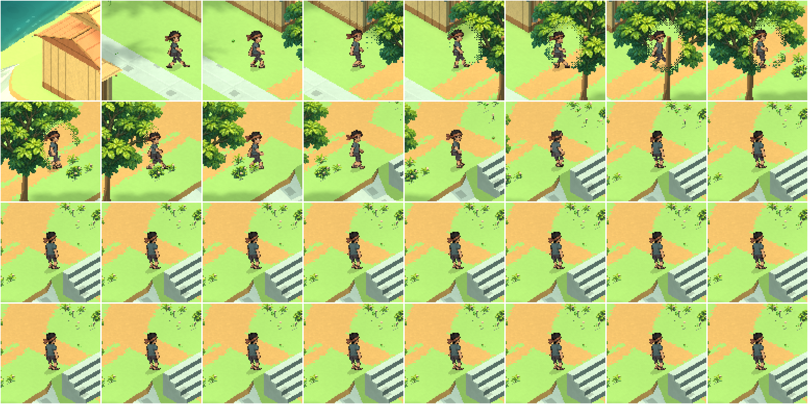

Original Godot 4.7.2 Apple M2 Compatibility 480×270 sequence from `work/nala-natural-gait` based on source `04e5c9e`; PNG SHA-256 `e641024bd069d91f9c4e4153dbac3491ec577eaac3881ddbe60f7a6c186e9377`. The sequence predates the final separate-equipment phase synchronization; [the report](../reviews/nala-natural-gait-2026-11-12.md) records final-source tests and the separate final-source occlusion image. The physical gait is still OFF in release code. This is documentation, not a staging screenshot, real-device performance proof, or a game/WorldKit asset.

## Village motion staging release, 12 November 2026

| Public dock, 844×390 | Public forest, 667×375 |
| --- | --- |
|  | 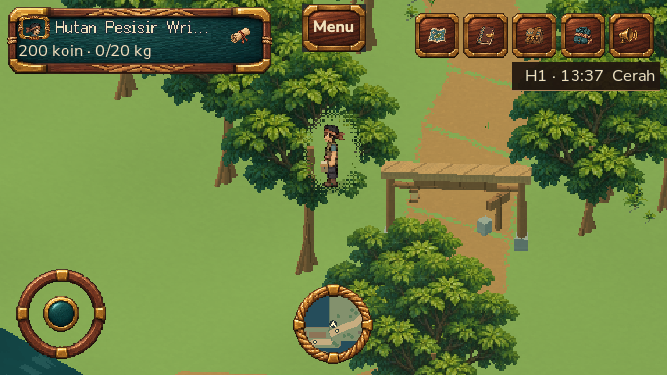 |

Original Jalasmara public Chromium/SwiftShader captures from the 6/6 smoke on source `75b562d92fab3285241c5d79591d6b2b2a6c2911`, image `sha256:463019d59d1f101ed3d7f1e4b70c3ffa19072b31352284c4a7138051da8f9f82`, CI PCK `6d43cad78760f1d33661953726e6c6b38b4546a0e8c26de1d897db525940c216`. Copied byte-identically from `artifacts/browser/staging-plan06-d7329640-aa54-4cb0-bc58-44d1cbd207ae/01-public-ready-hub.png` and `02-public-physical-canopy-667x375.png`; PNG SHA-256 respectively `2a9a588ce7de4c3a4c511a4018de5e216155b9c6329487a32ce1ef9396b47837` and `f455dbc7172ac8581c68cb74b345ba33dc9669e019653d662ccb8dde2ffdec63`. See the [release report](../reviews/village-boss-motion-staging-2026-11-12.md). These are project documentation, not game/WorldKit assets under the code license or physical-device performance evidence.

## Village steps and Gajah Mina candidate, 12 November 2026

| Seven original-art step strips | Gajah Mina phase one | Gajah Mina phase two |
| --- | --- | --- |
|  |  |  |

Original Jalasmara Godot 4.7.2 native Compatibility fixtures from candidate source `a47b32b011a4110616c5b0b97fcfddc06c91eb00`, local PCK `d667da760fec40b9b6cb132b4c5b3bc7fcf2d61b1096a960e6a73fb4a5e71dcc` (69,980,732 bytes). The first image renders fallback strips; four of those residents normally use their richer existing rig. PNG SHA-256 respectively: `d09b02d755a68637aa004040879893261eca63c53d9a37e267d7a92c2b66d1e0`, `95328d0d87661421b49f879fdd4dac6c9efd9a8c3475560bccb5aeda35df8cfb`, `c43cb6786ddc2c7e62679002015799fb302027b39de1df22d2c1cdc72b25cfde`. [Motion report](../reviews/village-boss-motion-2026-11-12.md). These are native development captures, not staging, full-playthrough, Windows/S23 FPS or game/WorldKit assets under the code license.

## Short-landscape HUD release, 12 November 2026

| Public staging dock, 844×390 | Public staging forest, 667×375 |
| --- | --- |
|  |  |

These original public Chromium/SwiftShader game captures are from the same disposable 6/6 route fixture, with zero account/receipt/shift/key residue. Source `ef84e55ec1e3fa23ba61d02753420959f4e54528`, Gitea run 54 success, active image `55da5dd15c306e8d8910da8f4f78d2e6ac90f9d56b23635412b422e3a699d9ae`, PCK `0725713d9985320f7111d6990ad8c5b031a16dce9b10f8514359ef94ad6f461d`. PNG SHA-256 values: `7c58eaf3f679a37790354b9910365918d7910fbaacee8a47db76f1380f055d1e` and `70fb7506cc3a71c14b38647cf79f3fa23928a60f04e350180fa073daa0fadd07`. They are documentation screenshots, not distributed game/WorldKit assets or physical phone FPS evidence. [Release report](../reviews/hud-short-landscape-2026-11-12.md).


Original Jalasmara Godot 4.7.2 native component fixture over an existing project screenshot. [The report](../reviews/hud-short-landscape-2026-11-12.md) records the layout assertions and limits. Released PCK `0725713d9985320f7111d6990ad8c5b031a16dce9b10f8514359ef94ad6f461d`/69,775,500 bytes; PNG SHA-256 `e5551e5fe921102498f5b3c36bfeccb7c4719c406fe656bafc96b0006e76d429`. This image is a local UI fixture, not physical-device gameplay. The screenshot is documentation, not a game or WorldKit asset under the code license.

## One-account full-day journey, 12 November 2026

| Forest crossing | Kedai shift closed | Day-two morning after reload |
| --- | --- | --- |
|  |  |  |

Original Jalasmara screenshots copied byte-identically from one completed local browser fixture. [The report](../reviews/full-day-single-player-2026-11-12.md) records its 9/9 journey, cleanup and limits. Runtime source `128fc592f9fe15cc2803a1a734a8200f39ee1422`, PCK SHA-256 `a2206c8993cc55469d45627417891b1e9290fc757c49c6b871749f27fb1e43f6` (69,774,796 bytes). PNG SHA-256/size respectively: `92b3e9dc61d77bed1d56307659063407a7023dc0cd4d42f6ba32982647a39512`/292,545 bytes; `26c4ce59ff041c34cd5ddc3a364c7e749fd3f299adcbec2d715404eefe626eed`/238,994 bytes; `218074695afa9c67d7c9c370d0c867b7751c9c50ba5fff6e5b5a828440554a50`/242,341 bytes. The disposable account was removed. This is software-browser development evidence, not physical-device FPS or final HUD/art acceptance, and the images are not game/WorldKit assets under the code license.

## Day-loop segment checks, 12 November 2026

| Local three-star capture | Local morning after Kedai/rest | Public staging forest |
| --- | --- | --- |
|  |  |  |

Original Jalasmara browser screenshots copied byte-identically from the three test fixtures in [the report](../reviews/day-loop-check-2026-11-12.md). Source `5f124fc72a0abbc0566d786f2b3b424929b14231`, released runtime source `128fc592f9fe15cc2803a1a734a8200f39ee1422`, PCK SHA-256 `a2206c8993cc55469d45627417891b1e9290fc757c49c6b871749f27fb1e43f6`. PNG SHA-256 respectively `803febd6e35dc385570d9282cee9cfce6962eee58cf58724812272fd36f68280` (361,303 bytes), `6663750caed09bddd38199f73d97793bba4f11dd97b4a70b23255ef14fbf9a60` (350,304 bytes), and `2d1d895cde90665fd7e0b06c9b020ce04746678f1f1bafa41453cb69e36b6e69` (253,920 bytes). These are separate fixtures and development evidence, not one uninterrupted full-day proof, physical-device FPS evidence, or game/WorldKit assets under the code license. Each fixture was removed.

## Staging `main` 128fc59: active Kedai shift recovered from the dock

| Automatic recovery panel | Movement after temporary close |
| --- | --- |
|  |  |

Original Jalasmara Chromium/SwiftShader screenshots from a disposable `female_nusantara` account, copied byte-for-byte from `artifacts/browser/shift-recovery-active-20261112.png` and `artifacts/browser/shift-recovery-moving-20261112.png`. Source `128fc592f9fe15cc2803a1a734a8200f39ee1422`, PCK `a2206c8993cc55469d45627417891b1e9290fc757c49c6b871749f27fb1e43f6`, image `sha256:5f906ce5b53937d378073f2c219ca5163c70f3c158891488d0f61669eed19d52`. PNG hashes: `169583c63e86728bf83bb0a067a9e49bc4b41ed2d1acdd2f38a1edd76e0861cf` (269,336 bytes), `5050ddda44050c2147f533bea752a9a26936502ff201745418fe5c35cd327186` (209,349 bytes). The fixture was removed with zero remaining players or shifts. [Release report](../reviews/kedai-shift-recovery-2026-11-12.md). These are development evidence, not game/WorldKit assets or proof from the owner's account or physical devices.

## Staging `main` 7c7bf22: Nala visible when the host starts unfocused

| Before | After |
| --- | --- |
|  |  |

These original Jalasmara Chromium captures deliberately forced `document.hasFocus()` false before the host loaded. The old build reproduced the owner's embedded-head report, including after the Menu reset; the new build renders the full `female_nusantara` body while paused and after reset. Old PCK `b3ff1a4f165f6ec12bd133d1222400f6f9e358ca7a4bd853663f07b699ab77d3`/69,774,364 bytes; corrected source `7c7bf22bb408d2e8598923a1d25b5ae46e53f886`, PCK `6afa6ef00905c6491e8e5b9dbee91977cd8566525ebd2afe0c42be7225a1f4d2`/69,774,348 bytes, image `sha256:1d7526beea022e539c341dc76a756826c34aff79e6603d1bd029ebacfb1a9c90`. PNGs are copied byte-for-byte from `artifacts/browser/staging-plan06-fc25cc40-496b-4e30-8e4e-ec5660a14ac7/01-public-ready-hub.png` (229,535 bytes, SHA-256 `0afff9170edbd0d924eddaae18af678571de4b85f7d0be35c46ca197cd3dbbe5`) and `artifacts/browser/staging-plan06-b2ea3aa0-2919-4b9f-bc29-72ac6a57a84c/01-public-ready-hub.png` (230,580 bytes, SHA-256 `0cd39356b3c00ea6a509cb90df7facd48011f91351acfa787b1cafe1c7d8ec95`). Both used disposable accounts with zero residual players, receipts, shifts or keys. [Release and root-cause report](../reviews/nala-cold-pause-atlas-2026-11-11.md). These screenshots document software-browser behavior; they are neither game assets nor proof of physical S23/Windows performance or owner-account acceptance.

## Staging `main` 0743339: balanced Nala visible after reset


Original Jalasmara Chromium/SwiftShader screenshot after real login and Menu → Reset posisi pemain. The temporary player used `male_nusantara`; the Godot diagnostics confirmed **balanced** quality and saved `(1000,1200)`. Runtime source `63cb3dad965d22e2ef2bf788c751bdf0ff1e80c5`, release source `0743339404d4121c5bee45ecc13270d942c59de8`, image `sha256:88c7fb6e7b1a9670f721e7525504393175e7ba7b3033d43d6efa895b611da9df`, PCK SHA-256 `b3ff1a4f165f6ec12bd133d1222400f6f9e358ca7a4bd853663f07b699ab77d3`. Copied byte-identically from `artifacts/browser/staging-plan06-ee521052-5360-4c5c-b757-e7f221d549c0/01b-male-nusantara-balanced-after-reset.png`: 236,156 bytes, SHA-256 `278f88b47ad0fef38190afa7bd13df6da511e4f4d28b8d4526e9d65b969aaf12`. A separate full physical route passed 7/7; see the [release report](../reviews/nala-dock-occlusion-2026-11-11.md). This is project documentation, not a game/WorldKit asset or physical-device proof.

## Historical staging `main` 8a4b4b0: male_default dock recovery


Original Jalasmara Chromium/SwiftShader screenshot after the real Menu → Reset posisi pemain interaction on staging source `8a4b4b033108ed997c19f419ab8959d81d51384d`, image `sha256:9c7d938b61e604489110a94ecb44c07f0d64cff4c235ee71e6614be1396fd904`, PCK SHA-256 `b740a032ca3f8fd0cbe49de8512e681f186f515dfc510557307c01c106e55a0b`. Copied byte-identically from `artifacts/browser/staging-plan06-d40e71bd-57cc-4ad9-a226-b6bbf2fd0d85/01b-reset-male-default-night-dock.png`: 181,990 bytes, SHA-256 `6b593b46f6070a79ce115d2bbdd1500fe7a368fb070e10d2137b0f4761fa70dd`. The [release follow-up](../reviews/reset-position-dock-followup-2026-11-11.md) records seven passing public checks and zero fixture residue, but the owner's subsequent screenshot showed the issue remained. This original-game screenshot is documentation, not a distributable game/WorldKit asset or physical-device performance evidence.

## Staging `main` 627116e: position reset


Original Jalasmara Chromium/SwiftShader screenshot from the passing public staging smoke of source `627116ecb7caf9939164cc33455da47868bb75df`, image `sha256:aa450ddfa350a07c9d60825a33887ca583bf15b4bd40c9a4a348591394857375`, and PCK SHA-256 `b740a032ca3f8fd0cbe49de8512e681f186f515dfc510557307c01c106e55a0b`. Copied byte-identically from `artifacts/browser/staging-plan06-6330d11e-8771-4ee2-bf6d-a67e55a3b7e7/01b-public-after-menu-reset.png`: 203,067 bytes, SHA-256 `a61f39ed10a74e98d7768e9eb89cac3ac6ba441826dc98ba53fe4bc220dbd3c6`. The [release report](../reviews/reset-position-2026-11-11.md) records the menu interaction, seven passing checks and zero fixture residue. This screenshot is project documentation, not a distributable game/WorldKit asset or physical-device performance evidence.

## Staging `main` 4ba2f27: gait quality gate


Original Jalasmara Chromium/SwiftShader screenshot from the passing public staging smoke of source `4ba2f274669492bb500dc09455786f086bd9ebbe`, image `sha256:cf49128afd172aebe9fa4cea0d2addf85df586401f06ae699da546c37493f3b6`, and PCK SHA-256 `b740a032ca3f8fd0cbe49de8512e681f186f515dfc510557307c01c106e55a0b`. Copied byte-identically from `artifacts/browser/staging-plan06-37f35346-5f6b-43ef-8276-685ae770dd7c/01-public-ready-hub.png`: 202,934 bytes, SHA-256 `8033cb3e1ca41124891f978bfb0e038073c3e9c895792dc3b9cdeb527edec4d7`. The fixture was removed. This is [release evidence](../reviews/gait-main-staging-2026-11-11.md), not a physical-device FPS result or a distributable game/WorldKit asset.

## Staging `main` f600b62: compressed-audio release


Original-game Chromium screenshot at 844 × 390 from source `f600b62bdbcfdd3cb870ba47679e8fc53d611cee`, PCK SHA-256 `cdbfac713fd72506e8458a9cd4fdfc0983f48f2cd805acdd0c9d61fc4f52106a`. The temporary login fixture was removed after the full-route smoke. PNG: 202,978 bytes, SHA-256 `4dc62d67b809e4f05920b7440f7e7ae779c1e396551bf33ca4a30ea6f6dc1f5a`. This is [release evidence](../reviews/main-staging-audio-compression-2026-11-11.md), not a distributable game/WorldKit asset or a physical-device performance result.

## Staging `main` 4980d6b: player visible beside dock crates


Original-game browser screenshot from staging source `4980d6b172e7524fad8dbef3ea02e3916c4ea3c3` and PCK `cb5bd527bca632c66f2d23f7dc1a87758d2e4d057249a28d5efc4a40e3516b27`, captured after real login at saved hub position `(1000, 1200)`. Chromium on the operator's Mac used a 1865 × 900 viewport and touch emulation. PNG: 305,702 bytes, SHA-256 `d6514da09da9a8750b908f28508a76b95baf0524af46101ca907aafceb1934e3`. The temporary test account was removed; no credentials appear. This is browser evidence, not a Samsung S23 or Windows GPU benchmark. [Release report](../reviews/main-staging-dock-2026-11-10.md). The game screenshot retains project-art terms and is not a MIT-licensed WorldKit asset.

## Staging `main` 446abf4: browser publik, 10 November 2026


Ketiga PNG disalin byte-identik dari smoke publik `artifacts/browser/staging-plan06-f8109a8d-440f-45a1-9aa8-80bc2fccd904/` pada source `446abf4`, PCK SHA-256 `5c0253f0bb9f103f6032c69b42dac6fc6fda7485a38f5b4d88380480a1eb9d7c`; [laporan rilis](../reviews/staging-main-446abf4-2026-11-10.md). SHA-256 gambar berurutan: `be3f917b63120e6a4337a74c5711e5f533a8be7de0824bb11e2cf079c4e7190c`, `0a274bb8e4b6e474d78b3d5170bd66d78ddbe17186e101e36848b954b53639df`, `70014a79dac4e1ec4893b74523f2b0b0e3cc00a7c3ad8bc53d475a89bf533f24`. Browser Chromium mesin operator, bukan Samsung S23/Windows fisik atau penerimaan artistik akhir. Tidak ada data akun/kredensial pada gambar. Ini bukti proyek untuk dokumentasi, bukan aset game/kit berlisensi MIT.

Bagian galeri lama di bawah mempertahankan asal dan status pada waktu pembuatannya; hitungan gambar/byte pada deskripsi historis berikut tidak mencakup tiga PNG rilis ini.

Twenty-six original evidence images, copied without cropping, recoloring or recompression. This is a small review gallery, not an asset kit or a complete acceptance report. Total PNG/APNG payload: **4,046,375 bytes**. Released-world images, local browser evidence and uninstalled authoring proposals are labelled separately.

## Gemini audit review: remaining claimed inversions also rejected


Root created this diagnostic sheet directly from the original atlas cells using nearest-neighbor crops, then root and peer independently reviewed all54heads. Together with the eighteen female explorer heads below, it rejects all seven submitted P0 inversion claims and the diving SE mismatch claim. The brown bandana tail is not the face. No source was mirrored, swapped, recolored or repaired. The genuinely reversed male-nusantara explorer NW set is excluded from Gemini's task and remains a different confirmed source issue. [Review and bounded correction instructions](../reviews/gemini-character-audit-integration-review.md).

Byte-identical copy of `.runtime/gemini-p0-original-crosscheck.png`:167,130bytes, SHA256 `a30ae9983466163e951488b9c3d8e3692e2c45aef5e28e6652b0f4afade8ec2b`. Each row labels original identity/outfit/direction; first column is IDLE, remaining eight are WALK0–7. Source crop x38..87/y16..49,3×nearest. No account data or text metadata. This is original project-art diagnostic documentation, not an MIT sprite pack or gameplay/native acceptance.

## Gemini audit review: preserve correctly facing female explorer rows


The external auditf67de11 labelled these rows reversed. Root and peer reviewed these enlarged original crops and rejected that P0 pair: the brown bandana tail contaminated the tool's skin-color centroid. No production row was swapped or mirrored. [Integrator corrections](../reviews/gemini-character-audit-integration-review.md) keep the audit on HOLD. This image is a diagnostic nearest-neighbor crop sheet from original project art, not game rendering or new authoring.

Peer source `.runtime/gemini-female-explorer-original-heads80-f67.png`, copied byte-for-byte:88,718bytes SHA256 `d61697e3341a5f863c42905295930fa4cf4e07e0a20d4460bd70a11adbdc391d`. Root independently checked original WALK SHA `c9fcd98430fc7fb27f0d08470e69030bd768a87a550f65f8033ce3c1398ab38f` and the cited original tail/face pixels. Project-art terms remain; no third-party moodboard or account data.

## NW daily authored elbow loop: proposal, not active gameplay


Sourcef013d91/rootd4a14af. Root viewed all eight poses, independently passed9loop+10rig CPU tests, and reproduced all fifteen output PNG/APNGs byte-for-byte. Original sourceFrame4 is distinct from authored animation phase0 and from any physical foot contact. Eleven explicit hidden shirt fills, a disclosed3pixel authored elbow-axis revision and five original hand-edge ownership decisions remain in the [report](../reviews/overnight-nw-daily-upper-loop.md). Fixed shoulders, fixed rear compositing, five unique poses/eight timed frames and unknown source anatomy/grip remain limitations. This is uninstalled artwork, not a new full-body walk or terrain acceptance.

Byte-identical curated copies: detail24,743bytes SHA256 `fba15bf6d0a3a99b8a5fe3f58923db1d563e342d129ac27250510f38b63b2393`; APNG15,870bytes SHA256 `6429a938628dd62a24e6c4a47553d499f6deef03af1cdbe0963461c700b13795`. Root checked source images/metadata; no account data or text metadata. APNG duration/loop are intentional. Original-project artwork terms remain separate from MIT code or moodboards.

## NW explorer authored elbow loop: proposal, not active gameplay


Source448e077/root2fd6340. Root independently passed9loop+10rig CPU tests, reproduced every PNG/APNG byte identically, and viewed all eight poses and the original notch repair. This is an authored coherent reference arrangement and two explicit hidden fore-root overlap pixels, not repaired production atlas, measured anatomical joints, grip, contact phase or natural walking acceptance. Five unique raster poses span eight timed frames; return retraces the authored curve. Fixed shoulders and fixed right-behind compositing remain limitations. [Report](../reviews/overnight-nw-explorer-upper-loop.md).

Original root outputs `artifacts/player-gait/nw-explorer-upper-loop-root-review/`: detail22,866bytes SHA256 `e39e6ea64259bb1428864edb759a2a91b8da174cd81ba382cf619b810c06c912`; APNG16,437bytes SHA256 `d4864e59e4693cfeff8c6668bf2375d0faac76a6fb09b03dc1c7eb78ccfb555e`. Copied without modification, no account data or image text metadata; APNG loop/duration are intentional. Original-project artwork terms remain separate from MIT tool code and third-party moodboards.

## Export5 local browser evidence: visible compact location overflow


Local Godot export72b173c, PCK `9a1ca274b88cf65e819f1c117da2ede7992420e2128b454ef6bc3cf7f19cbb1a`/64,500,848bytes. The separate forest fixture used real touch input, crossed the upper bridge and saved/reloaded;5/5PASS. The image was captured at667×375 with declared safe-area emulation, then restored844×390. Root reviewed the actual three dots after the unsuccessfulU+2026 attempt. It is software-rendered browser evidence, not physical S23 performance, new natural gait or a public-release acceptance.

Original `plan06-layout-8a5cf9af-9b88-4622-b13d-fa294d504287/left-forest-location-badge-667x375.png`, copied byte-for-byte after image/privacy/empty-metadata review:250,518bytes, SHA256 `e008a03f439e437c38fbd485538c0f2a1f7019233efe4ce17ac4a626700f150d`. [Integration report](../reviews/overnight-export5-integration.md). Image559/export5/9a1 is active; a separate fresh default-public route completed6/6PASS. These images remain local browser evidence.

## Export4: actual modular equipment in local browser

PCK `b34d95211a61354eebf9cd218455d1c2f4e4b99723b57e4cfbe2b0a113f0ba26`,64,495,984bytes, Godot export source28a3c6d. These are actual844×390 local browser captures. The same image898/PCKb34d was activated subsequently, but its public-route acceptance is a separate [release report](/docs/reviews/overnight-export4-integration.md). The physical lower-body pilot is absent from these images.


[Wardrobe gate7/7](/docs/reviews/overnight-actual-gear-browser.md) physically crossed the booth, checked hysteresis, visited the ocean, extracted and reloaded. At the actual reached dock corner, the body and teal tank are clear of the roof. Actual node reports independently show tank6/net12 visible meshes while diving and none while daily. This single idle image does not certify every mesh's pixel visibility, facing, item contact or natural gait.


[Explorer gate5/5](/docs/reviews/overnight-explorer-node-browser.md) used touch input, crossed the upper bridge and reloaded. All three actual checkpoints showed4satchel meshes visible, with tank/net/model vest hidden. This rainy-evening frame retains dark foliage and readable body/hip item; it is not new daytime/color-grading or all-direction art acceptance.

Original own-fixture artifacts were copied byte-for-byte after root image/privacy/metadata review; no account names, emails, credentials or user moodboards occur. Project original-art terms remain; these are documentation, not a reusable asset kit.

| Gallery file | Original evidence | Bytes | SHA256 |
| --- | --- | ---: | --- |
| `export4-dock-modular-gear.png` | `plan06-layout-07b25c0f-4ab0-4e93-b2d7-7a9b5378c64a/wardrobe-next-export-actual-gear-at-unobscured-dock-candidate.png` |183,436|`2979a4ceb4948283bf77388ca3c73932f5b5a592645b6d7aea443862929044b1`|
| `export4-forest-explorer.png` | `plan06-layout-ae6106ad-c495-4593-8d82-428b9c63910b/left-bridge-upper-crossed.png` |264,662|`45d8535f283fa54d151b51416ac4d77b02ab08371cb9b2d16d1cfbcb4cefe242`|

## WEST arm authoring proposal: not installed


One daily view only. The near arm now moves between opposing extremes, with a compact sleeve and explicit new torso repair in the original palette. Cyan/gold identify original arm cutouts; magenta identifies newly authored pixels. The pictured legs are the original atlas frames for context, **not the unfinished physical lower-body pilot**. Arm contact phase, gear overlap, native movement, other directions and explorer clothing remain unaccepted. This image does not depict the active game build.

Tool/source `e852197`, [authoring report](/docs/reviews/overnight-west-upper-authored-prototype.md), nine CPU tests passed independently in root. The original ignored evidence came from `Jalasmara-overnight-resident-art/artifacts/player-gait/west-upper-daily-loop-review/west-upper-before-after.png`; this copy is byte-identical,1620×1196,109,550bytes, SHA256 `0b2989f79a7e7ba7a75a33fdb0811fb9b6bb30fa91ddbd62e111b6391bc54d63`. Root inspected all eight frames and checked the copy for account/credential displays and image text metadata. Original-project artwork terms remain; this is development documentation, not an MIT asset pack or third-party moodboard copy.

## Accepted local world and loader package

Release-candidate source: `b5b459ea448bc8799bebb771e56df20ce5e8f039`. Web PCK: `5f5baf243a3bf941cf34fab6c143bb9cf2bc8d65997ded6ed4e048b929353f96`, **64,333,184 decoded bytes**. The native images below come from its integrated world-verification fixtures; the browser images were captured against that exact served PCK. Native rendering does not itself load a Web PCK.

### Village: Kedai Waras in daylight


Final grass/layout-10 house fixture. The view records brighter courts and common building/deck axes. It is a still image, not evidence of every doorway, resident schedule or naturally animated gait. See [world finishing progress](/docs/reviews/06b2-world-finishing-progress.md) and [grass-court geometry](/docs/reviews/06b-village-grass-courts.md).

### Terrain and stairs


One original frame from the final eight-case, 99-frame native sequence. Visible tread support and rooted terrain are reviewed separately from the unfinished full walk cycle. See [terrain review](/docs/reviews/06b-natural-terrain-edges.md) and [integrated checks](/docs/reviews/06b2-world-finishing-progress.md).

### Forest gateway in actual browser gameplay


The local route crossed both gates in both directions, held input against their actual post colliders, escaped, received save acknowledgements, traveled through the real portal and restored position after reload. Gateway **7/7** and separate canopy **4/4** passed; this frame alone does not prove collision. See [actual browser evidence](/docs/reviews/06b-local-world-browser-acceptance-5f5.md).

### Real body-stream error and retry


The test intentionally cut the WASM response after HTTP 200 and 262,144 received body bytes. The actual error UI appeared; pressing retry opened the real game in 10,495 ms with one player actor and no unexpected retry/API/page errors. The separate PCK test recovered in 11,466 ms. These are local functional checks, not device benchmarks or proof that the historical public HTTP/2 delay is resolved. See [loader fault and recovery evidence](/docs/reviews/06p-loader-body-fault-browser.md).

## Separate Nala restart candidate — NOT RELEASED


**This candidate is not included in the accepted PCK above.** Top: historical 592-frame component capture. Bottom: the 924-frame candidate reviewed in `62a8538134c4c190aa756d4a08f029a65aea9819` ([review in the candidate branch](https://github.com/ardianryan/Jalasmara-The-Game/blob/work/06b-nala-restart-audit/docs/reviews/06e-nala-restart-current-runtime.md)). The original comparison sheet was produced by the Nala lane; this gallery copies it unchanged.

For the illustrated daily/east case, both rows keep accepted distance 24→26→28→30→32. The candidate replaces the immediate high-knee pose at 26/28/30 with the existing low pose, then returns to existing raw frame 4 at 32. It still holds that low pose and retains the broad frame 4. This is a partial restart improvement, not a new full walk animation, a 3D sole-lock demonstration, or browser/device acceptance. The component root stays fixed in this sheet. See the [existing restart limits](/docs/reviews/06e-nala-restart-invariants.md).

Candidate results SHA-256: `241c1fb119d71df6fa92f29081357d2c7d6f63de84ae8a8cb48a44b4ac5d33d0`. Historical results SHA-256: `63ebdcc6ca159a0779bc51fdbc1c37b209a1fb6ee3f82e3289874c620c0ad31b`. The source manifest records the exact original frames 23–27 from both runs.

## Provenance and integrity

All source paths below are original ignored test evidence, not user moodboards or third-party gallery downloads. World/browser evidence came from `Jalasmara-06-buildings-gates`; restart evidence came from `Jalasmara-06-nala-restart-audit`. Images were visually checked for credentials and account/email displays; none are present. The copied PNGs have no text metadata chunks. Each copy byte-matches its source.

| Gallery file | Original evidence path | Dimensions | Bytes |
|---|---|---:|---:|
| `village-kedai-day.png` | `artifacts/godot/06b2-final-grass-houses/after10-kedai_waras-day.png` | 1440×810 | 281,834 |
| `terrain-central-stairs.png` | `artifacts/godot/06b2-final-stair-sequence/central_stone_steps-up-normal-032.png` | 1280×720 | 219,764 |
| `forest-gateway-night.png` | `artifacts/browser/plan06-layout-5267afcf-4517-444e-a1ab-2b730aa08cab/forest-gateway-inside-aperture.png` | 844×390 | 219,498 |
| `loader-error-retry.png` | `artifacts/browser/loader-body-wasm-fd305b1a-cdaa-41fb-ad69-e49be2542b91/02-real-body-error-and-retry.png` | 844×390 | 472,003 |
| `nala-restart-candidate.png` | `artifacts/godot/nala-gait-transitions/restart-before-after-native.png` | 1440×540 | 62,245 |

```text
57f16085dbe1b30b07aa05fd68d63d1a14cbe0b7477b1bf4872edbac2e5b43bc  village-kedai-day.png
33e1bc197f3a928eb5e3767e29e51d3e3b0e102a31adf89a827d82caa7c3e999  terrain-central-stairs.png
24d006b7ab4532d56e15a215d8538232d6c59387f606fc888a38b417a05f65a1  forest-gateway-night.png
b4efacf296705652ccd877dce3877884a3160a50503473a21e183a80257584a3  loader-error-retry.png
f4929d8aa189627acaaed6e5ea53087d7c81091e76c5b3892ee854d90fe47256  nala-restart-candidate.png
```

## Limits and license

Local native rendering, actual Chromium/WebGL and emulated touch are distinguished above. These images do not certify physical Windows/Samsung S23 performance, every nighttime UI/modal, complete NPC animation, public default-protocol startup or deployment. A picture from a candidate is not a release announcement.

The existing [project LICENSE](/LICENSE) remains unchanged: source code uses MIT; original game art, characters, world layout and other creative assets are **all rights reserved**. Screenshot publication for project review does not turn the artwork into MIT assets or grant reuse in another game. Existing [third-party notices](/THIRD_PARTY_LICENSES.md) still apply. Runtime remains Godot 4.7.2 Compatibility with the documented limited Noxe camera adaptation; this gallery makes no new engine or kit claim.

## Overnight Fish Gen pilot — NOT RELEASED


Original frame016 from the overnight production-HybridOcean fixture, copied unchanged. This is a new candidate after the released5f5 package above: FishGen0.1.0/pin0faa790, seed1519,32atlasframes, three decorative actors (one onlow), no catch/reward changes. Native40frames and5,400water-contact checks passed; export/browser/device acceptance remains pending. See [pilot and provenance](../reviews/overnight-fishgen-pilot.md). Fish Gen/JacobKulberg MIT notice and generated-output permission are credited separately; this screenshot retains the project artwork terms.

## Overnight compact HUD and resident art — NOT RELEASED


This is actual844×390 Chromium gameplay, exported source `1b67a9b`, PCK `1d3c94a5a449fe1e21ea6346da56f0684a1c3ccd0677100361296fc46923a2d8`/64,488,008bytes. The private recorder was exercised through its real menu and download; four functional checks passed and the temporary player was removed. The screen records the complete rendered world color grade, unlike an isolated ungraded component fixture. It does not prove Windows/S23 FPS, public startup or the later night-service fixes. See [recorder evidence](../reviews/overnight-recorder-browser.md).


The second image is a native component capture from the sized original-art rig candidate `70d8486`, integrated as `3ac21bb`. It uses source cutouts from the project's original six-resident atlas and one authored front-three-quarter view. Danu's65-world-unit body is compared with Nala's86; the full-world postprocessing is absent in this component view. Flat-court576/contact and production-selector lifecycle tests passed. The stronger scheduled-commute test subsequently found a Gito turn/reach failure, which remains open at this gallery checkpoint. This still image is neither a natural-walk acceptance nor evidence of eight authored directions. See [rig provenance and limits](../reviews/overnight-resident-art-rig.md) and [actual commute regression](../reviews/overnight-resident-commute-contact.md).

| Gallery file | Original evidence | Dimensions | Bytes | SHA-256 |
|---|---|---:|---:|---|
| `overnight-compact-hud-browser.png` | Integration worktree `artifacts/browser/performance-recorder-3e9706b8-6d78-4949-b3ac-5de2e3f7b2a0/recording-actual-game.png` | 844×390 | 213,879 | `518a86541cacf4eda31ee8b414faa96753f3104b2aa29abd296f36cb039b4294` |
| `overnight-danu-size-native.png` | Resident-art worktree `artifacts/godot/resident-art-rig-sized/pair-npc_kid_danu.png` | 1440×810 | 259,577 | `cc038d39fdcef6e429d4b3d0d80a812e001b0720aa14a69205f70676a69a7fd5` |

Both copies byte-match their source, have no PNG text metadata and were visually checked for account details or credentials. Existing project-art and third-party terms above remain unchanged. These are documentation images, not reusable MIT game assets.


## Overnight release — actual public browser


Source image798a47b, export593dc79, PCK1315f346/64,491,320bytes. The default HTTP/2 public smoke passed five checks,624physical camera-derived pulses, journal touch/pause and position reload; no browser/API errors and all temporary player state removed. The first ready observation was14,069ms after the successful game document request. This is functional Chromium/SwiftShader evidence, not Samsung S23 or Windows GPU performance. See [release evidence](../reviews/overnight-public-release.md).

| Gallery file | Original evidence | Dimensions | Bytes | SHA-256 |
|---|---|---:|---:|---|
| `overnight-public-hub.png` | `staging-plan06-a582cbda-55ee-4ca1-bf13-f7e19f94429d/01-public-ready-hub.png` | 844×390 | 202,560 | `294dee2ebfe3ca77f1ecba9455df275032109ed0634647807cada68cd44c6464` |
| `overnight-public-forest.png` | same UUID, `02-public-physical-canopy-667x375.png` | 667×375 | 252,870 | `3378a8eceb7967968fb594aa4dfd06a94b3da09a99123e0fe1274d2e81a5fa6e` |

Both PNGs are byte-identical copies, visually reviewed without credentials/account email. These new public results supersede historical gallery statements that default startup remained open; older images retain their original candidate status. FishGen and resident art are included in the new release, while the failed modular Nala lower-body pilot stays disabled. The same original-art and third-party license boundaries apply.


## Export3 accepted public build — 10 November 2026


These two original, uncropped screenshots came from the actual default HTTP/2 public run UUID `d07e56d3-965b-4d90-b251-72626c6cc6a4`. Image2036254, Docker sourced63a10b, exportb0f2ef8, PCK73d45630/64,494,656 bytes. [Six actual checks passed](../reviews/overnight-export3-public-smoke.md), including the new iframe regaining its clock writer and authoritative time advancing. This package includes the canonical ground/cache fix and short landscape loading host; no experimental Nala lower-body adoption or physical S23/Windows performance is implied.

Root reviewed both originals for exposed credentials/account details; no email/password/cookie/token appears and PNG text metadata is absent. Exact source files are `artifacts/browser/staging-plan06-d07e56d3-965b-4d90-b251-72626c6cc6a4/01-public-ready-hub.png` and `05-public-calendar-writer-resumes-after-reload.png`. Project artwork terms above remain in force.

| File | Dimensions | Bytes | SHA-256 |
| --- | --- | ---: | --- |
| `export3-public-hub.png` | 844×390 | 202,769 | `81936735bf9f7c97d544b1e1226bf7f9b18cf5f5929ee91cbcd03e0e2fba9696` |
| `export3-public-forest-clock.png` | 667×375 | 252,452 | `4c385d15b10d6a3833a438c445a61116a0a19cc9f6624f2055c32082f83fafc4` |


## SOUTH upper-body authoring proposal, not installed


Original authoring source85b5933, root34ec26b. [Scope/provenance](../reviews/overnight-south-upper-loop.md): original daily SOUTH frame0 supplies cutouts, v7 supplies93 authored hidden-body texels, six explicitly reviewed source boundary texels move with the right forearm. Shoulder/elbow/wrist anchors and motion are authored design, not measured anatomical joints. These are eight upper crops, not complete body gait or an eight-direction solution. No atlas, Lower, actor or gear was changed. No release/default adoption or natural-walk acceptance follows.

Root independently regenerated both files, matched exact hashes and reviewed all eight poses;9loop CPU tests passed. APNG contains8exactRGBAframes/100ms each; its cadence is not game timing. Original-art terms and existing Pillow notice remain. No moodboard pixels, external image service or credential used. Files have no account data; APNG animation metadata is intentional.

| File | Bytes | SHA256 |
| --- | ---: | --- |
| `nala-south-upper-authoring-proposal.png` |27,302|`6c9669ba365cf7f30de57274f6a47238abba4d8e7032bba80816e194bf932702`|
| `nala-south-upper-authoring-preview.png` |15,673|`0247e364733e4e5db951094e90fb16a600ffbbf6f5de8418b24ee8b8c288dbb3`|


## Explorer NW source defect and single-frame proposal


[Source audit](../reviews/overnight-nw-upper-source-audit.md) reads original rows/columns without mirror or swap. Root independently viewed the eight-direction comparisons and confirmed explorer NW WALK/IDLE orientation mismatch; distinct hashes and eight labelled rows do not establish eight correct headings. Other identities belong to the [isolated Gemini audit](../plans/07-gemini-character-source-audit.md), not this two-outfit lane.

The [proposal](../reviews/overnight-nw-explorer-orientation-proposal.md) is explicitly AUTHORED: original dailyNW0 head rows0–42 plus original explorerNWIDLE body rows43–75, identity transform. It covers one128×76 upper crop only, not frames1–7, joints, gear, anatomical mapping, contact phase or natural walking. Original atlas/runtime remain unchanged. Root regenerated both images with exact hashes and reviewed the rear-left head/neck continuity as a bounded still proposal. Existing project artwork/Pillow terms remain; no external image service or moodboard pixels used.

| File | Bytes | SHA256 |
| --- | ---: | --- |
|`nala-explorer-source-direction-audit.png`|96,467|`76dabb25ddf9578719a8c8f3264374964648e0adc70b9d3b5672d7073e913997`|
|`nala-explorer-nw-orientation-proposal.png`|27,093|`beb1161d1f49f948babe2488673a191ed68b4d65f458bb4faef887e3d90a915d`|
