# Jalasmara visual evidence

Sixteen original evidence images, copied without cropping, recoloring, recompression or new image generation. This is a small review gallery, not an asset kit or a complete acceptance report. Total PNG payload: **3,544,076 bytes**. Released-world images, local browser evidence and uninstalled authoring proposals are labelled separately.

## Export5 local browser evidence: visible compact location overflow

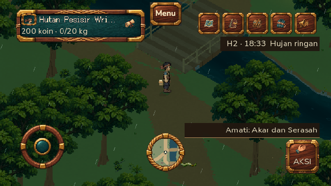

Local Godot export72b173c, PCK `9a1ca274b88cf65e819f1c117da2ede7992420e2128b454ef6bc3cf7f19cbb1a`/64,500,848bytes. The separate forest fixture used real touch input, crossed the upper bridge and saved/reloaded;5/5PASS. The image was captured at667×375 with declared safe-area emulation, then restored844×390. Root reviewed the actual three dots after the unsuccessfulU+2026 attempt. It is software-rendered browser evidence, not physical S23 performance, new natural gait or a public-release acceptance.

Original `plan06-layout-8a5cf9af-9b88-4622-b13d-fa294d504287/left-forest-location-badge-667x375.png`, copied byte-for-byte after image/privacy/empty-metadata review:250,518bytes, SHA256 `e008a03f439e437c38fbd485538c0f2a1f7019233efe4ce17ac4a626700f150d`. [Integration report](../reviews/overnight-export5-integration.md). Image559/export5/9a1 is active; a separate fresh default-public route completed6/6PASS. These images remain local browser evidence.

## Export4: actual modular equipment in local browser

PCK `b34d95211a61354eebf9cd218455d1c2f4e4b99723b57e4cfbe2b0a113f0ba26`,64,495,984bytes, Godot export source28a3c6d. These are actual844×390 local browser captures. The same image898/PCKb34d was activated subsequently, but its public-route acceptance is a separate [release report](/docs/reviews/overnight-export4-integration.md). The physical lower-body pilot is absent from these images.

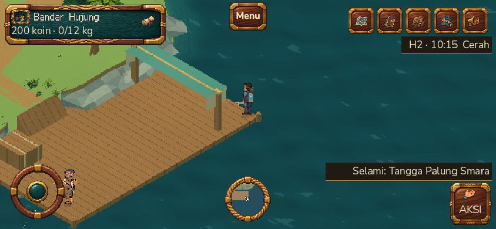

[Wardrobe gate7/7](/docs/reviews/overnight-actual-gear-browser.md) physically crossed the booth, checked hysteresis, visited the ocean, extracted and reloaded. At the actual reached dock corner, the body and teal tank are clear of the roof. Actual node reports independently show tank6/net12 visible meshes while diving and none while daily. This single idle image does not certify every mesh's pixel visibility, facing, item contact or natural gait.

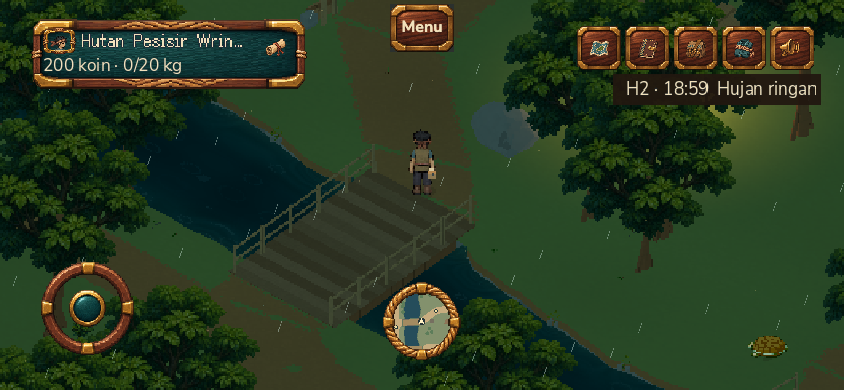

[Explorer gate5/5](/docs/reviews/overnight-explorer-node-browser.md) used touch input, crossed the upper bridge and reloaded. All three actual checkpoints showed4satchel meshes visible, with tank/net/model vest hidden. This rainy-evening frame retains dark foliage and readable body/hip item; it is not new daytime/color-grading or all-direction art acceptance.

Original own-fixture artifacts were copied byte-for-byte after root image/privacy/metadata review; no account names, emails, credentials or user moodboards occur. Project original-art terms remain; these are documentation, not a reusable asset kit.

| Gallery file | Original evidence | Bytes | SHA256 |
| --- | --- | ---: | --- |
| `export4-dock-modular-gear.png` | `plan06-layout-07b25c0f-4ab0-4e93-b2d7-7a9b5378c64a/wardrobe-next-export-actual-gear-at-unobscured-dock-candidate.png` |183,436|`2979a4ceb4948283bf77388ca3c73932f5b5a592645b6d7aea443862929044b1`|
| `export4-forest-explorer.png` | `plan06-layout-ae6106ad-c495-4593-8d82-428b9c63910b/left-bridge-upper-crossed.png` |264,662|`45d8535f283fa54d151b51416ac4d77b02ab08371cb9b2d16d1cfbcb4cefe242`|

## WEST arm authoring proposal: not installed

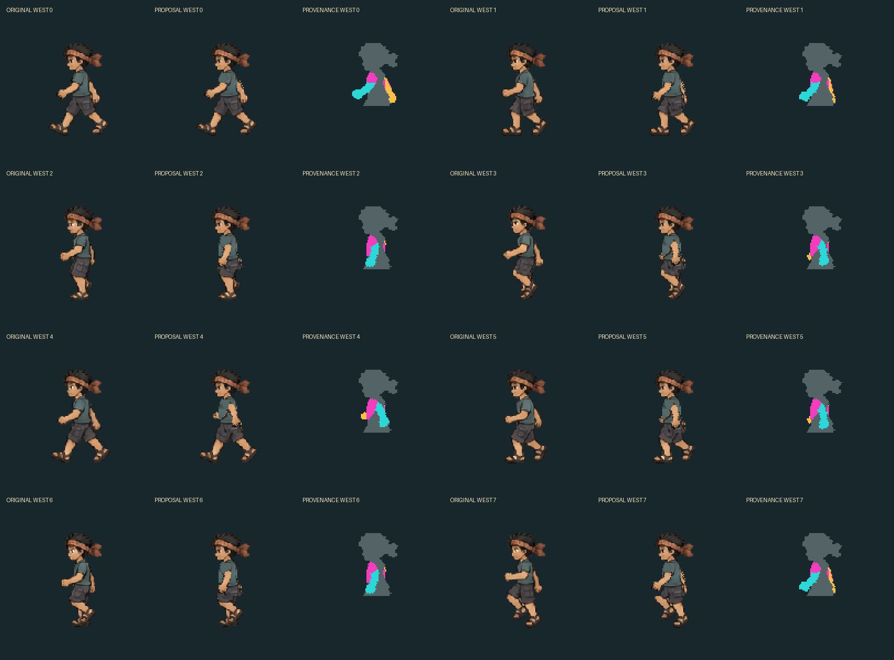

One daily view only. The near arm now moves between opposing extremes, with a compact sleeve and explicit new torso repair in the original palette. Cyan/gold identify original arm cutouts; magenta identifies newly authored pixels. The pictured legs are the original atlas frames for context, **not the unfinished physical lower-body pilot**. Arm contact phase, gear overlap, native movement, other directions and explorer clothing remain unaccepted. This image does not depict the active game build.

Tool/source `e852197`, [authoring report](/docs/reviews/overnight-west-upper-authored-prototype.md), nine CPU tests passed independently in root. The original ignored evidence came from `Jalasmara-overnight-resident-art/artifacts/player-gait/west-upper-daily-loop-review/west-upper-before-after.png`; this copy is byte-identical,1620×1196,109,550bytes, SHA256 `0b2989f79a7e7ba7a75a33fdb0811fb9b6bb30fa91ddbd62e111b6391bc54d63`. Root inspected all eight frames and checked the copy for account/credential displays and image text metadata. Original-project artwork terms remain; this is development documentation, not an MIT asset pack or third-party moodboard copy.

## Accepted local world and loader package

Release-candidate source: `b5b459ea448bc8799bebb771e56df20ce5e8f039`. Web PCK: `5f5baf243a3bf941cf34fab6c143bb9cf2bc8d65997ded6ed4e048b929353f96`, **64,333,184 decoded bytes**. The native images below come from its integrated world-verification fixtures; the browser images were captured against that exact served PCK. Native rendering does not itself load a Web PCK.

### Village: Kedai Waras in daylight

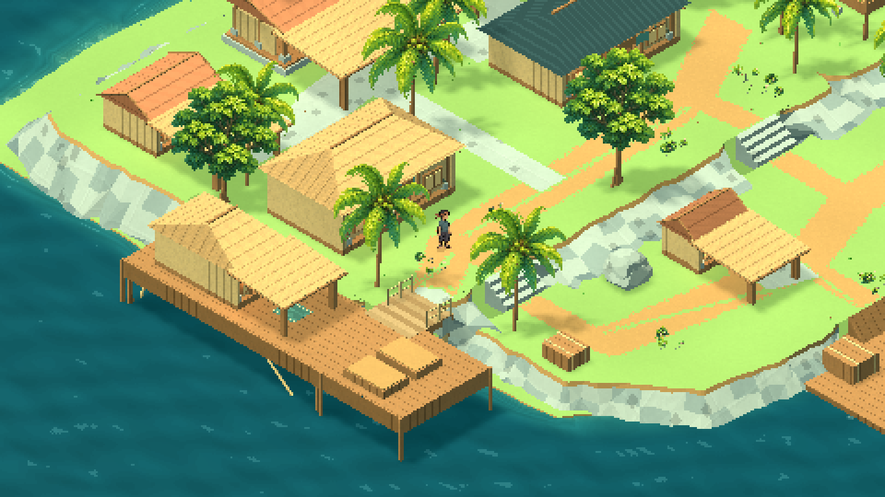

Final grass/layout-10 house fixture. The view records brighter courts and common building/deck axes. It is a still image, not evidence of every doorway, resident schedule or naturally animated gait. See [world finishing progress](/docs/reviews/06b2-world-finishing-progress.md) and [grass-court geometry](/docs/reviews/06b-village-grass-courts.md).

### Terrain and stairs

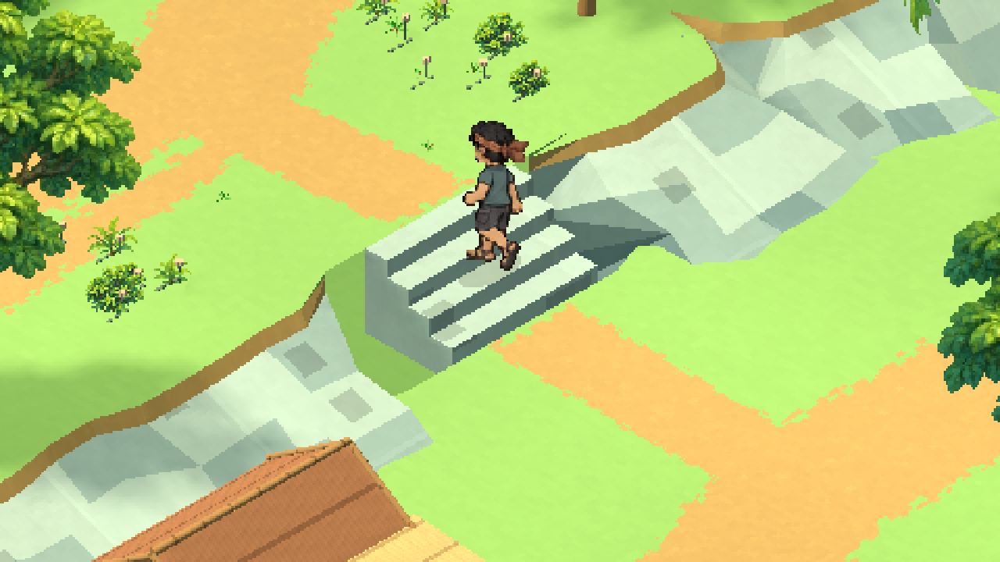

One original frame from the final eight-case, 99-frame native sequence. Visible tread support and rooted terrain are reviewed separately from the unfinished full walk cycle. See [terrain review](/docs/reviews/06b-natural-terrain-edges.md) and [integrated checks](/docs/reviews/06b2-world-finishing-progress.md).

### Forest gateway in actual browser gameplay

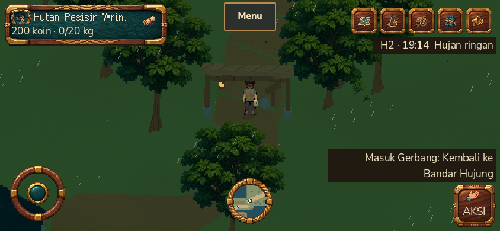

The local route crossed both gates in both directions, held input against their actual post colliders, escaped, received save acknowledgements, traveled through the real portal and restored position after reload. Gateway **7/7** and separate canopy **4/4** passed; this frame alone does not prove collision. See [actual browser evidence](/docs/reviews/06b-local-world-browser-acceptance-5f5.md).

### Real body-stream error and retry

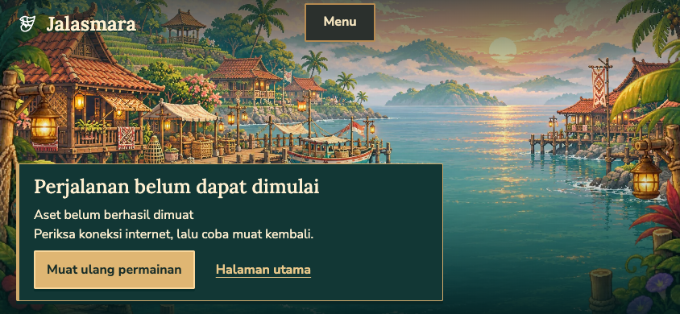

The test intentionally cut the WASM response after HTTP 200 and 262,144 received body bytes. The actual error UI appeared; pressing retry opened the real game in 10,495 ms with one player actor and no unexpected retry/API/page errors. The separate PCK test recovered in 11,466 ms. These are local functional checks, not device benchmarks or proof that the historical public HTTP/2 delay is resolved. See [loader fault and recovery evidence](/docs/reviews/06p-loader-body-fault-browser.md).

## Separate Nala restart candidate — NOT RELEASED

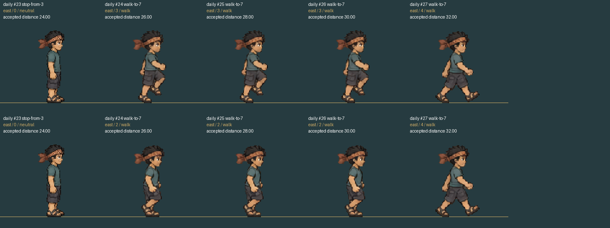

**This candidate is not included in the accepted PCK above.** Top: historical 592-frame component capture. Bottom: the 924-frame candidate reviewed in `62a8538134c4c190aa756d4a08f029a65aea9819` ([review in the candidate branch](https://github.com/ardianryan/Jalasmara-The-Game/blob/work/06b-nala-restart-audit/docs/reviews/06e-nala-restart-current-runtime.md)). The original comparison sheet was produced by the Nala lane; this gallery copies it unchanged.

For the illustrated daily/east case, both rows keep accepted distance 24→26→28→30→32. The candidate replaces the immediate high-knee pose at 26/28/30 with the existing low pose, then returns to existing raw frame 4 at 32. It still holds that low pose and retains the broad frame 4. This is a partial restart improvement, not a new full walk animation, a 3D sole-lock demonstration, or browser/device acceptance. The component root stays fixed in this sheet. See the [existing restart limits](/docs/reviews/06e-nala-restart-invariants.md).

Candidate results SHA-256: `241c1fb119d71df6fa92f29081357d2c7d6f63de84ae8a8cb48a44b4ac5d33d0`. Historical results SHA-256: `63ebdcc6ca159a0779bc51fdbc1c37b209a1fb6ee3f82e3289874c620c0ad31b`. The source manifest records the exact original frames 23–27 from both runs.

## Provenance and integrity

All source paths below are original ignored test evidence, not user moodboards or third-party gallery downloads. World/browser evidence came from `Jalasmara-06-buildings-gates`; restart evidence came from `Jalasmara-06-nala-restart-audit`. Images were visually checked for credentials and account/email displays; none are present. The copied PNGs have no text metadata chunks. Each copy byte-matches its source.

| Gallery file | Original evidence path | Dimensions | Bytes |
|---|---|---:|---:|
| `village-kedai-day.png` | `artifacts/godot/06b2-final-grass-houses/after10-kedai_waras-day.png` | 1440×810 | 281,834 |
| `terrain-central-stairs.png` | `artifacts/godot/06b2-final-stair-sequence/central_stone_steps-up-normal-032.png` | 1280×720 | 219,764 |
| `forest-gateway-night.png` | `artifacts/browser/plan06-layout-5267afcf-4517-444e-a1ab-2b730aa08cab/forest-gateway-inside-aperture.png` | 844×390 | 219,498 |
| `loader-error-retry.png` | `artifacts/browser/loader-body-wasm-fd305b1a-cdaa-41fb-ad69-e49be2542b91/02-real-body-error-and-retry.png` | 844×390 | 472,003 |
| `nala-restart-candidate.png` | `artifacts/godot/nala-gait-transitions/restart-before-after-native.png` | 1440×540 | 62,245 |

```text
57f16085dbe1b30b07aa05fd68d63d1a14cbe0b7477b1bf4872edbac2e5b43bc  village-kedai-day.png
33e1bc197f3a928eb5e3767e29e51d3e3b0e102a31adf89a827d82caa7c3e999  terrain-central-stairs.png
24d006b7ab4532d56e15a215d8538232d6c59387f606fc888a38b417a05f65a1  forest-gateway-night.png
b4efacf296705652ccd877dce3877884a3160a50503473a21e183a80257584a3  loader-error-retry.png
f4929d8aa189627acaaed6e5ea53087d7c81091e76c5b3892ee854d90fe47256  nala-restart-candidate.png
```

## Limits and license

Local native rendering, actual Chromium/WebGL and emulated touch are distinguished above. These images do not certify physical Windows/Samsung S23 performance, every nighttime UI/modal, complete NPC animation, public default-protocol startup or deployment. A picture from a candidate is not a release announcement.

The existing [project LICENSE](/LICENSE) remains unchanged: source code uses MIT; original game art, characters, world layout and other creative assets are **all rights reserved**. Screenshot publication for project review does not turn the artwork into MIT assets or grant reuse in another game. Existing [third-party notices](/THIRD_PARTY_LICENSES.md) still apply. Runtime remains Godot 4.7.2 Compatibility with the documented limited Noxe camera adaptation; this gallery makes no new engine or kit claim.

## Overnight Fish Gen pilot — NOT RELEASED

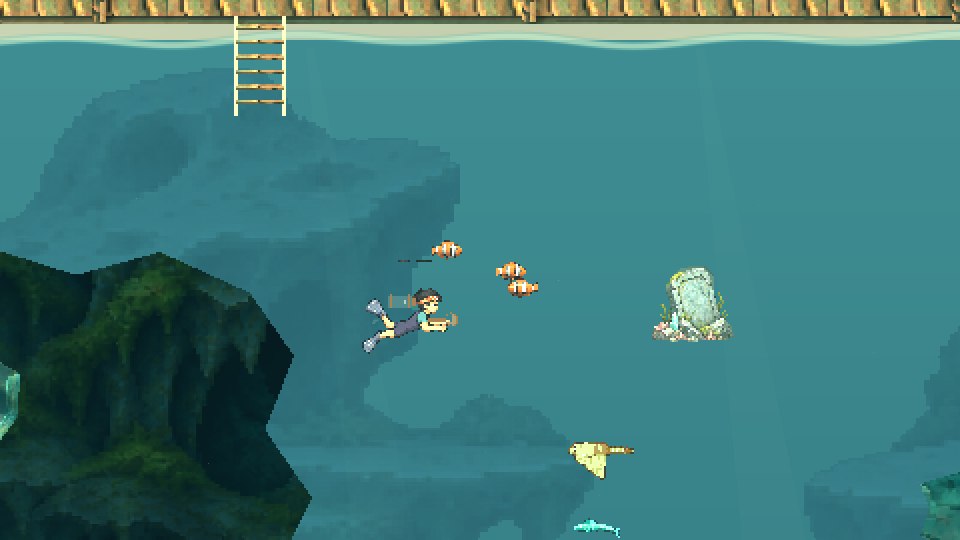

Original frame016 from the overnight production-HybridOcean fixture, copied unchanged. This is a new candidate after the released5f5 package above: FishGen0.1.0/pin0faa790, seed1519,32atlasframes, three decorative actors (one onlow), no catch/reward changes. Native40frames and5,400water-contact checks passed; export/browser/device acceptance remains pending. See [pilot and provenance](../reviews/overnight-fishgen-pilot.md). Fish Gen/JacobKulberg MIT notice and generated-output permission are credited separately; this screenshot retains the project artwork terms.

## Overnight compact HUD and resident art — NOT RELEASED

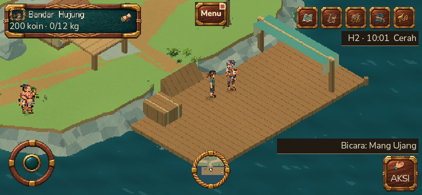

This is actual844×390 Chromium gameplay, exported source `1b67a9b`, PCK `1d3c94a5a449fe1e21ea6346da56f0684a1c3ccd0677100361296fc46923a2d8`/64,488,008bytes. The private recorder was exercised through its real menu and download; four functional checks passed and the temporary player was removed. The screen records the complete rendered world color grade, unlike an isolated ungraded component fixture. It does not prove Windows/S23 FPS, public startup or the later night-service fixes. See [recorder evidence](../reviews/overnight-recorder-browser.md).

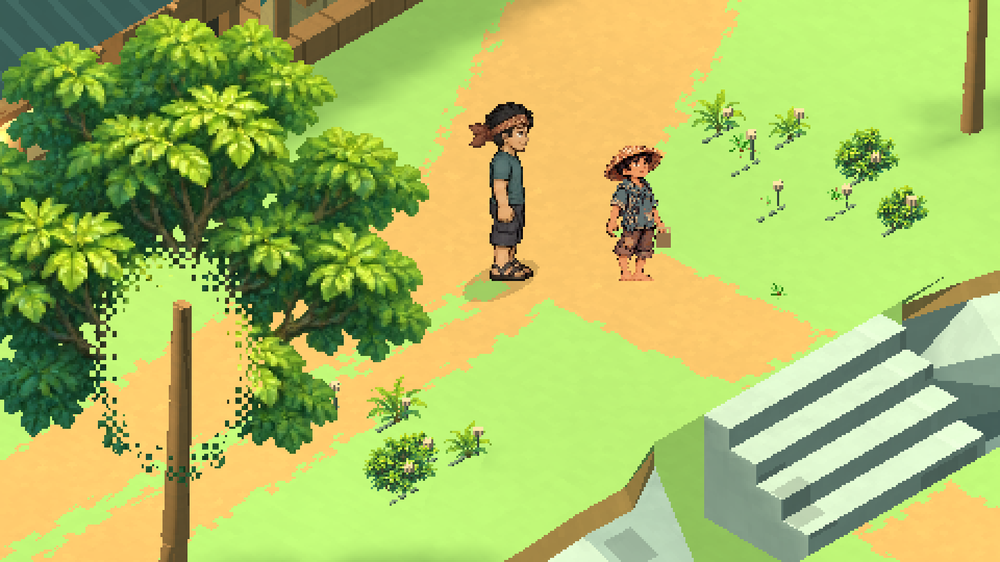

The second image is a native component capture from the sized original-art rig candidate `70d8486`, integrated as `3ac21bb`. It uses source cutouts from the project's original six-resident atlas and one authored front-three-quarter view. Danu's65-world-unit body is compared with Nala's86; the full-world postprocessing is absent in this component view. Flat-court576/contact and production-selector lifecycle tests passed. The stronger scheduled-commute test subsequently found a Gito turn/reach failure, which remains open at this gallery checkpoint. This still image is neither a natural-walk acceptance nor evidence of eight authored directions. See [rig provenance and limits](../reviews/overnight-resident-art-rig.md) and [actual commute regression](../reviews/overnight-resident-commute-contact.md).

| Gallery file | Original evidence | Dimensions | Bytes | SHA-256 |
|---|---|---:|---:|---|
| `overnight-compact-hud-browser.png` | Integration worktree `artifacts/browser/performance-recorder-3e9706b8-6d78-4949-b3ac-5de2e3f7b2a0/recording-actual-game.png` | 844×390 | 213,879 | `518a86541cacf4eda31ee8b414faa96753f3104b2aa29abd296f36cb039b4294` |
| `overnight-danu-size-native.png` | Resident-art worktree `artifacts/godot/resident-art-rig-sized/pair-npc_kid_danu.png` | 1440×810 | 259,577 | `cc038d39fdcef6e429d4b3d0d80a812e001b0720aa14a69205f70676a69a7fd5` |

Both copies byte-match their source, have no PNG text metadata and were visually checked for account details or credentials. Existing project-art and third-party terms above remain unchanged. These are documentation images, not reusable MIT game assets.


## Overnight release — actual public browser


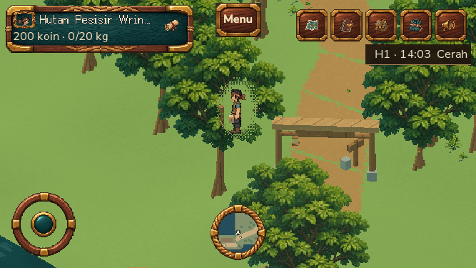

Source image798a47b, export593dc79, PCK1315f346/64,491,320bytes. The default HTTP/2 public smoke passed five checks,624physical camera-derived pulses, journal touch/pause and position reload; no browser/API errors and all temporary player state removed. The first ready observation was14,069ms after the successful game document request. This is functional Chromium/SwiftShader evidence, not Samsung S23 or Windows GPU performance. See [release evidence](../reviews/overnight-public-release.md).

| Gallery file | Original evidence | Dimensions | Bytes | SHA-256 |
|---|---|---:|---:|---|
| `overnight-public-hub.png` | `staging-plan06-a582cbda-55ee-4ca1-bf13-f7e19f94429d/01-public-ready-hub.png` | 844×390 | 202,560 | `294dee2ebfe3ca77f1ecba9455df275032109ed0634647807cada68cd44c6464` |
| `overnight-public-forest.png` | same UUID, `02-public-physical-canopy-667x375.png` | 667×375 | 252,870 | `3378a8eceb7967968fb594aa4dfd06a94b3da09a99123e0fe1274d2e81a5fa6e` |

Both PNGs are byte-identical copies, visually reviewed without credentials/account email. These new public results supersede historical gallery statements that default startup remained open; older images retain their original candidate status. FishGen and resident art are included in the new release, while the failed modular Nala lower-body pilot stays disabled. The same original-art and third-party license boundaries apply.


## Export3 accepted public build — 10 November 2026

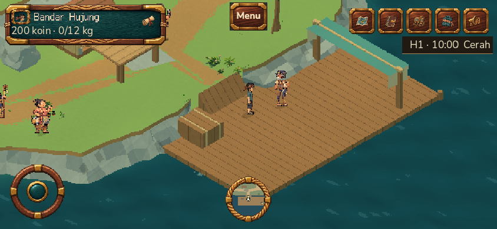

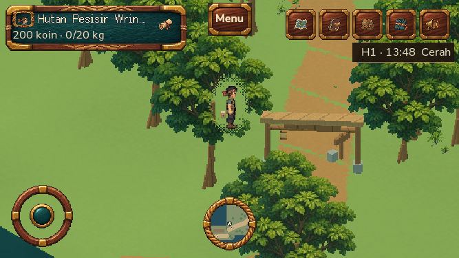

These two original, uncropped screenshots came from the actual default HTTP/2 public run UUID `d07e56d3-965b-4d90-b251-72626c6cc6a4`. Image2036254, Docker sourced63a10b, exportb0f2ef8, PCK73d45630/64,494,656 bytes. [Six actual checks passed](../reviews/overnight-export3-public-smoke.md), including the new iframe regaining its clock writer and authoritative time advancing. This package includes the canonical ground/cache fix and short landscape loading host; no experimental Nala lower-body adoption or physical S23/Windows performance is implied.

Root reviewed both originals for exposed credentials/account details; no email/password/cookie/token appears and PNG text metadata is absent. Exact source files are `artifacts/browser/staging-plan06-d07e56d3-965b-4d90-b251-72626c6cc6a4/01-public-ready-hub.png` and `05-public-calendar-writer-resumes-after-reload.png`. Project artwork terms above remain in force.

| File | Dimensions | Bytes | SHA-256 |
| --- | --- | ---: | --- |
| `export3-public-hub.png` | 844×390 | 202,769 | `81936735bf9f7c97d544b1e1226bf7f9b18cf5f5929ee91cbcd03e0e2fba9696` |
| `export3-public-forest-clock.png` | 667×375 | 252,452 | `4c385d15b10d6a3833a438c445a61116a0a19cc9f6624f2055c32082f83fafc4` |
