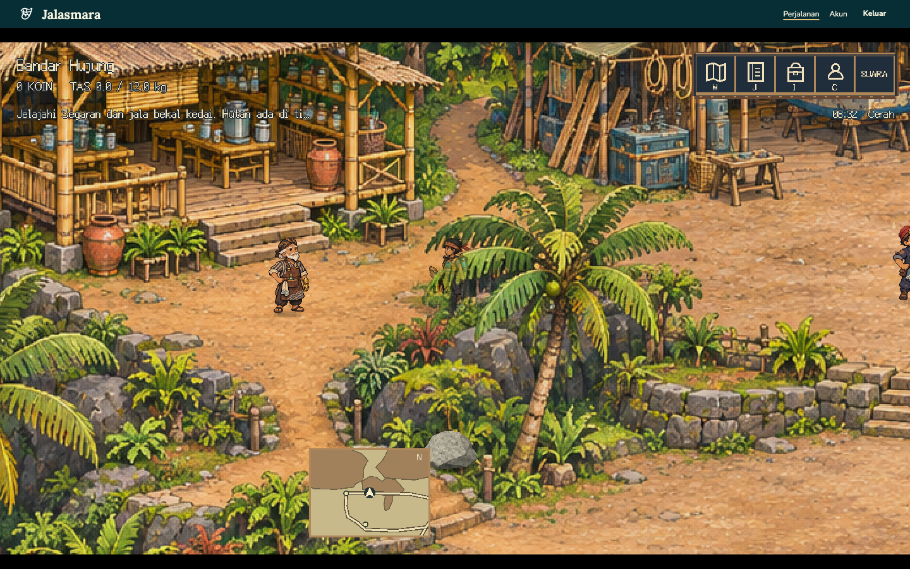

# Daratan modular: Bandar Hujung dan Wringin

## Status layout 4

Hub dan hutan kini dibangun dari komponen 3D, bukan bitmap peta yang disamarkan dengan mask. `WORLD.landMaps` menjadi sumber tunggal untuk poligon lantai, footprint bangunan/tanaman/batu, material, elevasi dan konektor. `LandWorld3D` merender floor/prop tersebut dengan kamera ortografis pada elevasi pandang 35°. Karakter tetap berupa billboard sprite pada koordinat gerak dua sumbu; proyeksi kakinya dikalibrasi ke physics/server.

Hub mempunyai pelataran lebar, empat konektor, rumah berfootprint empat sisi miring, kebun, 19 pohon fisik dan dock. Dasar coast organik hanya visual: tanah di belakang tebing tidak otomatis menjadi area yang dapat dipanjat. Delapan patch rumput tepi memiliki `walkable: false`, sehingga menghias lantai tanpa mengubah navigasi. Hutan mempunyai dua daratan rumput luas, celah sungai dan dua jembatan, serta 35 pohon fisik. Pemain dapat menjelajah lantai di luar jalur tanah; jalan dekoratif tidak dapat menutup sungai.

Server menerima lantai dari union poligon dengan clearance badan 12 piksel dan menolak footprint prop beserta marginnya. Steering klien memakai margin konservatif 13 piksel pada footprint yang sama untuk mengurangi ruas breadcrumb yang memotong sudut sangat tipis. Angka ini sengaja berbeda; bukan klaim parity radius yang persis sama. Seluruh rute authored diuji pada margin 13 piksel. Breadcrumb maksimal 64, basis timestamp, setiap ruas dan total jaraknya diperiksa server.

Upgrade atau perubahan versi permainan biasa mempertahankan koordinat sah, area dan timestamp posisi. Aksi admin yang tercatat atomik pada audit tetap membatalkan posisi lama. Migrasi layout hanya memindahkan koordinat yang menjadi tidak sah; akun, koin, inventori dan progres tidak direset.

Bukti komponen dan native lokal berada di `artifacts/godot/land-3d/` serta laporan runner. Tiga belas pemeriksaan dunia headless mencakup geometri, jalur, renderer komponen, air, traversal dan jam. Pemeriksaan native mengukur proyeksi kaki dan cahaya lokal; ini tidak membuktikan bahwa hasil akhir sudah menyamai referensi seni atau nyaman pada HP. Build modular masih menjalani finishing dan pengujian browser/deployment final. Hasil staging pada arsip berikut berasal dari build bitmap sebelumnya dan tidak boleh dianggap sebagai penerimaan rebuild ini.

Jam lokal berputar 24 jam visual dalam 36 menit nyata. Jam tersebut kosmetik; server tetap memutuskan hari cerita, kedai, hadiah dan akses. Lihat [lingkungan](environment.md).

## Arsip pemeriksaan sebelum layout 4

Bagian berikut menyimpan diagnosis dan bukti migrasi bitmap sebelumnya. Koordinat, jumlah collider, dan klaim renderer 2D di sini bersifat historis; implementasi aktif dijelaskan di atas.

## Temuan awal, 8 November 2026

Gambar peta darat mempunyai tajuk, batang, batu dan tanah yang sudah menyatu dalam bitmap RGB. Implementasi lama menyalin sebagian bitmap tersebut ke `Polygon2D` berurutan menurut kaki batang. Ini menyediakan urutan gambar, tetapi batas poligon juga bisa membawa potongan tanah dan goyangan membuat salinannya tidak berimpit dengan gambar dasar. Parallax tepi dari potongan peta tidak membuktikan Nala benar-benar berjalan di belakang tajuk.

Acuan privat `jungle-01-village-research-campsite` menunjukkan pemisahan yang lebih jelas: pemain dan kaki batang berada pada tanah yang sama, daun di depan menutupi sebagian pemain, sedangkan jalan kosong tetap terbaca. Acuan hanya dipakai untuk mempelajari komposisi; gambar atau susunan levelnya tidak disalin.

## Perubahan yang harus dibuktikan

- Pohon mempunyai alpha asli di sela daun dan sekeliling siluet, tanpa persegi tanah atau latar yang mengikuti tajuk.
- Titik pengurutan berada pada kaki batang. Nala di belakang batang/tajuk tertutup sebagian, lalu tergambar utuh saat kakinya berada di depan pangkal pohon.
- Batang memiliki tabrakan terbatas. Tajuk yang melebar di atas jalur tidak menjadi collider; berjalan di bawah daun tetap mungkin.
- Bayangan kontak mengikat batang ke tanah. Efek angin tidak menggeser collider atau seluruh pohon dari pangkalnya.
- Jika pemain tertutup terlalu banyak, petunjuk keterbacaan atau pengurangan opacity bekerja tanpa menghilangkan bukti pelapisan. HUD tidak dipakai sebagai pengganti bukti ini.
- Pengurangan gerak menahan goyangan tambahan; pengurutan dan tabrakan tetap sama.

## Hasil pengujian hutan

`ForestOcclusion.gd` mempertahankan posisi pohon pada bitmap dasar dan menambahkan tajuk terurut berdasarkan kaki batang. Shader membuat mask dari warna daun pada raster asli, mengeluarkan sebagian besar warna tanah dan air. Ini belum merupakan penggantian seluruh bitmap dengan pohon terpisah; mask warna masih dapat menganggap lumut hijau sebagai daun. Lapisan kayu solid berada pada titik kaki yang sama, dengan UV tetap dan tanpa shader angin atau fade kepala; batang tetap dapat menutupi pemain. Cahaya dan tabrakan ditangani terpisah.

`scripts/tests/land-occlusion.gd` lulus pada Godot headless. Uji memeriksa daun yang tertahan dan sela yang transparan, urutan depan/belakang, fade kepala setempat, serta goyangan nol dalam mode pengurangan gerak. Pada scene Forest sebenarnya, query physics mengenai collider batang lingkaran beradius 34,375 piksel dan tidak mengenai ruang tajuk pada titik uji yang bisa dilalui. Tajuk tidak menambahkan collider baru; state progres, inventori dan oksigen tidak berubah.

`scripts/tests/land-occlusion-render.gd` membandingkan hasil gambar Nala dengan tajuk terlihat dan disembunyikan, menggunakan karakter serta shader runtime sebenarnya. Pada posisi belakang (740, 880), piksel karakter yang masih terbaca adalah 56,4% dari referensi tanpa lapisan; pada posisi depan (740, 1000), 100%. Fade hanya berpusat di kepala saat tertutup, sehingga wajah tetap terbaca tanpa menghilangkan seluruh tajuk. Tangkapan `artifacts/godot/land-occlusion/behind.png`, `front.png`, pasangan referensi, dan `results.json` diabaikan Git.

## Hasil pengujian Bandar Hujung

Hub memakai tujuh lapisan pohon dengan tajuk dan kayu solid terpisah, tetap berimpit dengan pohon yang dilukis pada peta. Uji semantik memeriksa semua UV kayu terhadap koordinat sumber, titik urut kaki, dan pengurutan `Player.gd` yang sebenarnya. Tujuh collider lingkaran berasal dari `WORLD.hub.treeTrunks`; query physics menemukan collider pada tiap akar, dan `is_walkable` menolak akarnya. Dua poligon pelataran memperluas ruang berjalan di luar koridor jalur. Poligon tersebut tidak menghapus larangan pada batang atau obstacle bangunan/batu.

`scripts/tests/hub-occlusion-render.gd` memakai `HubScenery.gd`, `Player.gd`, Y-sort, shader tajuk serta bitmap runtime sebenarnya. Semua posisi bukti diperiksa `is_walkable`. Pada akar (890,625; 884,375), posisi di jalan tanah di belakang tajuk (780; 637) mempertahankan sekitar 67,9% piksel karakter dari referensi tanpa lapisan, sedangkan posisi depan (925,625; 944,375) mempertahankan 100%. Jam animasi `SurfaceWater` dibekukan pada 0 dan proses air dihentikan selama pengambilan, sehingga kilau air tidak ikut dihitung sebagai perubahan piksel karakter. Titik kaki dipilih pada piksel tanah cokelat (RGB 154, 109, 40), dengan mask daun di kepala bernilai 1,0; tidak cukup hanya lolos mask jalan. Perbandingan dibatasi pada kotak karakter, bukan seluruh layar. Nilai merupakan perbandingan gambar native pada cuplikan tersebut, bukan opacity yang ditetapkan sebagai statistik permainan. Bukti ada pada `artifacts/godot/hub-occlusion/` beserta referensi dan JSON, diabaikan Git.

Titik uji lama (870,625; 704,375) berada pada batu yang tergambar, meskipun sempat diizinkan mask jalan. Batas batu diperbaiki; uji sekarang mewajibkan titik tersebut serta tepi batu (870,625; 859,375) ditolak. Tangkapan dan klaim posisi di belakang kayu hub tersebut dibatalkan. Lapisan kayu tetap diuji pada scene hutan terkontrol; tidak semua batang pada peta hub dapat dikelilingi pemain.

## Air permukaan dan batas pemeriksaan

Uji native `surface-water-native.log` mencatat 45.982 piksel air bergerak di hub dan 10.226 di hutan, dengan nol perubahan pada piksel darat/dermaga pembanding. Pada malam hari, rasio terang air/darat masing-masing sekitar 0,498/0,497 di hub dan 0,497/0,500 di hutan. Artinya air mengikuti pencahayaan malam tanpa bidang layar terang sendiri. Uji semantik memeriksa tujuh sampel air/darat/dermaga/jembatan, parameter cuaca, pengurangan gerak dan collision yang tetap sama.

Bukti native mencakup pohon terpilih pada kedua area, bukan klaim bahwa semua tepi gambar dan pohon pada seluruh peta sudah sempurna. Bukti regresi browser dicatat di bawah; pemeriksaan seluruh pohon dan perangkat fisik tetap diperlukan. Pengujian ini tidak mengubah cakupan pilot 3D laut.

Regresi Chromium lokal untuk hutan juga lulus melalui akun uji baru yang terpisah: berjalan dari hub melalui gerbang, tujuh tajuk bermasker dan pengurutan kaki aktif, air permukaan aktif dengan fase yang maju, gerakan keyboard, buka/tutup jurnal dan peta, lalu muat ulang dengan posisi tersimpan. Tidak ada error browser maupun respons API gagal. Bukti berada di `artifacts/godot/forest-layer-final/`; akun uji dan sesinya dihapus setelah pengujian. Ini emulasi browser desktop, bukan pengujian HP fisik.

## Konektor teras dan batu 3D terpilih

`SurfaceTraversal.gd` membaca jalur konektor yang dipatok pada tangga/akses yang tergambar. Jalur dermaga adalah ramp kayu satu segmen, bukan tangga batu tambahan. Konektor batu memiliki indeks anak tangga, progres 0–1, elevasi teras yang kontinu, serta laju naik/turun berbeda. Bob kaki dibatasi 1,6 piksel dan berhenti saat diam atau mode pengurangan gerak aktif. Elevasi merupakan state traversal pada peta 2D; ini bukan klaim semua pelataran sudah menjadi mesh 3D bertingkat. Material langkah tersedia sebagai metadata; suara langkah batu khusus belum dinyatakan tersedia.

`scripts/tests/surface-traversal.gd` lulus pada 168 sampel maju/mundur di empat konektor. Pemeriksaan mencakup progres dan elevasi yang monoton, indeks anak tangga, pembeda ramp/tangga, diam, titik di luar konektor, pengurangan gerak, serta koordinat badan, metadata dunia dan resource akun yang tidak berubah oleh sampling. Pengujian integrasi animasi dan akses melalui browser tetap terpisah dari pemeriksaan helper ini.

`LandRockVisual.gd` menambahkan batu pilihan dari GLB Polyfork yang benar-benar dimuat sebagai mesh 3D, dirender melalui SubViewport transparan 128 × 128, lalu ditampilkan sebagai ViewportTexture dalam Y-sort daratan. Ini bukan PNG batu yang diklaim sebagai model. Bentuk dan pivot hasil proyeksi harus berada di dalam footprint solid yang sudah ada; model tidak menambah collider atau memperlebar area terlarang. Tidak semua batu pada bitmap diganti, dan batu 3D tambahan belum mengubah kota/hutan menjadi scene 3D penuh.

`scripts/tests/land-rock-render.gd` lulus secara native: satu mesh GLB ditemukan, tekstur presentasinya merupakan ViewportTexture, silhouette alpha tetap sama saat cahaya berubah, proyeksi kaki tepat di (480, 380), dan ukuran uji 160 × 100 piksel terkandung pada area solid. Render siang mempertahankan facet tanpa putih terpotong pada ambang uji; render malam meredup dengan silhouette alpha yang tetap. Nilai luminansi terkini tercatat di JSON bukti, karena penyesuaian material mengubahnya. Uji juga memeriksa state dunia/akun tetap sama dan tidak ada collider baru. Bukti `artifacts/godot/land-rock-3d/day.png`, `night.png` serta `results.json` diabaikan Git. Ini bukti native helper terisolasi, bukan hasil performa HP fisik maupun bukti seluruh penempatan pada map.

Setelah peninjauan komposit, batu hub diperkecil menjadi 65 × 46 piksel pada kaki (790, 850), di dalam area solid lama. Material GLB kini mempunyai shader grain piksel, pori/mineral dan lumut setempat; ini menggantikan warna hijau rata yang tampak terpisah dari batu pada bitmap. Bayangan kontak dibuat pendek di kaki batu, dan ViewportTexture disembunyikan sampai kalibrasi selesai. `composite-day.png` dan `composite-night.png` pada direktori bukti batu merupakan gambar native pada lingkungan peta sebenarnya. Peninjauan tersebut melengkapi uji struktur/geometri; sembilan pemeriksaan daratan pada Chromium melalui HTTPS staging juga lulus dengan material final.

## Regresi daratan melalui HTTPS

Sembilan pemeriksaan `VERIFY_LAND=1` lulus melalui domain staging pada Chromium. Gerakan keyboard sebenarnya menguji urutan depan/belakang tajuk, kayu solid, tabrakan batang, keterbacaan kepala, animasi air permukaan, mesh batu terkalibrasi, serta perlintasan tangga batu dengan laju yang menyesuaikan. Posisi kaki diperiksa terhadap seluruh rectangle solid dan lingkaran batang beserta margin badan 12 piksel; endpoint state pemain yang memerlukan autentikasi mengonfirmasi posisi permukaan server dalam jarak 2 piksel.

Warna raster di kaki dicatat sebagai diagnostik, bukan syarat bahwa semua pijakan harus berupa tanah cokelat: daun yang sudah tergambar pada bitmap dapat berada di atas tanah. Posisi browser tidak diklaim sama dengan titik tanah cokelat pada uji native. Pemeriksaan warna ketat tersedia terpisah melalui `VERIFY_BROWN_SOIL=1`; mode tersebut belum lulus pada otomasi browser. Bukti browser ada pada `artifacts/godot/land/`, diabaikan Git.

